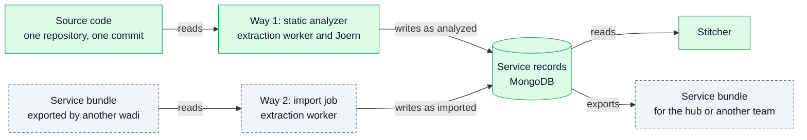
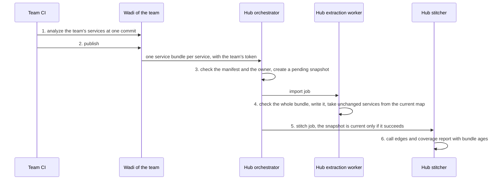

# Bundle import and hub plan

**Status:** proposal, not a decision record. Compiled 2026-11-17 against commit `f838045`
(wadi 0.9.0). Nothing in this document is built unless a section says so. Revised the same day
after a review by three models. Section 16 lists what changed.

**Purpose.** Wadi can write an analyzed snapshot to files, and it cannot read those files back.
This document records how a service could enter the map from a bundle that another wadi exported,
and how teams could send their services to one shared hub. It exists so that the owner and later
engineers or agents can pick the work up without repeating the analysis.

**What this is not.** It changes nothing in `architecture.md`. Phase 11 of that document already
fixes the shape of federation and the hub. The mechanics below are proposals. Each accepted part
gets a decision record there first, per the standing rule, and a GitHub issue.

**Related documents.**

- `target-architecture-plan.md` is the umbrella. It covers the readers, the records, the fold, the
  statuses, the shared keys, scope and the build order. This document does not repeat them.
- `identity-and-access-plan.md` covers test identities, the credential broker, the access prober
  and the access data a service bundle carries.
- `rule-packs-and-learned-rules-plan.md` plans the rule-set hash that a bundle manifest needs.
- `docs/designs/target-architecture-page.html` is the architecture page. Its sections "Two ways to
  get a service into the map" and "The hub" are the latest statement of this design.

**How to read the evidence.** "Read" means the code or document was opened on 2026-11-17 and the
`path:line` reference was checked. "Recorded" means `architecture.md` already fixes it. "Proposed"
means it comes from the design discussion or the architecture page and from nowhere else.
"Compiler's note" marks a point found in the code while this document was written, which the
discussion did not cover. "Unverified" means nobody ran it.

In this document "export" means the bundle that `wadi export` writes. It does not mean the export
file that Joern hands to the extraction worker (export 2.15.0).

---

## 1. What is built and what is not

### 1.1 Export of a whole snapshot (built)

Export shipped in Phase 2.5 and runs in 0.9.0. All rows below were read.

| Piece | Where | What it does |
|---|---|---|
| `wadi export <snapshot-id> --dir <folder>` | `cli/src/wadi_cli/main.py:891` | Streams the snapshot from the API and writes the bundle. It refuses a folder that is not empty unless `--force` is given (`main.py:902-906`). |
| `GET /api/v1/snapshots/{id}/export` | `services/orchestrator/src/wadi_orchestrator/app.py:350` | Streams one JSON record per line (NDJSON). It answers 409 for a snapshot that has not succeeded (`app.py:359-366`). |
| The stream | `services/orchestrator/src/wadi_orchestrator/export.py:18-62` | Emits every stored record of the snapshot in a fixed order, then the manifest. |
| The writer | `cli/src/wadi_cli/export_writer.py:33-89` | Reads the whole stream, checks it against the manifest, and only then writes files. |
| The manifest model | `libs/wadi-contracts/src/wadi_contracts/export.py:10-30` | `ExportManifest`, the last record of the stream. |

The bundle is a folder with these files (`export_writer.py:13-26`, recorded at
`docs/architecture.md:1636`):

| File | Content |
|---|---|
| `manifest.json` | The manifest, described below |
| `system.json` | The `System` record: id, name and repository sources |
| `snapshot.json` | The `Snapshot` record: id, system id, the commit of each repository, status, times |
| `service_boundaries.json` | One record per service or library, with its network names and ports |
| `endpoints.json` | Every endpoint, with its request and response shapes and its authorization |
| `remote_calls.json` | Every outbound call the static analyzer found |
| `mq_interactions.json` | Every queue interaction |
| `data_models.json` | Every persisted data model |
| `stitched_edges.json` | The call edges the stitcher resolved |
| `coverage_report.json` | The coverage report of the snapshot |
| `icfgs/<endpoint_id>.json` | The flow graph of one endpoint, one file per endpoint |

The manifest has six fields (`wadi_contracts/export.py:20-30`): `schema_version` (the contracts
version, 1.27.0 in wadi 0.9.0), `wadi_version` (the orchestrator that produced the bundle),
`system_id`, `snapshot_id`, `produced_at`, and `artifact_counts` (a count per kind of record,
which a reader checks against what it received).

Three properties of this format suit import. All three are recorded at
`docs/architecture.md:1634` and `:1636`.

- Every file validates against the published schemas. The end-to-end test validates every exported
  record again (`e2e/test_two_service_system.py:478-492`).
- The manifest comes last. A reader that never sees it knows the stream was cut short, and the CLI
  writer then writes nothing (`export_writer.py:66-73`).
- Exporting the same snapshot twice gives the same bytes, apart from `produced_at`. The same test
  proves it (`e2e/test_two_service_system.py:500-507`).

### 1.2 What is not built

| Piece | Evidence that it is missing |
|---|---|
| Import of a bundle | The CLI has no import or publish command. The API has no upload route among its routes (`app.py:240-858`). |
| Export of one service | The route and the command take a snapshot id only. |
| An import job | `JobType` has `fetch`, `extract` and `stitch` (`libs/wadi-contracts/src/wadi_contracts/enums.py:307-310`). |
| Bundle age and ownership | No contract model has a bundle, owner or team field. |

Section 4 lists what else stands in the way.

### 1.3 What the decision record already fixes

`architecture.md` records the shape of federation and the hub. Every row below is recorded and
none is built.

| Recorded | Where in `docs/architecture.md` |
|---|---|
| Each team runs wadi over the services it owns and publishes bundles. A bundle is full or boundary-only. Boundary-only carries endpoints, outbound calls and topics, without the flow graphs. | `:1468` |
| Another team's wadi imports a bundle as a contributed source. Its placeholder for that service becomes a real service with real endpoints, with no access to the source. | `:1468` |
| The stitcher reads stored records and never source code. The versioned contracts and the published JSON Schemas are therefore the federation protocol. | `:1468`, `:1446` |
| Two things are reserved today: a future `artifact-bundle` kind of source on `System`, and the `federated` provenance value. | `:1468` |
| The hub is a deployment role and not a new service. It is the same stack, with a system made mostly of `artifact-bundle` sources. | `:1469` |
| A composite snapshot is a recorded set of (bundle, version, produced-at). The coverage report shows staleness per bundle. | `:1469`, `:1490` |
| The orchestrator gets a bundle ingestion API. It checks schemas, the tag vocabulary and the schema version on arrival, and it flags unknown values by name. | `:1469`, `:1049` |
| Ownership metadata maps each team to its services. | `:1469` |
| Teams and permissions sit on the bearer-token design of §14. Nothing else is built for them. | `:1470` |
| Phase 11 has two prerequisites: `wadi export` and the shared-deployment authentication base of Phase 6. No other phase depends on Phase 11. | `:1442-1446`, `:1246` |
| Where wadi has no source for a service, as with a boundary-only bundle, source-on-demand says so. | `:255` |
| Breaking-change detection uses provider schemas plus what each caller sends and reads, a contract-checker service, and the CI gate `--fail-on contract-break`. | `:1463`, `:1418-1424`, `:1660` |

The record fixes the shape and not the mechanics. It does not say what a bundle for one service
contains, who writes imported records, how a team sends a bundle, or how the hub decides which
bundle is current. Sections 5 and 6 propose those.

## 2. Status of each idea

| Idea | Status on 2026-11-17 |
|---|---|
| Export of a whole snapshot: command, route, layout, manifest, same bytes on re-export | Built in 0.9.0, recorded in `architecture.md` §14 |
| A bundle as a kind of source (`artifact-bundle`) | Recorded in `architecture.md` Phase 11, not built |
| The `federated` provenance value | Recorded, present in the contracts, never written |
| Boundary-only bundles | Recorded in Phase 11, not built |
| The hub as a deployment role, composite snapshots, staleness per bundle, ingestion API, ownership metadata | Recorded in Phase 11, not built |
| Contract checker and `--fail-on contract-break` | Recorded in Phases 5 and 6, not built |
| Rule-set hash on every snapshot | Planned in `rule-packs-and-learned-rules-plan.md`, not built |
| Access data in a service bundle | Planned in `identity-and-access-plan.md` |
| One collection per reader, statuses, shared keys, scope | Planned in `target-architecture-plan.md` |
| Two ways in, from source and from a bundle, into the same collections | Proposed in discussion, on the architecture page |
| Export per service, and what a service bundle carries and leaves out | Proposed in discussion only |
| Import job: the orchestrator accepts, the extraction worker writes | Proposed in discussion only |
| An origin on every record | Proposed in discussion only |
| A service id that does not depend on a folder path | Proposed in discussion only. The mechanism is open (section 11, D4). |
| The publish command and the six sending steps | Proposed in discussion only |
| Idempotent resend and the folder fallback | Proposed in discussion only |
| Round-trip test and acceptance test | Proposed in discussion only |
| Push or pull, the default bundle kind, the branch the hub follows | Open, section 11 |

## 3. Two ways to get a service into the map

Wadi does not need the source of every service. A team can analyze a service where its code
lives, export the result, and import it into another wadi or into the hub. The owner asked for
exactly these two ways in the discussion and asked for import to become part of the architecture.

The diagram shows both ways filling the same service records, which the stitcher reads and export
writes out again.

Solid boxes are built. Dashed boxes are planned. Both ways fill the same collections, so the
stitcher, the fold and every client work the same on either, with one exception: a service
imported from a boundary-only bundle has no flow graphs, and section 5.6 says what its endpoints
answer. The bundle that export writes is the bundle that import reads.

| Question | From source | From a bundle |
|---|---|---|
| What it needs | The repository and the Joern container | Only the bundle |
| Who did the analysis | This install | Another wadi, named in the bundle's manifest |
| How each fact is marked | Analyzed here | Imported, with the team, commit, wadi version and rule-set hash it came from |
| Flow graphs | Always present | Present in a full bundle, absent in a boundary-only bundle |
| Who can close a gap with learn mode | This install | The team that holds the source |

## 4. What blocks import today

Every row was read in the code on 2026-11-17.

| Blocker | Evidence | What it breaks |
|---|---|---|
| A service id from a local folder depends on that folder's path | `normalize_repo_source` keeps a local path as written (`libs/wadi-contracts/src/wadi_contracts/ids.py:60-78`). `service_id` hashes it with the build root (`ids.py:87-95`). The worker calls it at `services/extraction-worker/src/wadi_worker/pipeline.py:141`. | The same service analyzed on two machines gets two ids, and the hub sees two services. Endpoint, call and data model ids hash the service id (`ids.py:98-120`), so they split too. Git URLs do not have this problem, because the https, ssh and scp spellings of one repository normalize to one form. |
| Snapshot and system ids are random | `app.py:301` builds `snap_` plus a random UUID. `app.py:246` does the same for `sys_`. | Every record carries its snapshot id (`libs/wadi-contracts/src/wadi_contracts/base.py:27-35`). Two installs never share one, so import needs a rule for which snapshot an imported record belongs to. |
| A snapshot needs at least one commit | `Snapshot.commits` has `min_length=1`, and each value must be a full SHA (`libs/wadi-contracts/src/wadi_contracts/system.py:55-71`). | A snapshot made only of bundles cannot be stored. |
| No bundle kind of source | `RepoSource` holds `source`, `branch` and `cred_ref` (`system.py:11-26`). `System.repos` needs at least one entry (`system.py:35`). | A system cannot name a bundle as a source. |
| `FEDERATED` is reserved and unused | `enums.py:34`. Only `StitchedEdge` has a `provenance` field (`libs/wadi-contracts/src/wadi_contracts/stitching.py:92`). The stitcher writes `machine-proven`, `config-resolved` or `heuristic` (`services/stitcher/src/wadi_stitcher/matching/http.py:18-21`). | No record can say that it was imported. Per-service records have no origin field, and every model rejects unknown fields (`base.py:16`). |
| No team tokens on the API | The API checks one shared bearer token, and only when one is configured (`app.py:184-192`, `libs/wadi-config/src/wadi_config/settings.py:70-72`). Bearer tokens as the norm for shared deployments belong to Phase 6 (`docs/architecture.md:1424`). | The hub cannot tell which team sent a bundle, or whether that team owns the service. |
| A bundle says nothing about the rules that produced it | The manifest has six fields (`wadi_contracts/export.py:20-30`). The commits are in `snapshot.json`, which a service bundle leaves out. The rule-set hash is planned and not built. | Two bundles of one service made with different rule sets look the same to the hub. |

The first row is the one to fix first. The research on systems that join facts from several
sources found that identity fails before the fact model does. OpenLineage warns that a change of
name format leaves existing nodes unable to connect to new ones, and a Backstage maintainer called
the entity key "an unavoidable limitation" (both pages opened by the research report, section 15).

Compiler's note. A bundle from a local folder also carries that folder's path in each boundary's
`repo` field (`libs/wadi-contracts/src/wadi_contracts/boundary.py:310`).

## 5. Proposed mechanics

Everything in this section is proposed. The source is the architecture page and the discussion.

### 5.1 Export per service

Today export writes a whole snapshot. The proposal adds one bundle per service, called a service
bundle. A change to one service then resends only that service.

| Part | Content of a service bundle |
|---|---|
| Manifest | The service id, the repository, commit and branch, the base commit it was checked against and whether it descends from it, a digest of the role mappings it carries from step 4, the library sources staged into the analysis, a digest of its records after the projection, the wadi version and image digest, the config keys it carries, the schema version, the rule-set hash once step 7 adds it, the time it was produced, a count per kind of record, and whether the bundle is full or boundary-only |
| Records | The service boundary, endpoints, outbound calls, queue interactions and data models. A full bundle adds the flow graph of every endpoint. Config records and declared contracts join once those readers exist. |
| Access | The access rules as read for each endpoint, and the roles and authorities each test identity has in this service. Access as measured stays on the install that measured it in the first version, because the access prober is its only writer (P4). `identity-and-access-plan.md` has the detail. |
| Left out | Stitched edges and the coverage report, because the receiver computes them for its own set of services. A bundle never carries a recipe. Config values pass the projection below, and a full bundle carries source text. |

Compared with the six fields of today's manifest (`wadi_contracts/export.py:20-30`), every
field in the row above is new except the wadi version, the schema version, the time it was
produced and the record counts. The rule-set hash depends on
`rule-packs-and-learned-rules-plan.md`. The architecture page calls it the rule hash.

The layout is one file per collection, so a new reader adds a file and changes no existing one.
The whole-snapshot export stays as it is. Import reads service bundles only, so it moves service
records between machines and does not restore a whole export.

**What a bundle may carry.** A service bundle is an export projection, not a copy of the stored
records. The projection lists the fields each bundle kind carries and drops every other field,
including a field that a later contract adds, until someone classifies it. A test fails when a
contract gains a string field that the projection does not classify. The receiver applies the
same projection again on import, so a bundle from an older exporter cannot bring in more. These
fields need a rule.

- Each flow-graph node carries its line of source (`IcfgNode.source_text`,
  `libs/wadi-contracts/src/wadi_contracts/icfg.py:73-75`). A full bundle therefore shares the
  code on every path of every endpoint.
- Other text is copied from the source too: the expression and detail of each piece of auth
  evidence (`services/extraction-worker/src/wadi_worker/auth_merge.py:663-690`) and the detail
  of each request policy (`services/extraction-worker/src/wadi_worker/pipeline.py:237-250`). A
  boundary-only bundle keeps what was parsed from that text, such as the effect, roles,
  authorities, pattern, kind and scope, and drops the text. A full bundle keeps it, like the
  source lines. A projected record still validates: a required text field that loses its text
  carries a fixed marker saying so. A CORS policy's detail holds its parsed origins, not source
  text (`libs/wadi-contracts/src/wadi_contracts/boundary.py:288-290`,
  `joern-platform/src/main/scala/wadi/packs/SpringSecurityPack.scala:636-645`), so both kinds
  keep it.
- The service boundary keeps environment entries chosen by name and by value shape
  (`services/extraction-worker/src/wadi_worker/boundary.py:396-409`). Any name that ends in
  `_URL` is kept, so a `DATABASE_URL` with a password in it would travel. The filter never looks
  at the value for a credential. It also keeps any value that starts with `http://`, `https://`
  or `lb://` under any name, and every `spring.security.*` setting, because config parsing keeps
  them (`services/extraction-worker/src/wadi_worker/appconfig.py:38`) and the worker copies them
  into `network.env` (`services/extraction-worker/src/wadi_worker/pipeline.py:156`). The
  receiving stitcher reads `network.env` for two things only: the config keys in a call's URL
  (`services/stitcher/src/wadi_stitcher/matching/http.py:106`), and the servlet context path,
  such as `/inventory-api`, which it strips before it matches an endpoint (`http.py:309-317`,
  `services/stitcher/tests/test_matcher.py:473`). The shape of a value proves nothing, because a
  password such as `changeit` parses as a host name. The projection therefore chooses entries by
  key first.
  - It keeps the two context-path keys, and every key that a `${...}` names in the host, port or
    path of the service's exported call URLs, in its dotted spelling and in the relaxed spelling
    the matcher also binds (`YAS_SERVICES_CUSTOMER` for `yas.services.customer`). It follows
    values that are themselves templates, by the name rules the matcher uses
    (`services/stitcher/src/wadi_stitcher/matching/paths.py:26-68`). Gateway route targets name
    no keys here, because the phone book parses them without expanding config
    (`services/stitcher/src/wadi_stitcher/phonebook.py:230-237`).
  - A kept value must be a template, a host name, a port number, a path, `host:port` with an
    optional path, or an `http`, `https` or `lb` URL with a host. A URL, and the literal text of a
    template, loses user names, passwords and query strings. A template keeps its placeholders
    and their defaults, and each default gets the same checks.
  - The projection never moves a call to a different target. The exporter runs the stitcher's
    own parsing twice, with the original values and with the projected ones: the matcher's
    expansion and URL parsing on each call URL, literal or templated, the phone book's parse on
    each gateway route target (`phonebook.py:36`), and the context-path lookup
    (`http.py:309-317`). Where the results differ, or a kept key's value fails the checks above,
    the value that made the difference is replaced by a withheld marker. The matcher treats a URL
    that holds the marker anywhere as unresolved, with its own reason code, and the phone book
    treats such a gateway target the same way. A withheld context path stops endpoint matching on
    that service: the call reaches the service and its endpoint stays unresolved, because today a
    missing prefix makes the matcher try the unstripped path (`http.py:166-172`). That is a
    stitcher change: today a key left
    unresolved in a path segment still matches an endpoint template as exact
    (`services/stitcher/src/wadi_stitcher/matching/paths.py:104-125`). Removing the key would let
    the call's own default apply, and an empty value would be substituted as it is
    (`paths.py:51-52`), so either could invent a target. Dropping a query, for example, turns the
    unparseable `http://inventory?mode=read` into a root route. The parsing code moves from the
    stitcher into a shared library for this (P1).
  - Every other entry is removed. That includes every `spring.security.*` setting and every JDBC
    URL, whose credentials sit where a URL parser reads the path.

  Gateway route targets (`pipeline.py:160-166`) get the same value checks. A value under a key
  that a call routes by travels as it is, because the receiver routes by it, so a secret stored
  under such a key, or a token in the path of such a URL, travels too. The manifest lists every
  config key a bundle carries, so a team can review the list before it sends one. Section 12
  lists that risk.
- Each outbound call carries the URL or template that the slicer rendered from the code
  (`joern-platform/src/main/scala/wadi/slicing/UrlSlicer.scala:178-186`) and the slicer's evidence
  text (`services/extraction-worker/src/wadi_worker/assembler.py:696-702`). The projection treats
  that URL as a template, not as a URL. Placeholders and `{?}` holes stay as written, and only a
  literal user name, password or query string is removed. The `?` inside `{?}` does not start a
  query. Today the call id hashes that rendered URL (`assembler.py:699`,
  `libs/wadi-contracts/src/wadi_contracts/ids.py:108-110`), so an id kept beside a stripped URL
  would let a receiver test a guess at the removed value. From step 3 the call id hashes the URL
  with those parts removed, in every analysis, so the joint and the split analyses still agree. The
  candidates of one site are deduplicated by the stripped URL as well, because today the slicer
  deduplicates them by the rendered URL (`UrlSlicer.scala:159-163`), so a stripped value would still
  decide how many calls a site has. Stored ids change once, as with B2. An export of a snapshot made
  before step 3 rekeys its call ids and every reference to them under the new rule, or refuses to
  export that snapshot. From the evidence it keeps only the markers the stitcher reads
  (`services/stitcher/src/wadi_stitcher/matching/base.py:30-40`) and drops the rest of the text.
- Endpoint auth evidence copies up to five `spring.security.*` settings with their values, as
  `key=value` (`services/extraction-worker/src/wadi_worker/auth_merge.py:813-822`). A setting
  such as an OAuth client secret would travel as it is. Both bundle kinds keep the key and drop
  the value, because it is config, not code.

The test seeds a fixture with sentinel secrets: as a password shaped like a host name under a key no
call names, in the user part of a URL a call names, in a JDBC URL and a JDBC template, in a gateway
route target, in an outbound call's URL and evidence, in a `spring.security.*` setting, and in an
auth expression and a request policy. It exports both bundle kinds and searches the exported bytes
for the sentinels, except in the source text that a full bundle carries by design. It also checks
that a boundary-only bundle holds no source text, and that no exported id changes when only a
sentinel changes. The two-repository acceptance test of section 9 checks the other side: calls that
resolve through config, including a nested template, a relaxed key spelling, a placeholder with a
default and a context path, stitch the same after import. A call or gateway target whose value is
withheld, including in a path segment, behind a default, or where a query decides the parse, stays
unresolved. A full bundle holds source text by design, and a line of code can hold a secret written
into it. A full bundle therefore goes only where the code itself may be read. Its manifest says so
and a team chooses it per service (D2). The two config fields reach today's whole-snapshot export,
the REST API and the MCP server as well, so the defect exists before any bundle does.

### 5.2 A bundle as a kind of source

A system lists its sources. Today each source is a git URL or a local path. The proposal adds a
bundle as a third kind, which the record already reserves as `artifact-bundle`
(`docs/architecture.md:1468`). One system can then mix kinds: a team's own services from source,
and its neighbours from bundles. Section 7 depends on that mix.

### 5.3 The import job

Import has two halves, split so that each collection keeps one writer.

1. The orchestrator accepts the bundle through the REST API. It checks the manifest: the schema
   version, the record counts and, on a hub, whether this team owns the service. It then creates an
   import job.
2. The extraction worker runs the import job. It checks every record against the schemas, then
   checks the bundle as a whole. Every record belongs to the bundle's service, no record id appears
   twice in its collection, and a node id appears once within one endpoint's flow graph. A node id
   repeats across flow graphs by design, when two endpoints share a method
   (`services/extraction-worker/src/wadi_worker/assembler.py:460`). Every reference to a record that
   the bundle's kind carries resolves inside the bundle or to a known service, or is a callee the
   analyzer left unbound and named on purpose (`assembler.py:816-823`, P10). A method reference that
   carries its own signature, such as an outbound call's caller
   (`libs/wadi-contracts/src/wadi_contracts/comms.py:75`, `source.py:33-37`), describes the method,
   so it need not resolve in a boundary-only bundle, which carries no methods. No id may collide
   with a record of another member of the snapshot the bundle joins, because Neo4j merges remote
   calls by snapshot and call id alone (`libs/wadi-storage/src/wadi_storage/graph.py:213-215`). The
   worker applies the projection of section 5.1 again. Only then does it store the records in the
   same collections that the static analyzer fills, marked as imported. A rejected or interrupted
   import stores nothing that a snapshot uses.

The reason is principle P4. The extraction worker is the only writer of per-service records, and the
orchestrator writes systems, snapshots and jobs (`docs/architecture.md:67`). If the orchestrator
wrote imported records, those collections would have two writers. The role mappings a bundle carries
from step 4 are per-service records too, so the worker writes them, marked as imported. For an
imported service the fold uses the role mapping in the receiver's identity profile when the profile
names that service. Otherwise it uses the imported mapping only for a test identity that the
receiver's profile links to the sender's, for the same deployment, and only when the stored mapping
has the digest the manifest names, which the worker checks on import, and the link approves that
digest, which the fold checks when the map is read, and the answer as read is not decidable for any
other identity (`identity-and-access-plan.md` section 6.6). The access table says which mapping it
used.

The import job runs inside the extraction worker, so it adds no process. It needs no Joern. A
stitch job follows it, as one follows an extract job today. The job needs a new job type beside
`fetch`, `extract` and `stitch`.

The discussion also proposed to build import as the exact reverse of export. It did not fix the
transport. The plain reading is an upload that reuses the export route's NDJSON framing, one
record per line with the manifest last, carrying the service bundle's own records, not the
whole-snapshot payload, which starts with the system and snapshot records
(`services/orchestrator/src/wadi_orchestrator/export.py:27`).

### 5.4 An origin on every record

Every record says how it arrived: analyzed here, or imported from a named bundle. An imported
record keeps the team, the commit, the wadi version and the rule-set hash it came from.
`architecture.md` asks for the same thing when it says that a contributed claim must always be
distinguishable (`docs/architecture.md:1468`).

Compiler's note. The record reserves `federated` as a provenance value for this purpose. Today
provenance exists only on stitched edges, as one value per edge. An edge from a local service to
an imported one is still resolved locally, by config or by heuristic. An accepted plan must say
whether the origin field replaces the `federated` value or whether both stay.

### 5.5 A snapshot made of bundles

Today a snapshot is one set of commits. The record generalizes it to a recorded set of
(bundle, version, produced-at) (`docs/architecture.md:1469`). The proposal is a snapshot that can
list bundles as well as commits. A team's local snapshot would mix both. A hub snapshot would hold
mostly bundles.

A snapshot of commits is consistent by construction. A snapshot of bundles mixes ages, and the
record's answer is to show the age of every bundle (`docs/architecture.md:1490`).

### 5.6 Full and boundary-only bundles

| Use | Full bundle | Boundary-only bundle |
|---|---|---|
| Stitching calls into and out of the service | Yes | Yes |
| Checking a neighbour for removed or changed endpoints (section 7) | Yes | Yes |
| Following a failure through the service's flow graphs | Yes | No |
| What other teams can see | The interface and the control flow of every endpoint | The interface |

A boundary-only service has no flow graphs, so the answers that come from one are not available
for its endpoints: which calls an endpoint makes, which entities it touches, and its flow. They
read as not available, with the reason, never as empty (P10). Stitching still works, because it
matches the service's outbound call records. Today a missing flow graph reads as no outbound
calls. MCP `endpoint_detail` passes an empty set of call ids when no graph is stored
(`services/mcp-server/src/wadi_mcp/service.py:440-452`), and the REST endpoint dependencies join
through flow graphs (`services/orchestrator/src/wadi_orchestrator/app.py:612-640`). Step 3
changes both.

The record describes boundary-only as "endpoints, outbound calls, topics" and compares it to how
teams already share API contracts and not implementations (`docs/architecture.md:1468`). The
architecture page also keeps data models in a boundary-only bundle. An accepted plan must settle
that difference.

Neither kind carries source files. A bundle has no source files in its layout
(`export_writer.py:13-26`), so source drill-ins on an imported service cannot work unless the
receiver also has the repository. A drill-in on an imported record then takes the repository, the
library and the commit from the inputs its bundle names, for the service's own files and for staged
library sources, or answers that the source is not available. It reads only a repository that the
receiving system lists in its own configuration, at a commit reachable from the ref the receiving
system configures for it, and the same holds for staged library sources. A boundary-only member
always answers not available, because the source route reads whatever file the caller names
(`services/orchestrator/src/wadi_orchestrator/app.py:857`). Having the files in a cache is not
permission to show them. Today a drill-in reads the commit the receiver's snapshot holds for that
repository (`services/orchestrator/src/wadi_orchestrator/app.py:899`), and a staged library file
goes to the first library that holds the path at the receiver's commits (`app.py:113-125`). In a
mixed snapshot either can be another build. The record covers the boundary-only case
(`docs/architecture.md:255`). A full bundle still carries one line of source for each flow-graph
node (section 5.1), so it shares code even without files. The first version of this document said
that neither kind carries source text, which was wrong for a full bundle.

## 6. The hub

### 6.1 What it is

The hub is not a new service. It is the same stack deployed once for an organization
(`docs/architecture.md:1469`). Each team runs wadi on the services it owns and sends one service
bundle per service to the hub. The hub runs the same stitcher and the same fold across every team's
bundles, and it shows how old each bundle is. An agent on any team can then ask about services that
team does not own. The hub analyzes no source, so it needs no access to any team's repositories.

### 6.2 How a team sends a service

The diagram shows one team's CI sending a service bundle and the hub turning it into a new
snapshot.

The six steps, as the architecture page states them, revised after the review of section 16:

1. The team's CI runs wadi on the services it owns, at one commit.
2. A publish command exports one bundle per service and sends each one to the hub's REST API with
   the team's token.
3. The hub's orchestrator checks the manifest: the schema version, the record counts, the branch
   and whether this team owns the service. The manifest names the branch the sender built from,
   and the team's token vouches for it, as it vouches for ownership. If the system follows one
   named branch (D3), a bundle from another branch is stored and starts no snapshot of the
   default map. Under that option, commit order decides too. Commit times do not order commits,
   because a parent and its child can share one. The publish command therefore asks the hub
   which commit its current map holds for the service and checks, in the sender's own
   repository, that the new commit descends from it. The manifest records that base commit and
   the answer, and the token vouches for both. The hub admits the bundle only if the base is
   still the current map's commit for the service when the snapshot is created. Otherwise it
   stores the bundle and answers that the sender must check again, so a proof made before
   another import landed cannot move the map back. A bundle whose commit does not descend from
   the current one, an older commit or one on another line, is stored and starts no snapshot.
   The first bundle of a service has no base and passes. A history rewrite, or a service that
   leaves the system, reaches the map only by an explicit request from the owning team. Under
   D3's other option, the newest bundle from any branch, the newest admitted bundle wins and
   descent is not checked. A local or folder import skips the check, because the person who runs
   that install chooses what to import. Otherwise the orchestrator creates a pending snapshot
   and its import job.

   From step 2, on every install, a system has at most one unfinished snapshot, pending or
   running, whether it comes from an analysis, an import or a restitch. Two guarantees hold.
   Two requests cannot both pass the check, for example through a unique index on the system's
   unfinished slot. And a snapshot never stays unfinished without a job: either the snapshot and
   its first job become visible together, or a sweep marks failed an unfinished snapshot whose
   jobs are gone or have run past a time limit, and a job that finishes after that cannot change
   it. Today an analysis inserts a running snapshot before it queues its jobs
   (`services/orchestrator/src/wadi_orchestrator/app.py:300-306`), and snapshots and jobs live in
   separate collections. A request that arrives while a snapshot is unfinished is stored and
   queued, or refused with a status that says to retry. It is never acknowledged and then lost.
4. The pending snapshot lists its members: the new bundle, and every other member of the current
   map, whichever branch rule D3 sets. D3 decides only which incoming bundle may start a snapshot.
   An import or an analysis carries the members of the current map it does not replace, so an
   analysis on a system that holds imported services keeps them. It builds on the current map, so it
   supersedes a newer snapshot whose stitch failed once its own filling jobs succeed. Only then is
   every bundle of the superseded snapshot that is neither in the current map nor in the new
   snapshot reported to its sender as not in the map. That covers a bundle that a failed restitch
   copied from the snapshot that admitted it, and leaves out a bundle carried from the current map.
   A resend of a reported bundle is admitted again under step 3 (section 6.3). A restitch takes
   exactly the members of the snapshot it restitches. An import replaces its own service, except
   that a local import of a service the install analyzes from source is refused unless the owner
   asks for it. An analysis replaces a member only with one it extracted successfully. A service
   whose extraction failed keeps its previous member, carried with its age and marked as a failed
   refresh, because today a staging or extraction failure of one service is caught, writes only its
   boundary with the error, and the job goes on
   (`services/extraction-worker/src/wadi_worker/pipeline.py:180-197`), failing only when every
   service fails that way (`pipeline.py:299-302`). A failure outside that handler, such as in
   assembly (`pipeline.py:255`), fails the whole job. It replaces the members it extracts, including
   an imported member with the same service id, because source wins over a bundle. It also replaces
   a member it analyzed before under the older service id that B2 retires, when the build root
   matches and the old member is bound to the new one. The system's own record binds them when the
   old member came from the same repository entry of the system as the new one. That is the proposed
   replacement policy. It resembles what a re-analysis gives today, where a fresh snapshot holds
   whatever each entry now contains (`services/orchestrator/src/wadi_orchestrator/app.py:285-311`):
   what an entry holds now replaces what it held before, so an owner who points an entry at another
   checkout has replaced the service. Otherwise the owner maps the old key to the new one. Shared
   history is no evidence, because a fork shares it, and neither is a folder's current remote,
   because a local path can later hold another checkout. Today the two spellings stay distinct keys
   (`libs/wadi-contracts/src/wadi_contracts/ids.py:60-75`), and a snapshot records each repository
   key with its commit (`libs/wadi-contracts/src/wadi_contracts/system.py:49-57`), so a bound
   upgrade never shows one service twice; older snapshots keep their ids. An old member that is not
   bound stays as a carried member with its age until the owner removes it. It removes a member it
   analyzed before only on affirmative evidence that the service is gone, such as its build root no
   longer existing at the new commit. A clean scan is not that evidence: today discovery skips an
   unreadable POM (`services/extraction-worker/src/wadi_worker/boundary.py:363-368`) and a module
   with no Java sources (`boundary.py:89-90`), and the worker only warns on an empty result
   (`services/extraction-worker/src/wadi_worker/pipeline.py:139`). A member carried into a new
   snapshot keeps the commit and the staged library inputs it was read at, and its drill-ins use
   those or answer that the source is not available. A member of a repository the analysis read but
   did not refresh is marked as not re-read in this snapshot, with its commit and age (P10). An
   analysis never removes an imported member, and any other member leaves only by an explicit
   request: the owning team's on a hub, the owner's on a local install. The collision check of
   section 5.3 runs on every new snapshot. Today an analysis builds its snapshot from the system's
   repositories alone (`services/orchestrator/src/wadi_orchestrator/app.py:285-311`). The hub's
   extraction worker checks the new bundle as a whole (section 5.3) and stores its records as a
   member of the pending snapshot, under its id or listed by it, as D5 settles. Under D5's suggested
   option the worker also copies the records of the unchanged members from the current map; under
   the other option the pending snapshot lists them. Earlier records stay, because older snapshots
   use them. Each imported fact keeps the team, commit, wadi version and rule-set hash it came from.
5. The stitcher runs across all members. The current map of a system is its succeeded snapshot
   admitted last, which is how the web map's landing page picks one today, by creation time
   (`frontend/lib/wadi/routes.ts:22-30`). The previous snapshot stays current until the new one
   succeeds. A snapshot succeeds when every job that filled it, extract, import or copy, and its
   stitch have succeeded. Today the monitor requires an extract job
   (`services/orchestrator/src/wadi_orchestrator/monitor.py:60-78`), so a snapshot filled by
   import or copy would never succeed. Step 2 changes that rule.

   Today the REST API and the MCP server serve any snapshot that exists, whatever its status
   (`services/orchestrator/src/wadi_orchestrator/app.py:454`,
   `services/mcp-server/src/wadi_mcp/service.py:366-375`). Step 2 changes that too: a read of a
   pending or running snapshot answers with its status and no records, so a half-written import
   is never read as a map. A failed snapshot is never current. Read by its id, a failed analysis
   answers with its records and its failed status, as today. A failed import serves none of the
   records it wrote.

   A restitch today sets a succeeded snapshot back to running and rewrites its edges in place
   (`services/orchestrator/src/wadi_orchestrator/app.py:438-442`,
   `libs/wadi-storage/src/wadi_storage/stitch.py:26-36`). Under the rule of step 2 that would hide
   the map while it runs, and a failed restitch would hide it for good (`monitor.py:48-58`). From
   step 2, a restitch on every install therefore takes the same path as an import: a new pending
   snapshot with the same members, so the published map never changes under a reader. The REST
   answer names the new snapshot. A restitch is accepted only for the system's newest snapshot whose
   filling jobs all succeeded. That is the current map, or a newer snapshot whose stitch failed,
   including a first analysis that has never succeeded. A failed retry therefore never removes the
   last snapshot that can be recovered, a restitch of an older map can never push a newer one out of
   reach, and an older snapshot can never become current again. That keeps today's recovery after a
   stitcher crash (`services/orchestrator/src/wadi_orchestrator/app.py:415-421`,
   `docs/architecture.md:279`). It is accepted only while the system has no unfinished snapshot, so
   the new snapshot cannot pass over newer data.
6. The coverage report lists the age of every bundle and of every carried member, so a stale service
   is visible before anyone trusts an answer.

The arrows that leave the orchestrator are jobs. As everywhere in wadi, the orchestrator writes a
job to MongoDB and the other service claims it.

### 6.3 Properties of the sending flow

- **Idempotent resend.** Sending a bundle that is already the service's current member changes
  nothing, because the identity of a bundle comes from the service, the commit, the code and rules
  used (the wadi version and image digest, and from step 7 the rule-set hash beside them), the
  bundle kind and the library sources staged into the analysis (§5.2.14), from step 4 the role
  mappings it carries, and from step 6 the commit of every other repository its records were read
  from, such as a deployment repository, and the environments those records cover. So does a digest
  of the bundle's records after the projection, with `snapshot_id` and `created_at` left out. Any
  change to an exported fact then makes a new bundle, including one that an input outside the
  repository caused without being carried, such as a Spring profile set in a compose `env_file`
  named by an absolute path or by `..`
  (`services/extraction-worker/src/wadi_worker/boundary.py:538`, `:547-556`), which can change a
  service's port at the same commit. The digest also leaves out, or replaces with a content-derived
  form, every id the graph export assigns per run, such as a flow graph's node ids
  (`libs/wadi-joern-client/src/wadi_joern_client/export.py:163`, `assembler.py:460`). A value the
  projection drops leaves no trace in that digest, so it cannot confirm a guess at a dropped secret.
  The hub recomputes the digest from the received records before it treats a send as a retry. The
  decision record fixes how records are ordered for it, and a test analyzes one commit twice,
  renumbers one graph, and expects one digest. The rule-set hash never replaces the version and
  image digest, because the same rule files can run under different parser code. The manifest
  records each of them. Service, commit and rules alone cannot tell a full bundle from a
  boundary-only one. The branch is part of the identity too, so a bundle stored off the map never
  makes the same commit on the named branch read as a retry. A resend is a retry, and changes
  nothing, only while a bundle with the same identity is the service's member in the current map.
  Any other resend, including one whose earlier snapshot failed or one that brings back an older
  member, is admitted like a new bundle under the rules of section 6.2. A new wadi version on the
  same commit is a new result. The hub has to compare that identity. It cannot compare raw bytes,
  because two analyses of one commit with the same rules give records that differ in `snapshot_id`
  and `created_at` (`base.py:27-29`, `app.py:301`), which the records digest leaves out. That last
  point is a compiler's note.
- **Folder fallback.** The same bundle can be written to a folder and imported from that folder.
  This serves networks from which the hub cannot be reached.
- **Bundle age.** The coverage report of a hub snapshot lists each bundle with its version and the
  time it was produced. The record requires this (`docs/architecture.md:1469`, `:1490`).
- **Ownership by team.** The hub keeps a map from team to services. It uses the map at step 3 to
  refuse a bundle for a service the sender does not own, and later for questions along team lines,
  such as what breaks downstream if team B changes X (`docs/architecture.md:1469`).
- **A team imports a neighbour's bundle from the hub.** The flow also runs the other way. A team's
  own wadi pulls a neighbour's bundle, and its placeholder for that service becomes a real service
  with real endpoints. Placeholder ids derive from the service's logical name alone, so the
  upgrade is a join (`ids.py:123-130`).

## 7. Question 1: testing a service against the hub's data

The owner's question, condensed. I own a service and the hub has every service's data. Can I
import the hub's data and test my service against it, to see whether I have breaking changes?

The answer is yes by design, and it does not work today because import is not built. The record
covers both halves. A team's wadi can import another team's bundle (`docs/architecture.md:1468`),
and a planned contract checker compares two snapshots and reports breaks, with the CI gate
`--fail-on contract-break` (`:1463`, `:1424`).

The flow would be:

1. Pull the bundles of your neighbours from the hub. You need only the services that call yours
   and the services yours calls. A boundary-only bundle is enough.
2. Analyze your own service from source, at your branch.
3. Stitch them together and compare the result with the hub's current map.

What the comparison can catch depends on which facts wadi extracts today.

| Your change | Caught with today's facts? | Why |
|---|---|---|
| You remove an endpoint, or change its verb or path, and another service calls it | Yes | The caller's call reaches your service and matches no endpoint. The stitcher publishes it as undetermined with the reason `no-endpoint-match` (`services/stitcher/src/wadi_stitcher/matching/http.py:9-12`). |
| You call an endpoint the other service does not have | Yes | The same rule, in the other direction. |
| You add a required role, and a caller does not forward a token | Partly | Wadi extracts both facts: the roles on your endpoint, and whether each outbound call forwards a token (`libs/wadi-contracts/src/wadi_contracts/comms.py:86-100`). Nothing compares them yet. The comparison is the auth-consistency analysis of Phase 3 (`docs/architecture.md:1405`). |
| You remove or rename a response field | Half | Wadi sees that your response shape changed and who calls the endpoint. It does not know which fields each caller reads. |
| You change a queue topic or message | No | The stitcher links HTTP calls only (`services/stitcher/src/wadi_stitcher/pipeline.py:44`). |
| Same contract, different behaviour | No | Static analysis of shapes cannot see it. |

The response-field row is the important gap. The record plans to close it by extracting what each
caller sends and which response fields it reads, as new facts on each outbound call
(`docs/architecture.md:1463`, Phase 5 at `:1420`).

Three more pieces are recorded and not built, and step 3 needs at least one of them: the snapshot
comparison `compare_snapshots(a, b)` (Phase 4, `:1415`), the contract-checker service (Phase 5),
and the CI gate (Phase 6). Until one exists, the first two rows of the table should still show up
after import, as unresolved calls in the coverage report of the mixed snapshot. That is an
inference from the matcher code and is unverified.

One limit follows from the hub itself. The neighbour's bundle is as old as the neighbour's last
send. A check against it says whether you break what the neighbour published, and it says nothing
about what the neighbour has changed since.

## 8. Question 2: two services analyzed apart, then imported together

The owner's question, condensed. I have two services that depend on each other. If I analyze and
export each one separately and import both into one install, can the stitcher connect them and
detect the calls between them correctly?

The answer is yes for HTTP calls, by design. Nobody has run it, so everything in this section is
reasoning from the code. Section 9 names the test that would prove it.

### 8.1 Why it should work

The stitcher never reads source. It loads four stored collections of one snapshot: service
boundaries, endpoints, outbound calls and queue interactions
(`services/stitcher/src/wadi_stitcher/pipeline.py:80-83`). The static analyzer already builds one
code graph per service. After import the stitcher gets the same inputs as after a joint analysis.

Each boundary record carries the service's own names and ports
(`NetworkIdentity`, `libs/wadi-contracts/src/wadi_contracts/boundary.py:51-103`). When service A
calls `http://service-b:8080/orders/1`, the stitcher looks up `service-b` among all boundary
records, finds service B, and matches the verb and path to one of B's endpoints. The lookup order
is recorded in `services/stitcher/src/wadi_stitcher/phonebook.py:1-25`.

| Order | Lookup | Where the name comes from | In the callee's own bundle? |
|---|---|---|---|
| 1 | Compose hostname | The compose file at the root of the callee's repository (`services/extraction-worker/src/wadi_worker/boundary.py:430-497`) | Yes, if that file is in the same repository |
| 2 | Application or discovery name | The callee's own application config | Yes |
| 3 | Gateway route | The gateway's route table (`phonebook.py:230-289`) | No, it is in the gateway's bundle |
| 4 | Port | The callee's ports. Used only for a loopback or IP host with a port that exactly one service owns (`phonebook.py:198-211`). | Yes |

These cases work when the two services are analyzed apart:

- A direct HTTP call whose host is the callee's compose hostname, application name or discovery
  name, including `lb://name` targets and Feign client names.
- Kubernetes DNS spellings of a name the callee's record carries (`phonebook.py:155-177`).
- A URL built from config keys of the caller. The stitcher expands them from the caller's own
  record (`wadi_stitcher/matching/http.py:106`).
- A call that pointed at a placeholder before the callee's bundle arrived. It gets a real target
  on the next stitch.

### 8.2 What is lost

| Case | What happens | Evidence | What to do |
|---|---|---|---|
| The callee's network name is defined only in a deployment repository or a Helm chart | The callee's record does not carry the name. A call to a bare host name lands on a placeholder service at heuristic confidence. A call to a dotted host name is published as an external API. | `wadi_stitcher/matching/http.py:129-133`, `:259-282`, `services/stitcher/src/wadi_stitcher/matching/paths.py:91-94` | The planned config reader for Kubernetes and Helm reads those names. See the note below the table. |
| The call goes through a gateway | The routes live in the gateway's boundary record. Without it the gateway's host name is resolved as in the first row. | `GatewayRoute` in `libs/wadi-contracts/src/wadi_contracts/boundary.py:31-48`, `phonebook.py:222-289` | Import the gateway's bundle as well. |
| Both services use a shared library from a third repository | Wadi pools the modules of all repositories of one system before it decides what is a library. Analyzed alone, a service cannot see that library, and the types the library declares stay unresolved. | `discover_system_services`, `services/extraction-worker/src/wadi_worker/boundary.py:131-193` | Each team adds the library's repository to its own system. |
| The services talk over a queue | Wadi extracts queue interactions. The stitcher loads them, counts them and links nothing. | `wadi_stitcher/pipeline.py:44`, `:83`, `:147` | Wait for queue stitching, Phase 3 in the record (`docs/architecture.md:1404`). This case is lost in a joint analysis too. |

These cases do not all end in an unknown. When every lookup fails, including the port rule for a
loopback or IP host (`services/stitcher/src/wadi_stitcher/phonebook.py:198`), a bare host name lands
on a placeholder, and a dotted host name, the callee's or the gateway's, is published as an external
API although its target is inside the system. A cluster DNS name that no service claims whole is
looked up by its first label (`services/stitcher/src/wadi_stitcher/phonebook.py:153-162`), so when
the callee's own name is missing and another service claims that label, the call goes to that
service: to an endpoint whose verb and path match
(`services/stitcher/src/wadi_stitcher/matching/http.py:173-177`), or else to the endpoint-unmatched
unknown. Both are wrong facts, in a joint analysis too, and the planned config reader is meant to
fix them. The shared-library case leaves types unresolved, and the queue case links nothing.

Compiler's note on the first row. The discussion said the stitcher "falls back to matching by
port, or reports the call as unresolved". The code is narrower. The port rule applies only to a
loopback or IP host, and a host name nobody claims becomes a placeholder or an external API.
The code also shows that this loss is not caused by separate analysis. The extraction worker reads
no Helm chart and no Kubernetes manifest. It reads the compose file of each repository on its own
and binds it to the modules of that repository
(`services/extraction-worker/src/wadi_worker/boundary.py:84-101`, file names at `:442`). A name
that lives only in a separate deployment repository is not read in a joint analysis either.

The shared-library case has a measured size. On the ICPC system, 335 of the 336 response shapes
that were unresolved before §5.2.14 were types the shared library declares
(`docs/architecture.md:753`).

## 9. Tests that prove it

Both tests are proposed and neither exists.

**The round-trip test.** Export a service bundle, import it into an empty install, export that
service again, and compare the per-service records after removing the envelope fields
(`snapshot_id`, `created_at` and the origin). Both sides have passed the projection of section
5.1, which changes nothing the second time. It proves that import loses nothing and adds nothing
beyond what the projection removes.

The first version of this document compared raw bytes of a whole snapshot. That cannot pass. The
orchestrator mints a new random snapshot id and system id (`app.py:246`, `:301`), the stitcher
regenerates edges and the coverage report with a new `created_at` (`base.py:29`), and a service
bundle leaves edges and the coverage report out. The acceptance test below is the main proof.

**The failure tests.** A rejected upload, an import interrupted halfway and the same bundle sent
twice must each leave the previous snapshot readable and unchanged.

**The acceptance test.** Analyze a system of two services that call each other, once as one system.
Then analyze the same two services apart, export each, and import both into one install. For every
call the projection did not withhold, the stitched edges of the two results must agree on id, kind,
caller, target, confidence and provenance, and the unresolved entries of the two coverage reports
must agree on call and reason code, which live there and not on the edge
(`services/stitcher/src/wadi_stitcher/matching/http.py:295-302`). Edges are not compared byte for
byte, because an edge copies the call's URL and evidence (`http.py:103`, `:283-294`) and the
projection reduces both. For a call whose value the projection withholds, the test lists the edges
and unresolved entries that call must have after import and compares them as a set, because one call
can have an edge per candidate service (`http.py:151-190`). Each expected edge id is computed by the
edge id rule that step 3 leaves in place (`libs/wadi-contracts/src/wadi_contracts/ids.py:133-142`).
A withheld value never takes its default. A withheld URL value leaves the call unresolved with an
undetermined edge and the withheld reason code, even where the joint analysis gave another such as
`url-unparseable` (`http.py:124`). A withheld context path leaves that candidate with the
endpoint-unmatched reason, and a candidate it does not touch keeps its edge. A call the stitcher
leaves out because it is unreachable or suspected
(`services/stitcher/src/wadi_stitcher/pipeline.py:97-100`) has no edge in either result. The test
lists those calls and expects those differences. It also checks that every stored edge id is unique.
Until contracts 1.28.0 a call that matched no endpoint on two candidate services got two
undetermined edges with one id, the unique index on edges
(`libs/wadi-storage/src/wadi_storage/mongo.py:93-95`) refused the insert
(`libs/wadi-storage/src/wadi_storage/stitch.py:33-36`), and the stitch failed, in a joint analysis
too. An undetermined edge carries no target fields, so the fix could not come from the target
alone. Issue #26 fixed it ahead of step 3: every outcome of one call carries an id that is distinct
from the call's other outcomes and the same across runs, because an unmatched outcome is keyed on
its candidate service (`candidate_service_id`, `architecture.md` section 7). Step 3 keeps that
rule. The fixture includes a call that misses on two candidates.

Compiler's notes on the acceptance test follow.

- The two services must be in two repositories. Discovery scans a whole repository, so a service
  inside a shared repository cannot be analyzed apart today. The existing fixture
  `joern-platform/fixtures/petstore-system` is one repository with one compose file at its root
  and a shared `common` module, so it needs a split or a new fixture.
- Edge ids hash the caller's service id, the call site and the target (`ids.py:108-110`,
  `:133-142`). They match across the two runs only when both runs use the same repository sources.
- The comparison must leave out `snapshot_id` and `created_at`, which every edge carries
  (`base.py:27-35`) and which differ between runs.
- A second fixture pair should cover each row of section 8.2, with the result today's code gives for
  each call as the golden result, the wrong facts of section 8.2 included. That turns the four
  losses into pinned behaviour.

## 10. Where this sits in the build order

`target-architecture-plan.md` section 15 holds the build order, revised after the review of section
16. Step 1 gives the service an id that does not depend on a folder, through B2 inside W0. Step 2
gives each record an origin and lets a snapshot list imported bundles beside commits. Step 3 is
export per service and the import job, proven by the acceptance test of section 9. Step 11, the
last, is the hub: the publish command, ownership by team and authentication for a shared install.

A local import needs no team token and no ownership check, so step 3 does not wait for the
Phase 6 authentication base. Sending to a shared hub does. The record names both prerequisites
for Phase 11 as a whole (`docs/architecture.md:1446`), so an accepted plan splits that phase in
two.

The first version had "a snapshot that can be made of bundles" both under what import needs and
under the hub step. A team that imports one neighbour's bundle already needs a snapshot that
mixes commits and bundles, so the revised order puts it in step 2.

## 11. Open decisions for the owner

D1 to D3 come from the discussion. D4 and D5 were found while this document was compiled. Their
options and recommendations are this document's own and were not discussed.

1. **D1. Push or pull.**
   - Push from CI: each team's pipeline sends its bundles. It costs the publish command, team
     tokens and a secret in every team's CI.
   - Pull by the hub: the hub fetches bundles from where teams leave them. It costs a location per
     team that the hub can read, a schedule, and credentials for every location on the hub.
   - Recommended: push from CI, with import from a folder as the fallback for closed networks.
2. **D2. Full or boundary-only by default.**
   - Full: every flow graph travels. Following a failure across services needs it. It costs size,
     since flow graphs are the large records, and it shows each team's control flow to the others.
   - Boundary-only: the interface alone. It is enough for stitching and for the checks of
     section 7. Questions about the inside of a service then end at the team border.
   - The discussion stated the trade-off and gave no recommendation. The first version of this
     document suggested full by default. The review of section 16 found that a full bundle
     carries a line of source per flow-graph node (section 5.1).
   - Suggested now: full for an import on the team's own install, and boundary-only by default
     when sending to a shared hub. A full bundle to a shared hub is a choice the team makes per
     service. Following a failure across services then works where a team chose to share.
3. **D3. Which branch the hub's map follows.**
   - One named branch per system: the map means one thing. Bundles from other branches are stored
     and left out of the default map.
   - Newest bundle from any branch: no setting to maintain, and the map mixes released and
     unreleased code.
   - Recommended: one named branch per system.
4. **D4. How a service gets an id that does not depend on a folder path.**
   - Refuse to export a service bundle from a local folder. It costs almost nothing to build. It
     blocks every team that analyzes a local checkout, and a CI job has one at hand.
   - Derive the identity from the checkout's git remote. It costs a rule for a checkout with no
     remote or with several, and it changes the ids of every existing system that was analyzed
     from a folder, once.
   - Let the user declare a name for the source. It works without a remote, and a declared name
     can collide or drift.
   - Suggested: adopt the hardening plan's B2 (`foundation-hardening-plan.md:387-400`), with the
     key on each repository instead of on `System`. B2 as written adds one `identity_key` to
     `System`, but a system holds several repositories (`system.py:35`) and a service id is
     computed per repository (`services/extraction-worker/src/wadi_worker/pipeline.py:141`).
     One key per system would give two local repositories with a service at their root the same
     id, which is the two-repository acceptance test. It would also make a service's id depend
     on the system it is registered in. Each repository's key comes from that checkout's
     `origin` remote, with an explicit override. B2 already rejects always using `origin`,
     because a fork or a local-only repository would inherit a wrong identity. No publish when
     neither exists. A test checks that two local repositories in one system get different ids.
     B2 rides with W0 in the hardening plan, so this lands in step 1.
5. **D5. Where the origin and the snapshot key of an imported record live.**
   - Inside each record: a new origin field, and the receiver's snapshot id written into each
     record. Every reader sees the origin without a join. It costs a contract change on every
     per-service model, a copy of every service's records for each new hub snapshot, and a
     round-trip test that cannot compare raw bytes.
   - Beside the records: records stay as exported, and the snapshot lists its member bundles with
     their origin. This matches the record's wording of a composite snapshot and keeps the round
     trip byte-identical. It costs a change to every storage read that filters by snapshot id
     (`libs/wadi-storage/src/wadi_storage/artifacts.py:161-167` is the pattern) and a join wherever
     a client shows the origin.
   - Suggested now: inside, through one optional `origin` field on `ArtifactEnvelope`. Import
     rewrites the receiver's envelope and keeps the rest of each record. Every storage read stays
     unchanged. The first version suggested beside, mainly to keep the round trip byte-identical,
     and section 9 shows that a byte-identical round trip cannot pass anyway. The reviewers
     disagreed here: Gemini kept beside, and Opus and GPT preferred inside. Beside becomes worth
     its cost if copying records into each hub snapshot is measured as too slow.
6. **D6. Import before or after the identity work.** The first build order put the identity
   profile, the credential broker and the access prober before bundle import. All three
   reviewers recommended import first, because it proves the hub premise with the smallest
   change to records. The revised order puts import at step 3 and identity at steps 4 and 5. The
   owner can still move identity first, or defer it further as the reviewers suggest.

## 12. Risks and what is unverified

- Nobody has run an import. Sections 7 and 8 are reasoning from the code.
- **Import across wadi versions.** The record says the write path is same-release by construction,
  so it is strict, and the read path tolerates unknown values (`docs/architecture.md:1105`). Import
  is a write path that takes records from another release. The record says ingestion flags unknown
  vocabulary by name (`:1049`). It does not say whether such a bundle is stored or refused. The CLI
  writer already refuses a record kind it does not know (`export_writer.py:59-64`).
- **Neither the rules nor the tag registry version travel.** Until the rule-set hash exists, two
  teams on different rule sets send bundles that look alike. `version.py:11-16` says the tag
  registry version is recorded so that ingestion can check it, and only the schema export carries
  it (`libs/wadi-contracts/src/wadi_contracts/schema_export.py:37`).
- **One namespace for names and ports.** The stitcher resolves names across all services of a
  snapshot. Two services that claim one name become two candidates at lower confidence
  (`phonebook.py:128-143`), and the port rule needs a port with exactly one owner. A hub holds the
  services of many teams, so both conditions get worse there. Scope, in
  `target-architecture-plan.md`, may help. Its effect on the hub is unverified.
- **Where an uploaded bundle waits.** The orchestrator accepts it and the worker reads it. In the
  compose file the two share only the repository cache volume (`infra/docker-compose.yml:110-111`,
  `:132-135`). No document says where the bundle is kept between the two steps. Step 3 needs an
  answer. Suggested: the orchestrator stores the uploaded bundle in MongoDB, in a collection only
  it writes, and the import job names it. The bundle stays from the moment the orchestrator
  acknowledges it, including while it waits for the system's slot, until its snapshot succeeds
  or fails.
  A shared volume works on one machine and not on a hub whose workers run elsewhere.
- **A secret under a routing key.** The projection of section 5.1 keeps a config value only
  under a key that a call routes by, and that value travels as it is. A secret stored under such
  a key, or a token in the path of such a URL, as in some webhook URLs, travels in both bundle
  kinds. Removing it would break the match it serves. The manifest lists every key, so a team
  can review them before sending.
- **Records that belong to no single service.** Once the config reader reads a shared deployment
  repository, its records have no service bundle to travel in. A library also has its own boundary
  record of kind `library`. Nobody has decided which bundle carries either.
- **Flow graph node ids.** A node id is built from Joern node ids, which are stable only within
  one Joern export (`libs/wadi-joern-client/src/wadi_joern_client/export.py:163`,
  `services/extraction-worker/src/wadi_worker/assembler.py:461`). Two bundles of one service cannot
  be compared by node id.
- **Idle cost of a hub.** The record expects the worker and Joern to stay idle on a hub
  (`docs/architecture.md:1469`). The discussion found that the on-demand Joern lifecycle is not
  implemented. This document did not check it. The owner decided on 2026-11-17 that footprint
  stays as it is during the proof of concept.
- **Team tokens and ownership.** The record and this document name them and design neither.

## 13. Rejected alternatives

- **One bundle per system for the hub.** A change to one service would resend every service.
  Rejected in the discussion in favour of one bundle per service.
- **The orchestrator writes imported records.** Those collections would get a second writer,
  against P4. Rejected in the discussion.
- **The hub as a new service.** The record rejects it. The hub is a deployment role of the same
  stack (`docs/architecture.md:1469`).
- **A service bundle that carries stitched edges and the coverage report.** Both depend on the set
  of services at the receiver, so the sender's copies would be wrong there.
- **A bundle that carries a recipe or a credential the broker holds.** Rejected on the
  architecture page. Analysis and bundles never read the secret store.
  `identity-and-access-plan.md` has the reasons. What a bundle can still carry from code or
  config is in section 5.1.
- **An import format that differs from the export format.** Bundles are exported artifacts in the
  record (`docs/architecture.md:1446`), and one format makes the round-trip test possible.
- **The stitcher guesses a link when a name is missing.** P10 forbids it, and no step adds a guess.
  Section 8.2 lists the two ways today's lookups already reach a wrong fact, which the planned
  config reader is meant to fix.
- **Other transports for the stream.** For export, the record already rejects composing the
  existing read routes in the CLI, a manifest that streams first, and a tar or zip stream
  (`docs/architecture.md:1634`). An upload route that takes the same stream inherits these choices.

## 14. What an accepted plan would change in `architecture.md`

- §4 (`:111`): a snapshot is a frozen set of commits. It becomes a set of commits and bundles, and
  the consistency promise becomes the displayed age of each bundle.
- P4 (`:67`): the extraction worker's domain also covers imported per-service records.
- §7: `RepoSource` gains the bundle kind. `Snapshot.commits` may be empty when bundles are
  present. Records gain an origin, or the snapshot gains a member list. The service id rule for
  local folders changes, which touches the identity rule and needs a migration note. `JobType`
  gains the import job. The manifest gains its new fields.
- §7 (`:1105`): the rule for a write path that takes records from another release.
- §14 (`:1632-1636`): export per service, the service bundle layout, the upload route, and the
  determinism rule for service bundles.
- §15: an import command and a publish command in the CLI.
- §5.4: bundle ages in the coverage report.
- §11 Phase 11 (`:1442-1446`, `:1468-1469`): the phase splits. Service bundles and import move
  ahead and no longer wait for Phase 6. The hub keeps both prerequisites. The mechanics of
  sections 5 and 6 are recorded with their rejected alternatives.
- `architecture-views.md`: the snapshot lifecycle gets the import path, and a use-case trace shows
  a team sending a bundle.

## 15. Sources

**Outside sources.** This document relies on one outside finding, in section 4. It comes from the
research report "Multi-source evidence model prior art" written for the discussion. The report
opened both pages, through a fetch tool that returns extracts.

- OpenLineage naming specification: https://openlineage.io/docs/spec/naming
- Backstage issue 11406: https://github.com/backstage/backstage/issues/11406

**Repository.** Every `path:line` reference was read on 2026-11-17 at commit `f838045`. The
decision record is `docs/architecture.md`: P4 (`:67`), the tag vocabulary (`:1049`), write strict
and read tolerant (`:1105`), the roadmap (`:1400-1446`), the design notes on breaking changes,
federation and the hub (`:1463-1470`), and the export record (`:1632-1636`).

**Design.**

- The architecture page, `docs/designs/target-architecture-page.html`: the sections "Two ways to
  get a service into the map", "The hub", "Every piece in one table" and "How settled each part
  is".
- The design discussion this document was compiled from. The owner's three questions on export,
  import and the hub, and the answers to them, are the source of sections 3 and 5 to 9. They are
  items 071 to 077 of `discussion-record.md` in
  `docs/research/2026-11-architecture-discussion/`. The research report cited above is
  `report-08-multi-source-evidence-prior-art.md` in the same folder.

## 16. Review by three models on 2026-11-17

Claude Opus 5.5, GPT 6.2 Sol and Gemini 3.8 Flash reviewed this plan with its two siblings, each
on its own and read-only. `target-architecture-plan.md` section 21 has the full list and the
scores. The changes to this document are below.

| Finding | Raised by | What changed |
|---|---|---|
| A full bundle carries a line of source per flow-graph node, and the boundary can carry a password inside a `*_URL` value | GPT | Section 5.1 defines an export projection. Section 5.6 is corrected. D2 now suggests boundary-only for a shared hub. |
| Replacing a service's records deletes what older snapshots used, and an interrupted import could expose a partial service | Opus, GPT | The worker checks the whole bundle and stores a new set. A new snapshot becomes the default only after its stitch succeeds (sections 5.3 and 6.2). |
| The byte-identical round trip cannot pass | Opus | Section 9 compares per-service records without envelope fields and adds three failure tests. |
| A snapshot made of bundles sat in step 11, though import needs it | All three | It moves to step 2 (section 10). |
| D4 reopened a question that the hardening plan's B2 already answers | Opus, Gemini | D4 now suggests B2. |
| Service, commit and rules cannot tell a full bundle from a boundary-only one | GPT | The bundle identity adds the kind and the staged library sources (section 6.3). |
| Access as measured would be imported by the worker into a collection the prober owns | GPT | It stays on the install that measured it (section 5.1). |

Two points stay open. The architecture record lists boundary-only contents as "endpoints, outbound
calls, topics" (`docs/architecture.md:1468`), and the page adds data models. GPT and Gemini both
flagged it. Where an uploaded bundle waits between the orchestrator and the worker is also still
undecided (section 12).

### Round 2

The second round found three defects in this document, now fixed. B2 needed the identity key on
each repository (D4). The import sequence wrote records before their snapshot existed and named
no copy of the unchanged services (section 6.2). Endpoint auth evidence carries
`spring.security.*` values, which the projection now drops (section 5.1). Section 12 now
suggests where an upload waits, and the bundle identity names the wadi version (section 6.3).
