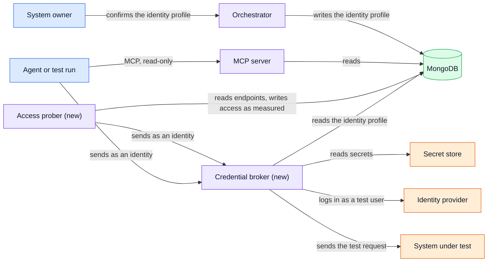
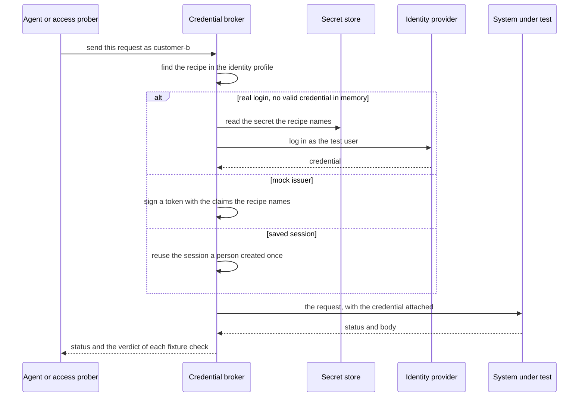

# Identity and access plan

**Status:** proposal, not a decision record. Compiled 2026-11-17 against commit `f838045`
(wadi 0.9.0). Nothing in this document is built unless a section says so. Revised the same day
after a review by three models. Section 19 lists what changed.

**Read with the direction record (added 2026-11-18).** `architecture.md` §11 now holds a direction
record and a build order of eleven steps. Where this plan differs from
`target-architecture-plan.md`, that plan governs. No difference is known. This plan is steps 4, 5
and 9 of the build order. Three points have moved.

- **D5 is in the accepted order.** The module comes after import. The order of steps 4 and 5
  against the config reader of step 6 is confirmed at the checkpoint after step 3.
- **D8 waits for step 5.** Phase 3 item 2 of `architecture.md` is not built before steps 4 and 5,
  and the decision on a separate findings collection follows step 5.
- **Two of the three corrections in section 17 are made.** `architecture.md` now carries a dated
  amendment on token propagation at both places. The line on gateway enforcement is unchanged.

D1 to D9 here are this plan's own labels. A bare D label in the target plan means a decision of
the rule-packs plan. The open decisions of section 14 move to GitHub issues with the `decision`
label, and a decision record in `architecture.md` closes each one.

**Purpose.** Wadi 0.9.0 reads access rules from Spring code and publishes one claim per endpoint.
An agent or a test generator needs two more things: a valid credential for each kind of user, and
the expected result of each call for each kind of user. This document records the design that a
discussion on 2026-11-17 reached for that need, with the evidence behind it, so that the work can
be picked up later without repeating the research.

**What this is not.** It changes nothing in `architecture.md`. Each accepted part gets a decision
record in that document first, per the standing rule, and a GitHub issue. It is also not about
access to wadi itself. The bearer token of wadi's own REST API (`architecture.md` §14) is a
separate subject.

**Related documents.**

- `target-architecture-plan.md` is the umbrella plan. It defines the readers, the records, the
  fold, the statuses, the shared keys, the scope and the full build order. This document uses
  those terms and does not repeat their detail.
- `bundle-import-and-hub-plan.md` covers export, the import job and the hub. Section 6.10 here
  says only what a service bundle carries about access.
- `docs/designs/target-architecture-page.html` is the page the discussion produced. Its section
  "Identity and access" is the latest statement of this design. It wins where an earlier answer
  in the discussion differs.
- `architecture.md` §5.2.9 to §5.2.14 record the access extraction that is built. Phase 3 item 2
  in §11 is the next step that a decision record plans.
- `foundation-hardening-plan.md` section 9 (W4) and `rule-packs-and-learned-rules-plan.md` are
  proposals that touch the same code. Section 11 here says how they relate.

**How to read the evidence.** A claim about the repository carries a path and a line. The paths
come from an audit written for the discussion. The compiler of this document opened the cited
lines again at commit `f838045`, and section 15 names the exceptions. A claim about the outside
world comes from one of six research reports and keeps the marker its report gave it:

| Marker | Meaning |
|---|---|
| [O] | The research agent opened the source during the session |
| [A] | Abstract page only |
| [S] | Search snippet only, page not opened |
| [R] | Recalled from memory, not opened |
| [P] | Preprint, not peer reviewed |
| [VC] | Vendor claim |
| [NC] | The report marks it "not confirmed" |
| [I] | The report's own inference |

"Unverified" means nobody checked the statement. Section 18 lists the sources with their URLs.

---

## 1. The need

Three of the owner's messages state the need (items 078, 081 and 086). The first asked whether
authentication and authorization need a separate service, and called them "one of the biggest
gap now". The second and third said what is needed:

- Every application handles authentication and authorization in its own way. The examples were
  custom roles, OAuth and single sign-on.
- An agent or a service that generates test cases needs a valid credential. It has to act as
  different users and roles, and it has to know the expected result for each of them. The aim is
  to check that the system works for everyone and that a user sees only what that user may see.
- The services of one system differ from each other, so combining them is hard.
- One framework alone enforces access in several layers, and one layer can override another.
  Spring Boot was the example.
- A credential has to be available in two ways. A test run can generate it beforehand. A test
  that tries one endpoint with every role needs it at the moment of the request.

The first answer in the discussion (item 080) extended wadi's current model. The owner's second
message rejected it and set a condition for the next answer. It must not be shaped by how wadi
extracts access today, "because we did it badly now". Section 12 records what the later design
keeps from the first answer.

Two later messages asked how the architecture changes with this module, and where the module is
in the main figure of the architecture page. Items 092 and 096 answered them, and the page holds
the result.

The goal, in the words of the architecture page, is that an agent or a test generator can call
any endpoint as any kind of user and know what should happen.

## 2. Status of each idea

| Idea | Status on 2026-11-17 |
|---|---|
| One claim per endpoint with five states, built from enforcement records, for Spring | Built. `architecture.md` §5.2.9 to §5.2.14 |
| A token fact on every outbound call (`forwarded`, `not-forwarded`, `undetermined`) | Built. `architecture.md` §5.2.11 T4 |
| `GET /snapshots/{id}/auth`, access facts in five of the nine MCP tools, the access views in the UI | Built |
| A walk over stitched edges that compares caller and callee, a findings collection and an MCP tool for it | Recorded in `architecture.md` (Phase 3 item 2). Not built. |
| A CI gate `--fail-on new-unauthenticated-endpoint` | Recorded in `architecture.md` (Phase 6). Not built. |
| An access rule pack for FastAPI, and a design pass for Express | Recorded in `architecture.md` (Phase 8). Not built. |
| Identity as a type test, a vocabulary census, withholding on the census, Shiro names, a third oracle state | Planned in `foundation-hardening-plan.md` (W4). Not built. |
| Spring Security stays plugin code, a rules-only framework marks authorization as not read, an unapproved authorization rule can only move an endpoint to withheld | Planned in `rule-packs-and-learned-rules-plan.md`. Not built. |
| Readers with their own records, the fold, the statuses, the shared keys, the scope | Proposed in discussion only. See `target-architecture-plan.md`. |
| The split into three problems (section 5) | Proposed in discussion only |
| Test identities and the identity profile | Proposed in discussion only |
| Recipes in the Web Fuzzing Commons format | Proposed in discussion only |
| The credential broker, with a mock issuer | Proposed in discussion only |
| The access prober | Proposed in discussion only |
| Access rules as read, one record per place a rule lives | Proposed in discussion only. The Spring code part exists as today's enforcement records. |
| The config reader also reads gateway, ingress and mesh access rules | Proposed in discussion only |
| The declared reader also reads the security part of a spec | Proposed in discussion only |
| A rule pack says how its framework answers a refused request | Proposed in discussion only |
| Access as measured | Proposed in discussion only |
| The access table in the fold | Proposed in discussion only |
| Identity as a shared key | Proposed in discussion only |
| The call view shows whether the caller passes the user's identity on, next to what the callee requires | Proposed in discussion only. It overlaps Phase 3 item 2. |
| Two more MCP tools, and a call that sends a request as an identity | Proposed in discussion only. Where the call lives is open (section 14). |
| A service bundle carries access rules and role mapping, never a recipe or a credential the broker holds | Proposed in discussion only. See `bundle-import-and-hub-plan.md`. |
| Mock tokens copy the claim layout of one real token per test identity | A proposal made in the discussion. The research found no existing practice. |
| Checks that a user sees only their own records | Proposed in discussion only, for a later stage |
| The first answer's checker service and seven-step order | Replaced in the discussion. History only (section 12). |

## 3. What wadi does today

Everything in this section is built. It comes from the audit (research report 9). Short names
for the paths:

| Short name | Path |
|---|---|
| `C/` | `libs/wadi-contracts/src/wadi_contracts/` |
| `Pack` | `joern-platform/src/main/scala/wadi/packs/SpringSecurityPack.scala` |
| `Export` | `joern-platform/src/main/scala/wadi/export/WadiExport.scala` |
| `Merge` | `services/extraction-worker/src/wadi_worker/auth_merge.py` |
| `Oracle` | `services/extraction-worker/src/wadi_worker/auth_oracle.py` |
| `Arch` | `docs/architecture.md` |
| `Hard` | `docs/foundation-hardening-plan.md` |

Wadi has a claim per endpoint and a token fact per outbound call. The call view already carries
the caller's token fact (`auth_propagation_state` on `RemoteEdgeItem`, `C/views.py:65`), so only
the callee's claim is missing beside it. The first version of this document said that nothing
joins the two. Extraction is specific to Spring and matches by name.

### The model

| Part | Content | Where |
|---|---|---|
| The claim, `EndpointAuth` | `authenticated` (true, false or none), `denied`, `roles`, `authorities`, `relationships`, `composition_unresolved`, `mechanism`, `mechanisms`, `evidence` | `C/endpoint.py:417-466` |
| States | authenticated, denied, unauthenticated, withheld, no_evidence. A validator makes them sum to the endpoint count. | `C/views.py:206-241` |
| The claim rule | `false` cannot stand beside an active record that wadi detected and could not read. `true` cannot stand beside an unread `chain-bypass`. A contract validator enforces both. | `C/endpoint.py:481-517` |
| The enforcement record, `AuthEvidence` | `kind`, `effect`, `resolution`, `active` with `inactive_reason`, `roles`, `authorities`, `expression`, `pattern`, `http_method`, `relationship`, `covers_route`, `anchor` | `C/endpoint.py:313-366` |
| Evidence kinds | `annotation`, `security-dsl`, `config`, `chain-bypass`, `interceptor`, `servlet-filter`, `aspect`, `in-handler`, `gateway`, `authority-model` | `C/endpoint.py:177-196` |
| Effects | `require-authenticated`, `require-roles`, `require-authorities`, `require-relationship`, `permit-all`, `deny-all`, `unknown` | `C/endpoint.py:210-239` |
| Resolutions | `resolved`, `partial`, `opaque` | `C/endpoint.py:242-251` |
| Relationship | `relation`, `resource_type`, `resource_binding`, `authorities`, all free strings | `C/endpoint.py:278-310` |
| Mechanisms | `jwt-bearer`, `opaque-token`, `http-basic`, `form-login`, `oauth2-login`, `oauth2-resource-server`, `saml2`, `x509`, `remember-me`, `custom-filter`, `stateless-session` | `C/endpoint.py:388-401` |
| Request policy | Kinds `cors`, `csrf-disabled`, `csrf-exempt`, `entry-point`, `access-denied`. Kept per service and never merged into the claim. | `C/boundary.py:274-299`, `C/tags.py:120-128` |
| Outbound call, `RemoteCall` | `auth_propagation` (`authorization-header` or `feign-interceptor`) and `auth_propagation_state` (`forwarded`, `not-forwarded`, `undetermined`) | `C/comms.py:44-100` |
| Call edge, `StitchedEdge` | No access field | `C/stitching.py:58-97` |
| Coverage rollup, `AuthCoverageSection` | Counts per state, `unread_by_kind`, `relationship_scoped`, `composition_unresolved`, `extraction_gaps`, `request_policies`, `unexercised_vocabulary` | `C/stitching.py:407-477` |

The merge removes the `ROLE_` prefix from roles and keeps authorities as written (`Merge:49-64`).

### What is extracted

Access extraction is `Pack:1-1705` plus `Export:1823-2153`, about 2,000 lines of Scala. The
worker adds `Merge` (1,119 lines) and `Oracle` (214 lines).

- Annotations: `PreAuthorize`, `PostAuthorize`, `Secured`, `PreFilter`, `PostFilter`,
  `RolesAllowed`, `PermitAll`, `DenyAll`, with meta-annotations and inheritance (`Pack:89-145`).
  The exporter reads whether method security is switched on (`Export:2067`), and the merge
  applies it (`Merge:272-304`).
- Filter-chain rules, with 12 access calls and 7 matchers, the reactive ones among them
  (`Pack:167`). Rules stay with their own chain (`Arch:442`).
- Chain bypass (`Pack:909`), mechanisms (`Pack:751`), CORS and CSRF (`Pack:624`), and what a
  grant means, such as a role hierarchy or a claim converter (`Pack:558`).
- Enforcement outside the chain: interceptors (`Pack:1053`), servlet filters (`Pack:1073`),
  aspects (`Pack:1362`), checks inside a handler (`Pack:1384`) and annotations a project defines
  itself (`Pack:1130`). One test, `gatesMethod`, decides whether each of them gates
  (`Pack:1404-1423`).
- Rules bound from configuration files (`Merge:424`).
- Token propagation on outbound calls (`Pack:1548-1705`).

Every pass matches Spring, AspectJ or servlet identifiers. The file says so: "Matching is by
NAME" (`Pack:24`). The worker hard-codes `mechanism="spring-security"` (`Merge:111`, `Merge:157`).
The oracle opens only files that contain one of six Spring identifiers (`Oracle:63-68`). The
parts that do not depend on Spring are the contract models, the claim rule (`Merge:163-222`),
path matching with precision (`Merge:1060`) and the coverage rollup.

Wadi withholds the claim (`authenticated` is none) when it found no evidence at all
(`Merge:104-105`), when only records that do not gate exist (`Merge:115-117`), when nothing
readable requires authentication and an unread guard is in range, when an unread bypass or an
unread `permit-all` is in range, and when an annotation is present and wadi found no
`@EnableMethodSecurity` (`Merge:299-300`). Interceptors, servlet filters, aspects scoped by
`execution(...)` and checks inside a handler are always `unknown` and `opaque`
(`Merge:368-369`).

### What is not extracted

- **The join across a call.** No component compares what a caller passes on with what the called
  endpoint requires. The stitcher's only access code is the coverage rollup
  (`services/stitcher/src/wadi_stitcher/pipeline.py:127`). Neo4j endpoint nodes carry two access
  properties, `auth_authenticated` and `auth_roles`
  (`libs/wadi-storage/src/wadi_storage/graph.py:195`), and the audit found nothing that reads them.
- **Rules about one record.** "May this caller access this record" is never answered.
  `resource_binding` is always empty (`Pack:1181`). A check inside a handler is detected from the
  handler's own body, wadi does not follow the methods it calls, and the record is opaque.
  `@PostFilter`, `@PreFilter` and `@PostAuthorize` keep their expression as text. No detector
  exists for tenant filters or query restrictions.
- **Anything outside the service's code.** Wadi reads `application.{yml,yaml,properties}`, up to
  five `spring.security.*` keys as context (`Merge:813-823`), and Spring Cloud Gateway and Zuul
  routes as routing only. `GatewayRoute` has no access field (`C/boundary.py:31-48`). Wadi reads
  nothing from Kubernetes, Helm, a mesh, an ingress, OpenAPI security schemes, an identity
  provider or a policy engine. The `gateway` evidence kind has no producer.
- **Other frameworks.** Shiro, Sa-Token, Micronaut and Quarkus annotations are named as a limit
  (`Arch:652`). Attribute rules and external policy engines "both presently collapse to
  `UNKNOWN`" (`Arch:654`).
- **A credential.** Wadi cannot make or hand out a token.

A grep of the source at this commit for `security-constraint`, `DispatcherType`,
`dispatcherTypeMatchers`, `EndpointRequest` and `management.endpoints` returns nothing. Section 4
shows why those names matter.

An agent that uses wadi today cannot learn a mismatch between caller and callee, which identity
crosses a call, the rule about one record or the parameter it binds, what an opaque guard does,
how guards combine, what a gateway or a mesh enforces, CORS for one endpoint, or how a token is
checked. The MCP server has nine tools (`services/mcp-server/src/wadi_mcp/server.py:42-175`).
Access facts arrive through `list_endpoints`, `endpoint_detail`, `list_services`,
`coverage_report` and `remote_edges`. No tool answers for the whole system, and none filters by
state or role. The REST API has `/snapshots/{id}/auth`
(`services/orchestrator/src/wadi_orchestrator/app.py:685-752`), and the UI has a five-state chip
(`frontend/components/shared/auth-chip.tsx:24`).

### Where the documents and the code disagree

| Subject | The document says | The code does |
|---|---|---|
| Token propagation | `Arch:455` and `Arch:1462` say detection fires on 0 of 157 calls and that Phase 3 owns the fix | The fix shipped (`Pack:1548`). `Arch:606` records 207 forwarded, 158 not-forwarded, 17 undetermined. |
| Gateway enforcement | `Arch:450` says it is "detected and reported" | No producer exists for the `gateway` kind |
| Spring in the contract | `Merge:19-20` says "nothing Spring-typed reaches the contract" | `Merge:111` writes `"spring-security"` |
| Tag registry | `C/tags.py:3-4` says packs may only emit registered tags | `auth-policy` and `auth-authority` are emitted (`Pack:645`, `Pack:572`) and are not in the registry (`C/tags.py:234-245`) |

Two code paths also disagree with each other. The coverage report's `authenticated` count
includes denied endpoints (`services/stitcher/src/wadi_stitcher/coverage.py:193`), and the
`/auth` totals exclude them (`app.py:741-744`).

### Open items

Five open issues are about access:

| Item | Priority | Issue |
|---|---|---|
| The aspect that answers 403 on ICPC is not detected. It decides from state that other advice wrote. | P1 | [#34](https://github.com/arfan-rfn/wadi/issues/34) |
| The corpus measurements cannot be reproduced from the repository | P1 | [#33](https://github.com/arfan-rfn/wadi/issues/33) |
| Enforcement scope carries a path pattern and no HTTP verb. Up to 133 ICPC endpoints may be withheld too often. | P2 | [#35](https://github.com/arfan-rfn/wadi/issues/35) |
| `denied` has never run on a real corpus | P2 | [#32](https://github.com/arfan-rfn/wadi/issues/32) |
| CORS and CSRF policy is published per service and is not matched to endpoints | P3 | [#39](https://github.com/arfan-rfn/wadi/issues/39) |

W4 in the hardening plan adds proposals A4, E4, A5 and C1 to C5 (`Hard:689-894`). The one that
matters most here is A5. A service with a permissive Spring chain and a guard that wadi does not
model publishes `authenticated=false` with evidence (`Hard:778-788`). The plan marks it as not
measured on a real corpus.

### Measurements so far

| Corpus | Result | Where |
|---|---|---|
| train-ticket, 262 endpoints | true, false and none went from 85, 129 and 48 to 111, 151 and 0 | `Arch:459` |
| train-ticket-aitest, 365 endpoints | Token propagation is 207, 158 and 17 of 382 calls. 40 request policies. | `Arch:605-606` |
| ICPC, 804 endpoints | Withheld went from 7 to 0. 643 endpoints carry a relationship. 9 endpoints moved from public to protected. | `Arch:700`, `Arch:777`, `Arch:716` |

All three corpora are Spring (`Hard:898-901`). No measurement compares wadi's claim with what a
running system answers.

## 4. Why reading the rules cannot be the verdict

### The twelve places Spring Security decides

A request to a Spring application can be allowed, denied or skipped in twelve places, in this
order. All rows are [O] from report 15 unless a cell says otherwise.

| # | Place | Documented pitfall |
|---|---|---|
| 1 | Servlet container constraints | They skip `RequestDispatcher` forwards and includes. HTTP methods the constraint does not list stay unprotected. |
| 2 | `WebSecurity.ignoring()` | A matching request gets no `SecurityContext` and no security headers. |
| 3 | Chain selection by `securityMatcher` and `@Order` | Only the first matching chain runs. A request that matches no chain "is not protected". |
| 4 | CORS | `CorsFilter` must run first, because a preflight request carries no cookies. |
| 5 | CSRF | `CsrfFilter` runs before the authentication filters, so Boot's actuator POST endpoints return 403 by default. |
| 6 | Authentication filters | Filters placed before `AuthorizationFilter` "do not require authorization". |
| 7 | `authorizeHttpRequests` | The first matching rule wins. |
| 8 | Dispatcher types | Rules run on REQUEST, FORWARD, ERROR and INCLUDE, so a view forward or Boot's error dispatch is authorized again. ASYNC is [NC]. |
| 9 | The actuator chain | With any user `SecurityFilterChain` bean, Boot's own security configuration "backs off completely". Behaviour on a management port is [NC]. |
| 10 | Method security before the call | It is off without `@EnableMethodSecurity`. The order is PreFilter 100, PreAuthorize 200, Secured 300, JSR-250 400. |
| 11 | `@PostAuthorize` (500) and `@PostFilter` (600) | They run after the method body, so after any database write, unless transaction advice is ordered first. |
| 12 | Handler code | `isUserInRole("ADMIN")` adds the `ROLE_` prefix itself. |

Places 10 to 12 depend on arguments and return values that exist only at run time. The audit
shows wadi reading places 2, 3, 7 and 10 as rules, place 6 as the list of mechanisms, places 4
and 5 as request policy that it keeps apart from the claim, and places 11 and 12 as text or as
opaque records. The grep in section 3 found no reader for places 1, 8 and 9.

### Defaults that changed between versions

| Change | Version | Marker |
|---|---|---|
| A request that matches no `authorizeHttpRequests` rule is denied | Spring Security 6.0 | [O] |
| `AntPathRequestMatcher` and `MvcRequestMatcher` are removed, and `/**/x` patterns are not allowed | Spring Security 7.0 | [O] |
| The lambda DSL and `PathPatternRequestMatcher` are required | Spring Security 7.0 | [O] |
| A trailing slash no longer matches, and the option to turn that back on is removed | Spring Framework 6.0, then 7.0 | [O] |
| Rules run on every dispatcher type. Through 5.8 they ran once per request. | After Spring Security 5.8 | [O] |
| `LoginRequiredMiddleware` can close a whole Django project | Django 5.1 | [O] |
| A request without a credential gets 401. Earlier versions answered 403. | FastAPI 0.122.0 | [O] |
| A global guard makes "every route" require a signed-in user | NestJS `@nestjs/authentication`, version [NC] | [O] |

A reader that emulates Spring has to reproduce a matcher language, first-match order across
chains, and these defaults, from configuration written in Java. That is one precedence model per
framework and per major version. A wrong model fails without any error.

### Frameworks declare access in five shapes

Report 13 read the documentation of thirteen framework families. All rows are [O] unless marked.

| Framework | With no rule, an endpoint is | Shapes | What makes it hard to read |
|---|---|---|---|
| Spring Security 7.1.2 | Closed. The default chain is `anyRequest().authenticated()`. | S2, S1 | The rule table is Java code |
| Jakarta REST | The specification is silent [NC]. Jersey needs `RolesAllowedDynamicFeature`. | S1, S2 | The same annotation is inert or enforced, depending on a registration at run time |
| Quarkus 3.40 | Open (`deny-unannotated-endpoints=false`) | S2, S1 | Policy is split across properties, annotations and code |
| Micronaut Security 5.5.2 | Closed. It answers 401 "for any endpoint invocation". | S1, S2 | Custom `SecurityRule` beans at any order |
| ASP.NET Core 10 | Open. `FallbackPolicy` is `null`. | S1, S5 | A policy name is a string that resolves to handler code |
| NestJS | Open, guards are opt-in [I] | S1, S5 | A decorator is metadata. The guard that reads it gives it meaning. |
| Express 5.x with Passport | Open [I] | S3 | Middleware are arbitrary functions |
| Fastify 5.12.8 | Open | S3 | The range of a hook follows the plugin registration tree |
| FastAPI | Open [I] | S4 | A dependency means whatever its body does |
| Django 6.1, DRF | Django is open. DRF uses `AllowAny` unless `DEFAULT_PERMISSION_CLASSES` is set. | S1, S3 | Settings are Python, and `get_permissions()` is dynamic |
| Flask 3.1 with Flask-Login | Open. Flask ships no access control. | S1 | Decorators are wrappers the project writes |
| Go (gin, echo, chi) | Open | S3 | Groups and closures are passed across packages |
| Rails 8.1, Pundit, CanCanCan | Open. Pundit enforces nothing until `authorize` runs. | S3, S5 | The policy class and method are found by convention at run time |

The shapes are:

- **S1.** A marker on a handler or a class.
- **S2.** A rule table matched by path.
- **S3.** A chain in registration order, limited by a group, a plugin or inheritance.
- **S4.** An injected dependency.
- **S5.** A policy object found by name or convention, often called from code.

The report's conclusion for rule packs is in section 6.4.

### What no static tool sees

**Layers in front of the service and behind it.** Report 12 read the documentation of thirteen
enforcement layers. Most of them have a setting that lets a request through without an error.
Rows are [O] unless marked.

| Layer | What a configured check proves | Settings that let a request through |
|---|---|---|
| Spring Cloud Gateway 5.0.4 | `TokenRelay` forwards the user's access token. Access rules sit in Spring Security [R]. | The documentation states no validation or authorization |
| Kong 3.16 | The most specific instance of an auth plugin runs once per request | `config.anonymous`. A failed check returns no 4xx, and the request continues as the anonymous consumer. |
| AWS API Gateway (REST) | The method invokes its authorizer | `NONE` methods, a cached authorizer policy reused across methods, the default `execute-api` endpoint, API keys (which only track usage) |
| Apigee | `VerifyAccessToken` checks the token, one listed scope and the API product | It covers every request only when attached at the ProxyEndpoint PreFlow |
| nginx `auth_request` | 2xx allows, 401 or 403 denies | The subrequest's own logic. `satisfy` can combine it with other access modules. |
| ingress-nginx | A hook or a client certificate on that Ingress | `enable-global-auth: "false"`, `optional`, `optional_no_ca`. The project announced the end of maintenance for March 2026. |
| oauth2-proxy 7.15 | The proxy checks a session or a JWT | `--skip-auth-route`, `--trusted-ip`, `--email-domain=*`. A caller that reaches the service directly can forge the forwarded headers. |
| Gateway API `ExternalAuth` | A hook on that rule | Not standardized. It has been in the Experimental channel since v1.4.0. |
| Envoy 1.41-dev | A matching rule verifies signature, issuer, audiences and expiry | No matching rule or an empty `requires`, unset `audiences`, `failure_mode_allow`, per-route `disabled`, RBAC shadow rules |
| Istio 1.32 | STRICT requires a client certificate | An unset mode means PERMISSIVE. HTTP-only fields are ignored on TCP. Path normalization can differ. |
| Linkerd | A port with a Server denies unless authorized | The default policy `all-unauthenticated`, and `audit` mode |
| PostgreSQL 18 row security | A row filter, and default deny with no policy | Superusers, `BYPASSRLS`, table owners without `FORCE`, `TRUNCATE` and `REFERENCES` |
| Hibernate 7.1 `@FilterDef`, `@TenantId` | Nothing alone | No effect unless enabled per session or `autoEnabled`. Skipped on primary-key lookups unless `applyToLoadByKey`. |

A cloud platform's own access control proves only which service calls. It never proves who the
end user is [O].

**Seven conditions.** Report 12 lists what must hold before "this endpoint cannot be reached
without authentication in environment E" is true:

1. Every network path to the workload in E is known: gateway routes, other Services, NodePort and
   LoadBalancer, cloud default endpoints, pod to pod.
2. Each path crosses an enforcement point whose rule matches this method and path.
3. The rule requires a credential, with no skip, anonymous, optional, shadow, audit or fail-open
   setting, and every value is resolved for E.
4. The enforcement point and the application normalize paths the same way.
5. Direct reach inside the cluster is closed. Pods are "non-isolated for ingress" by default [O].
6. The logic of any external hook is known.
7. The deployed configuration equals the configuration that was read. Only a running system can
   show this.

Item 080 concluded from this list that the claim is almost never provable from files.

**Policy that is not in a repository.** Casbin policy in a database, Keycloak server policy,
OpenFGA and SpiceDB tuples, Amazon Verified Permissions stores, Oso Cloud and OPA bundles built
elsewhere cannot be read from the service's repository. Neither can the content of a token or the
role mapping inside an identity provider (report 13, [O]).

**Intent.** Extraction yields what the code does, and never what the team intended (Ote,
EvoMaster, FixMeUp, all [O]).

### The state of tools

Report 10 surveyed tools that detect authorization flaws. Markers are per row.

| Tool | How it works | Limit or evidence |
|---|---|---|
| CodeQL | Dataflow and structural queries | Missing-authorization and direct-object-reference queries exist for C# only (`cs/web/missing-function-level-access-control`, `cs/web/insecure-direct-object-reference`, precision "medium"). The report found none for Java with Spring, Python, JavaScript, Ruby or Go. [O] |
| Semgrep rules | Patterns and taint | One C# rule flags a controller without `[Authorize]` [O]. One Rails rule flags an unscoped `find` [S]. |
| Semgrep AI-powered detection | A model lists routes, checks handlers and traces parameters | 61% precision on one customer's repositories, against 22% for Claude Code alone [VC]. Results change between runs [O]. No independent evaluation found. |
| route-detect | Semgrep rules per framework that mark routes with or without checks | No evaluation [O] |
| OWASP Noir | An endpoint inventory with 24 framework taggers | Its documentation calls the tags indicators, not findings [O] |
| Spectral OWASP ruleset, Redocly, vacuum, 42Crunch audit | Read the OpenAPI document only | A spec cannot prove that the implementation enforces the declared scheme. Redocly accepts `security: []`. [O], vacuum [S], 42Crunch [VC] |
| Autorize | Replays proxied requests with a weaker session and with none, then compares | Only requests a person visited. Its README says "false positives or false negatives are possible". [O] |
| AuthMatrix, ZAP access control | Run every user against every request | A person enters who may call what [O] |
| RESTler | Reuses a resource as an attacker user | Off by default, no role model [O] |
| EvoMaster | Access checks on status codes after fuzzing, with two or more users | Its check for a missed authorization fired zero times on 44 real APIs [O][P] |
| Schemathesis | `ignored_auth`, `object_level_authorization` | Reads only. Needs two configured peers. [O] |
| BOLABuster | A model writes two-user test scripts from an OpenAPI document | People verify each hit. 17 CVEs in 3 projects. [O][VC] |
| Akto, 42Crunch scan, Salt Security | Replay with another token, or learn a baseline from traffic | Pass criteria or accuracy are not published [O][VC] |

Reports 10 and 11 count EvoMaster's access checks differently. One says six of nine checks
concern access policy, the other says seven. This document did not resolve the difference.

The report looked for each of these and found no tool that does it:

- Compute effective access across gateway, mesh and application.
- Check that the identity a caller passes on meets what the called endpoint requires.
- Detect flaws about one record outside research prototypes tied to one framework and SQL.
- Read annotations a project defines itself without hand-written rules.
- Publish "could not determine" for a guard it cannot read.
- Know the intended policy. Every dynamic tool needs a person to supply it.

The report also found no independent precision or recall figure per category for any commercial
product.

Access control is the first category of the OWASP Top 10:2025, and object-level authorization is
API1 in the OWASP API Security Top 10 2023 [O]. CWE-862, missing authorization, is fourth in the
2025 CWE Top 25 [O]. ASVS 5.0.0 states the requirements this plan touches: 8.2.1 per function,
8.2.2 per record, 8.2.3 per field, 8.3.3 for decisions on the original caller's permissions
across services, and 13.2.1 for authenticated calls between services [O].

### The state of research

Report 11 read the papers. "Result" is the paper's own number.

| Work | Method | Result and limit | Marker |
|---|---|---|---|
| Sun, Xu, Su (USENIX Security 2011) | Sitemaps per role | 8 vulnerabilities in small PHP applications | [O] |
| RoleCast (OOPSLA 2011) | Infers security-critical variables per role | 13 new vulnerabilities, 3 false positives. It assumes each role's code sits in separate files. | [A] |
| FixMeUp (NDSS 2013) | Repairs missing checks | 38 bugs, 30 repaired. It needs annotations from a developer. | [O] |
| MACE (CCS 2014) | Compares authorization context across paths | New vulnerabilities in 5 of 7 applications. Later papers that rebuilt it scored it 25 true and 14 false, and 47 of 161. | [A] |
| SPACE (ICSE 2016) | A catalog of access patterns, Rails only | 33 reports, 23 bugs | [A] |
| Waler (USENIX Security 2010) | Dynamic invariants plus model checking | 47 new vulnerabilities. It needs training runs. | [O] |
| BolaRay (CCS 2024) | Infers ownership models from SQL, PHP | 247 reports, 193 true (21.86% false positives). Of 101 studied bugs, 62% were missing ownership checks and 25% were fixed in SQL. Its rules are "neither sound nor complete". | [O] |
| MOCGuard (IEEE S&P 2025) | Infers user-owned data from the schema, Java | 161 confirmed, 19 false (89.44%). Recall is measured against the union of its own findings and a rebuilt MACE. | [O] |
| BolaZ (2025) | CodeQL finds APIs that take resource ids, Spring Boot | 35 of 36 reports confirmed | [O][P] |
| Ote (OSDI 2026) | Concolic execution of Rails handlers | It "does not guarantee completeness or tightness" and recovers what the code does | [O] |
| AutoArmor (USENIX Security 2021) | Extracts service calls and generates mesh policy | 4 of 755 call URLs missed. The end user is out of its range. | [O] |
| Das et al. (PeerJ CS 2021) | Reads `@RolesAllowed` across services | One application with 4 services and seeded violations | [O] |
| Neo (2026) | A model composes CodeQL queries across services | Recall 85.0% and precision 81.0% on 20 verified cases in 4 applications | [O][P] |
| AuthScope (CCS 2017) | Swaps fields between two users in mobile traffic | 597 vulnerable authorizations in 306 of 4,838 applications | [O] |
| RESTler checkers (ICST 2020) | Replays with another user's token | 7 bugs on 3 services. The other-user check found none. | [O] |
| BACScan (CCS 2025) | Black-box scan | 89 vulnerabilities in 20 applications. It measured earlier oracles that compare responses at 70.97% and 86.96% error. | [O] |
| A2CT (ICISSP 2025) | Treats response bodies with 80% overlap as similar | 14 vulnerabilities in 2 of 30 applications. It reports "some false positives" and does not count them. | [O] |
| BACFuzz (2025) | An oracle on SQL queries, PHP only | 16 of 17 known bugs, 26 new | [A][P] |
| Semgrep study (2025) | Coding agents with no supporting structure, Python | Claude Code: 13 true and 46 false (22%), 0 of 19 where the check was in another file or a custom role, 0 of 18 where middleware implied it. Codex: 0 of 5 and 2 of 44. The runs cannot be repeated. | [O][VC] |

BACScan's abstract and body disagree on which of its two figures is the false-negative rate.
Report 11 found no measured study of token propagation, and no peer-reviewed result for a model
that extracts policy from code. It also covers Nemesis, MA-RAG and Abdelfattah et al., which this
plan does not use.

What the reports conclude:

- Static analysis alone cannot prove a finding, and it cannot read conditions the client controls
  (BACScan, BolaZ).
- Dynamic testing alone finds little, because a generic check does not know the policy (RESTler,
  EvoMaster).
- A model alone does badly where the check is in another file or implied (Semgrep study).
- The combination that the evidence supports is a static model that picks the endpoint and the
  pair of identities, and a replayed request that proves the result.
- Results about one record are candidates. The best measured precision is 78 to 89% on corpora
  the authors chose, and no recall figure rests on independent ground truth. Ownership also has
  to be read from the data layer, since a quarter of the 101 studied bugs were fixed in SQL.

### Three ways to learn whether a caller is allowed

Report 15 compared them.

| | Read the rules | Ask the framework in a test process | Probe the running system |
|---|---|---|---|
| Needs | Source | A context that boots with mocked dependencies | A deployment, a credential per role, valid requests |
| Covers | Declared rules on every endpoint | The real decision for the layers that execute | The whole path, gateways included |
| Cannot see | Run-time values (places 10 to 12) | Gateways, and rules about one record without data | The reason for a response |
| Cost per framework | A precedence model per major version | An adapter each. "Only Spring, ASP.NET and DRF expose a decision call." | Low. The cost is per system. |
| Silent wrong answer | Likely where defaults changed (6.0, 7.0) | The Spring evaluator returns true when no rule applies | Likely if responses are read naively: BACScan's figures, 403 for callers with no credential, 404 that hides a resource, 400 before 403 |

The details behind the middle column are [O]. Spring has
`WebInvocationPrivilegeEvaluator.isAllowed`, which returns true when the manager gives no result
and whose URI-only form skips rules for one HTTP method. MockMvc with `springSecurity()` runs the
filter chain and the handler. ASP.NET Core has `AuthorizationPolicy.CombineAsync` and
`IAuthorizationService.AuthorizeAsync`, and misses resource checks written in handlers. DRF has
`view.check_permissions(request)`, and misses object permissions. NestJS, FastAPI, Express,
Fastify, Go and Rails have no decision call. `@SpringBootTest` builds the full context, so every
bean must resolve. The report found no published tool that builds an access table by asking a
framework.

## 5. Three problems

Item 083 split the subject into three problems, because each has a different best solution.

| Problem | Why it is separate | Solution in this plan |
|---|---|---|
| Getting a credential | No tool can derive it from code. Test users, their roles and their secrets exist only with the system owner. | The identity profile, recipes and the credential broker |
| Knowing what should happen | The running system has already combined every layer, so nobody has to model how one layer overrides another | The access prober measures it. The static analyzer supplies what makes the measurement reliable. |
| Explaining why | A measurement gives a result and no reason | Access rules as read. They become a prediction and an explanation. |

When the prediction and the measurement disagree, one of two things is true. The analyzer is
wrong, which is input for learn mode. Or the system is misconfigured, which is a security finding.

## 6. The design

Nothing in this section is built unless a sentence says so.

### 6.1 Test identities and the identity profile

A test identity is a named kind of caller, such as anonymous, customer, another customer or
admin. A test names a test identity and never contains a token.

The identity profile belongs to one system in one environment. It holds:

- the mechanism the system uses to authenticate;
- the test identities;
- a recipe for each test identity (section 6.2);
- the roles and the authorities each test identity has in each service, kept apart as the rules
  keep them;
- the name of each secret a recipe needs, and never the secret.

| Question | Answer |
|---|---|
| Who drafts it | Wadi, from what the readers found: OpenAPI security schemes, issuer settings, login endpoints, and the roles each service checks |
| Who confirms it | A person, once per system |
| How wadi checks it | Wadi runs each recipe and calls one protected endpoint to confirm that the credential works |
| Where it is kept | Wadi's database, and a `.wadi/` file a team can commit |
| Who writes it | The orchestrator |

Three inputs for the draft are built today: the mechanisms per service
(`C/endpoint.py:388-401`), the roles and authorities on each claim, and the `authority-model`
records that say where a role comes from (`C/endpoint.py:196-207`). Reading OpenAPI security
schemes or issuer settings is not built.

No existing format records which roles a test user has (section 8). A person supplies that
mapping.

### 6.2 Recipes and the credential broker

A recipe says how to get the credential of one test identity. The credential broker runs it, in
one of three ways:

| Way | What happens | Fits |
|---|---|---|
| Real login | The credential broker logs in as a test user, at a login endpoint or at the identity provider | The whole system in a test environment |
| Mock issuer | The credential broker signs a token with the claims the test asks for. The service's real validation still runs. | One service running alone |
| Saved session | A person logs in once, and the credential broker reuses that session | Single sign-on with a second factor |

The systems the owner named then differ only in the recipe:

| The system uses | Recipe |
|---|---|
| A custom login that returns a token or a cookie | Call it and extract the token |
| OAuth with an identity provider | Client credentials for a service identity. For a user, a test user in a test tenant. |
| Single sign-on with a second factor | It cannot be fully automated. Use a test user excluded from the second factor, or a saved session. |
| One service tested alone | The mock issuer |

The owner's two ways of getting a credential are one mechanism run at different times.

| When the recipe runs | Fits |
|---|---|
| Once before the run, per test identity | Test suites in CI. Single sign-on with a second factor. Logins that are slow or rate-limited. |
| At the moment of the request, kept until the credential expires | An agent that tries one endpoint with every test identity. Long runs in which tokens expire. |

**Only the credential broker reads secrets.** Analysis still runs with no secret and no API key. The
credential broker reads the identity profile from MongoDB, reads each secret from the owner's secret
store at run time, keeps credentials in memory until they expire, and writes only its request log.
An agent names a test identity, the credential broker attaches the credential, and the agent never
holds a secret. Section 8 gives the outside guidance this follows.

A token is not always enough. Section 9 lists the cases under "Limits".

For tests saved in a repository, item 088 proposes a small helper that takes the name of a test
identity at run time. The helper sends the test's requests through the credential broker and
never holds a token, so the broker stays the only place that holds credentials. The same test
then runs locally with the mock issuer and in staging with real login.

### 6.3 The access prober

The access prober calls each endpoint as each test identity, through the credential broker, and
stores what the system answered. It runs on command, as its own service.

Naive probing is unreliable (section 4). The static analyzer supplies what makes it reliable:

| What the access prober needs | Why | State today |
|---|---|---|
| The list of endpoints, and a valid request for each | An invalid request can return 400 before the access check runs | Endpoints, parameters and request shapes are built (`C/endpoint.py:535`). Validation constraints are not read (`Hard:1120-1139`). |
| Which endpoints change data | Probing stays read-only by default | The HTTP verb and an entity access summary per endpoint are built (`architecture.md` §5.2.17). The discussion did not fix which of them decides. |
| How each framework answers a refused request | 401, 403 and 404 mean different things in different frameworks | Not built. Planned as a small data table in each framework's rule pack. |
| The roles each service checks | The test generator knows which test identities to try | Built for Spring, on each claim |

**Three calls per cell.** For each cell of the access table, the access prober compares three
calls: one with no credential, one as a test identity expected to pass, and one as a test
identity expected to fail. The discussion named the three calls and did not specify the
comparison rule. One reading is that the call that passes shows that the request itself is
valid, which separates a refusal from a bad request or a missing route.

**How frameworks answer a refused request.** From report 15, [O] unless marked.

| Framework | No credential | Authenticated, lacks the role | Unknown route |
|---|---|---|---|
| Spring resource server | 401 with `WWW-Authenticate: Bearer` | 403 | 401 under `anyRequest().authenticated()` [I] |
| Spring form login | Redirect to the login page | 403 | Redirect [I] |
| ASP.NET Core | JWT gives 401. A cookie scheme redirects to login. | JWT gives 403. A cookie scheme redirects to an access-denied page. | 404. A fallback policy also applies to unmatched requests. |
| DRF | 401 if the first authentication class sends `WWW-Authenticate`, otherwise 403. `SessionAuthentication` gives 403. | 403 | 404 [R] |
| Django | Redirect to `LOGIN_URL` | `permission_required` redirects unless `raise_exception`. `AccessMixin` gives 403. | 404 [R] |
| NestJS | 403 when a guard returns false. 401 only if the guard throws it. | 403 | 404 |
| FastAPI | 401 since 0.122.0, 403 before | Decided by user code. The official scopes example returns 401. | 404 |
| Express with Passport | 401 | Outside Passport | 404 after all middleware ran |

The order of validation and access checks also differs, [O] unless marked:

- Spring URL rules run before the servlet. `@PreAuthorize` on a controller runs after argument
  resolution, so an invalid body returns 400 first.
- ASP.NET Core evaluates attributes "before data binding".
- DRF checks permissions "before any other code".
- NestJS runs guards before pipes.
- FastAPI raises an error for malformed JSON before dependencies run, and reports schema errors
  after them.
- Fastify validates between `preValidation` and `preHandler`. Express follows registration order.
  Rails is [NC].

A system may answer 404 where 403 would be true. RFC 9110 §15.5.4 permits it. GitHub's REST API
does it for private repositories, DRF's `DjangoObjectPermissions` does it without read
permission, and Laravel has `denyAsNotFound()` [O].

Wadi already publishes two Spring facts that change these answers: the `entry-point` and
`access-denied` request policies of a service (`C/tags.py:120-128`). The discussion did not
connect them to the access prober. This document notes the link.

**The first version.** The review of section 19 found that the access prober needs three things
wadi does not have yet: valid request values, a refusal table per framework (step 7) and an
independent statement of what should happen. The first version therefore sends the requests of
one fixture, written by a person, and compares the answers with expected answers written by a
person. It probes no other endpoint. Generating requests from wadi's request shapes comes after
validation constraints are read.

**Limits on the access prober.** It calls test environments only, and never production. It sends
read-only requests unless a person allows more. Section 9 says how the credential broker enforces
both.

### 6.4 Access rules as read

Today wadi stores one claim per endpoint, with the Spring evidence listed inside it. The design
stores one record per place a rule lives:

| Place | Reader | State today |
|---|---|---|
| The service's code | Static analyzer | Built for Spring, as enforcement records inside the claim |
| A gateway, an ingress or a mesh | Config reader | Not built. The `gateway` evidence kind has no producer. |
| A spec | Declared reader | Not built |
| The data layer, such as row security or a tenant filter | Not assigned | Not built. Item 080 named the layer. The page does not. |

The static analyzer's access result changes meaning. It becomes a prediction with its reason. The
static analyzer also lists the roles each service checks, where a role comes from, and a valid
request for each endpoint.

Item 080 proposed fields for the record: the layer, the environment, OAuth scopes, the token
audience, and whether the subject is the end user or the calling service. It also proposed that
the config reader records "a check is configured" unless it read every setting that lets a
request through. The page keeps the record and does not fix its fields.

Existing models give vocabulary, and each leaves something out. What each cannot express is
report 12's own reading. XACML 3.0 has subject, resource, action, environment, rule and combining
algorithm, and cannot say which deployed layer enforces. NIST SP 800-162 names the parts of
attribute-based access control and gives no policy syntax. Zanzibar tuples cannot express
conditions on attributes. OAuth scopes cannot name the object. RBAC cannot express ownership of
one record.

**What a rule pack can hold.** Report 13 concludes, for rules as data:

- A data rule can capture S1 markers with their arguments and opt-out marker, S2 tables with
  literal entries and their precedence, the framework's default with the switches that flip it,
  authentication settings in configuration files (issuer, audience, key source), and call sites
  of an external engine.
- Code is needed for the range of an S3 chain, S4 dependency graphs, rule tables built with
  constants or lambdas, resolving a policy name to the code that decides, and expression
  languages such as SpEL.
- Policy outside the repository is published as an explicit unknown, with the call site as
  evidence.

The page adds one thing to each framework's rule pack: how that framework answers a refused
request.

### 6.5 Access as measured

One record holds the answer one endpoint gave one test identity, with the environment and the
time of the measurement. The records live in MongoDB, one set per environment. Only the access
prober writes them.

What a measurement proves (report 12):

- A 2xx answer to a request with no credential shows that the endpoint can be reached without
  authentication in that environment, at that time, on that path, only when the evidence for an
  anonymous request below holds, and only for the layers that evidence covers. A gateway, a stale
  fixture or a wrong route can answer 2xx as well.
- A 401 or 403 proves enforcement on that path only.
- The absence of an observed 403 proves nothing.

Each record therefore stores more than the status code: the request case sent, the deployment
and identity-profile revisions, and the evidence the fixture asks for. A measurement whose
evidence is missing reads as **inconclusive**. The fixture states the evidence for three kinds of
result.

- **An anonymous request.** The request carried no credential, the deciding layer treated it as
  anonymous by the evidence the fixture names, since an intermediary can attach an identity of its
  own, and the answer came from the intended route, not from a gateway default or a missing route.
- **An authenticated request.** The credential broker obtained the credential by the identity's
  recipe, whether a login, a mock token or a saved session. The fixture names evidence of the
  principal and the authorities that the deciding layer applied to this request, such as a check the
  service exposes or that layer's decision log, and the evidence shows the intended identity with
  the roles and authorities that the mapping used for the cell predicts. Evidence that shows another
  principal or other authorities makes the result inconclusive and is reported as a mapping
  mismatch, never used to confirm or contest the cell. The claims of a token or a user-info answer
  show what was issued, not what the service applied, so on their own they leave the result
  inconclusive. This holds for an authenticated refusal as well as an allowed answer. The answer
  came from the intended route.
- **A refusal.** The refusal came from the layer the fixture names, such as the Spring filter
  chain or the gateway, with that layer's status and headers. A denial before the handler is a
  valid refusal. Reaching the handler is not required for it.

A 400 before the access check, a failed login and an answer from the wrong route are
inconclusive, never refused or allowed.

A measurement holds for the test identities tried, in one environment, at one time. It says what
the system does. What the system should do still comes from a person or a spec.

Traces are a weaker source for the same question. The trace importer, which is marked "later",
would read them. An OpenTelemetry server span shows that a handler ran and its status. It does
not show whether a credential was present, unless headers or `user.*` attributes are configured,
and those are opt-in. Every `enduser.*` attribute is deprecated in semantic conventions v1.45.0
[O].

### 6.6 The access table and its statuses

The fold builds the access table when someone reads the map. The table has one cell per
endpoint, test identity and request case. A request case is the fixture's description of what a
request touches, such as the identity's own record or someone else's, because one caller can be
allowed on one and refused on the other. Each cell holds the answer as read, the answer as
measured and a status, and the two answers are compared only within one request case. The fold
stores nothing.

The answer as read for one test identity comes from two inputs: what the rules of the endpoint
require, and the roles and authorities that test identity has in that service. They come from the
identity profile. For an imported service the profile does not name, they come from the role mapping
its bundle carried (`bundle-import-and-hub-plan.md` section 5.3), and only for a test identity that
the receiver's profile links to the sender's, for the same deployment. The link names the digest of
the mapping it approved (`bundle-import-and-hub-plan.md` section 5.1), so it becomes part of the
receiver's profile revision, which is how it meets the scope rule of `target-architecture-plan.md`
section 4.5. A bundle with another digest makes the answer not decidable until a person renews the
link. Otherwise the answer as read is not decidable. The cell says which mapping it used. Roles and
authorities stay separate facts, as the rules keep them
(`libs/wadi-contracts/src/wadi_contracts/endpoint.py:218-221`).

The fold compares each comparable read source on its own before it combines them. Comparable means
the same decision at the same layer. A gateway that passes a request and a service that refuses it
are two decisions in sequence, not a conflict: the answer as read for the whole path is the
combination of every layer on it, and one layer's pass never reads as allowed end to end. When the
roles, the authorities and the request case cannot decide a source's rule, that source's answer is
not decidable, and a measurement can neither confirm nor contest it. A rule that requires a relation
to the resource (`AuthEffect.REQUIRE_RELATIONSHIP`) is the common case: roles cannot answer it
unless the request case states the relation. Two comparable read sources that give different
answers, such as the code and a spec, keep the cell contested whatever a measurement shows, as the
umbrella's rule that contested wins requires. A spec states intent, not enforcement: it can make the
cell contested or withhold the answer as read, and never supplies the answer on its own, because
declared security can only withhold a claim (`target-architecture-plan.md` section 6.3). A read that
combines layers takes its answer as read from the layer that decides it, and lists every layer it
used with that layer's own status as evidence. The cell's status still comes from the table below,
so a layer's agreement never makes the cell confirmed.

The page names the five statuses for every fact. It does not spell them out for an access cell.
Applied to one cell, the definitions in `target-architecture-plan.md` give the table below, with
one narrowing: a spec states intent, not enforcement (that plan's section 6.3), so an agreeing
spec never confirms an access cell, and only a measurement of the whole path does.

| Status | In an access cell |
|---|---|
| confirmed | The answer as read and the answer as measured agree for the whole path. Agreement between read sources about one layer confirms that layer, not the cell. |
| static only | A code layer decides the answer as read, and no measurement of this cell is conclusive. A spec that agrees is recorded beside it as a check. This is not an error. |
| observed only | The access prober measured an answer, and no rule wadi read decides it: none was read, or the rule read is not decidable for this cell |
| declared only | A deployment file decides the answer as read, such as a gateway rule that refuses what the code allows, no code layer shows that decision, and no measurement of this cell is conclusive |
| contested | The answer as read is decided and a conclusive measurement differs from it, or two comparable read sources, such as the code and a spec, give different decided answers, measured or not. An answer as read that is not decidable never makes the cell contested. |

When more than one row applies, contested wins, as the umbrella's rules require. A cell that no row
fits, because its answer as read is not decidable, its measurement is missing or inconclusive and no
two comparable read sources disagree, holds no fact, so it has no status: it shows both answers with
their reasons (P10), and learn mode lists it as a gap.

A contested cell is a lead, not yet a finding. It can be an error in the analyzer, a
misconfigured system, or a measurement problem such as a gateway answer or a wrong role mapping.
It becomes a finding only against an independent expectation, written by a person or a spec. A
claim that wadi withholds keeps its withheld state beside any measurement, and an inconclusive
measurement never makes a cell confirmed or contested. The value set of a measured answer is
allowed, refused or inconclusive. The value set of an answer as read (allowed, refused, not
decidable) is not designed.

### 6.7 Identity as a shared key

The shared keys in `target-architecture-plan.md` are service, endpoint, method, data and
messaging. This design adds identity, made from a test identity named in the identity profile.

Services name their roles differently. One says `ROLE_ADMIN`, another uses an OAuth scope, a
third uses a group. The identity profile maps the test identity "admin" to each of them. Records
from services that differ then join on the test identity, and the result is one table for the
whole system.

### 6.8 What the call view adds on each call

The call view shows whether the caller passes the user's identity on, next to what the called
endpoint requires. The two stay separate facts: forwarding a credential does not show that the
callee accepts it. Both inputs exist today: `auth_propagation_state` on the outbound call
and the claim on the endpoint. `StitchedEdge` has no field for either (`C/stitching.py:58-97`).
The call view `RemoteEdgeItem` already joins the caller's value at read time (`C/views.py:65`),
so adding the callee's claim to that view is a small change that can come at any point of the
build order.

Report 12 lists the ways identity crosses a call. Rows are [O].

| Pattern | What the called service can verify | What goes wrong | What a static reader can detect |
|---|---|---|---|
| Forward the user's token | Signature, issuer, expiry, audience | A broad audience lets a recipient replay the token elsewhere (RFC 9700 §4.9) | The inbound `Authorization` header copied to an outbound call. A validator with no audience. |
| Token exchange (RFC 8693) | A new audience. The subject is the user and `act` names the calling service. | A token service that does not restrict who may exchange | The call to the token endpoint, and the requested audience |
| Client credentials | The client only | The user id travels as a parameter, which allows a confused deputy | A callee that authorizes by role and takes the user id from the request |
| mTLS with SPIFFE | The workload's identity | The workload is known, the user and the permission are not | The mesh mode and the policy principals |
| Headers set by a gateway | Only if signed, or if the sender is authenticated | The client supplies its own copy, or reaches the callee around the gateway | A callee that reads an identity header unverified, with no rule that strips it |

Wadi's three propagation states say whether an `Authorization` header crosses the call. They do
not say which of these patterns the call follows, and wadi tracks no identity or role across a
call.

### 6.9 MCP tools and sending a request as an identity

The MCP server gets two more tools, one for the test identities and one for the access table.
Both are read-only, and the MCP server stays read-only. The discussion did not name the tools.

For each endpoint an agent gets the test identities, the expected result for each, and whether
wadi measured that result or read it from code.

To send a test request, an agent names a test identity and the credential broker attaches the
credential. The main figure of the page draws this as an arrow from coding agents to the
credential broker, labelled "sends as an identity". Where the call lives is an open decision
(section 14, D4). Wherever it lives, it passes the checks of section 9: the list of allowed
targets, the read-only rule, the caller's token and the request log.

### 6.10 What a service bundle carries

A service bundle also carries the access rules read for each endpoint, and the roles and authorities
each test identity has in that service. Access as measured stays on the install that measured it,
because the access prober is its only writer (P4). A service bundle never carries a recipe. Config
values pass the routing projection of `bundle-import-and-hub-plan.md` section 5.1, and a full bundle
carries a line of source per flow-graph node. That document has the rest.

### 6.11 What is kept where

| Thing | Kept in | Written by |
|---|---|---|
| Identity profile | Wadi's database, and a `.wadi/` file a team can commit | The orchestrator |
| Role mappings imported with a service bundle | MongoDB, with that service's other imported records | The extraction worker, during import |
| Secrets | The owner's secret store, such as CI secrets or a vault. The identity profile holds only the name of each secret. | The owner |
| Credentials | The credential broker's memory, until they expire | The credential broker |
| Access rules as read | MongoDB, with the other records of each reader | Each reader |
| Access as measured | MongoDB, with the environment and the time of the measurement | The access prober |
| The credential broker's request log | MongoDB, one entry per request, never a credential | The credential broker |

## 7. Three test levels

How the credential is made depends on what the test runs against.

| The test runs against | How the identity is set | Any role without a test user | What the test proves |
|---|---|---|---|
| One service, inside its own test process | The framework's test support sets it, such as Spring's `@WithMockUser`. No token and no credential broker. | Yes | The service's own rules |
| One service running alone | The credential broker's mock issuer signs a token with the claims the test asks for | Yes | The service's token checks and its rules |
| The whole system in a test environment | The credential broker logs in as a test user at the real identity provider | No. One test user per test identity. | The whole path, gateway included |

The second row is the owner's case of a token produced at the moment of a request for every role.
Section 14, D1, asks which level comes first.

## 8. What the research found about credentials

Everything in this section is from report 14.

### Formats

| Format | Expresses | Cannot express | Tool-neutral | Marker |
|---|---|---|---|---|
| OpenAPI 3.2.1 (10 Sep 2026) | The scheme `type` (`apiKey`, `http`, `mutualTLS`, `oauth2`, `openIdConnect`). How the credential is sent (`name`, `in`, `scheme`, `bearerFormat`). The flows `implicit`, `password`, `clientCredentials`, `authorizationCode` and `deviceAuthorization`, with their URLs and `scopes`. `openIdConnectUrl`, `oauth2MetadataUrl`. | Credential values, test users, the mapping from user to role, custom login endpoints, where a token sits in a response | Yes | [O] |
| Arazzo 1.1.0 (17 May 2026) | A workflow that logs in, extracts a value and sends it in a later call. The spec's example stores `sessionToken: $response.body` from `loginStep` and sends `$steps.loginStep.outputs.sessionToken` as `Authorization`. | It has no auth object: "Security is left to the implementer". Credentials are workflow `inputs`. No refresh, no roles. | Yes | [O] |
| Web Fuzzing Commons auth 0.8.0 | Users, each with fixed headers or a login call, and how to extract and send the token | Refresh, a browser redirect, a second factor. The role is only implied by the user's name. | Intended. Its README lists CATS, EvoMaster, Schemathesis and WuppieFuzz. | [O] |
| RESTler settings | `token` from `location`, `token_refresh_cmd` or `module`, `token_refresh_interval`, `client_certificate_path` | Login is a script the user writes. Two users only for one checker. | No | [O] |
| Schemathesis (version not shown) | `--header`, `--auth`, `[auth.openapi.<SchemeName>]`, `[auth.dynamic.openapi.<SchemeName>]` with `path`, `payload`, `extract_from` and `extract_selector`, `@schemathesis.auth()` with `refresh_interval`, `--auth-wfc` | Several users only through Web Fuzzing Commons | Its own, plus Web Fuzzing Commons | [O] |
| EvoMaster | `--header0` to `--header2`, Web Fuzzing Commons since 4.0.0, `getInfoForAuthentication()` in white-box mode | It cannot register users | Its own, plus Web Fuzzing Commons | [O] |
| ZAP automation | `authentication.method` with `manual`, `http`, `form`, `json`, `script`, `autodetect`, `browser` and `client`. `verification`, `sessionManagement`, several `users`, `credentials.totp`, a browser step `TOTP_FIELD`. `ZAP_AUTH_HEADER_VALUE` [S]. | Single sign-on and CAPTCHA are not mentioned | No | [O] |
| Postman, Bruno, Nuclei | Postman runs the authorization code, PKCE, implicit, password and client credentials flows, and refreshes tokens except in its CLI, Newman and monitors. Bruno fetches and refreshes tokens. Nuclei has `static` and `dynamic` secrets. | Nuclei holds one secret per target | No | [O] |

### The Web Fuzzing Commons authentication format, field by field

The report quotes the field names from the opened source and gives no description per field. The
third column is this document's reading of each name. It is unverified against the schema.

| Field | Inside | Reading of the name |
|---|---|---|
| `auth[]` | Top level | One entry per user |
| `name` | `auth[]` | The name of the user. Nothing else states the role. |
| `fixedHeaders` | `auth[]` | Headers sent unchanged on every request of this user. The alternative to a login call. |
| `loginEndpointAuth` | `auth[]` | A login call that produces the credential |
| `endpoint` | `loginEndpointAuth` | The login path on the API under test |
| `externalEndpointURL` | `loginEndpointAuth` | A full login URL outside the API under test, such as an identity provider |
| `payloadRaw` | `loginEndpointAuth` | The body of the login request, as written |
| `payloadUserPwd` | `loginEndpointAuth` | A user name and a password, as structured values |
| `verb` | `loginEndpointAuth` | The HTTP verb of the login request |
| `contentType` | `loginEndpointAuth` | The content type of the login body |
| `expectCookies` | `loginEndpointAuth` | The login answers with cookies that later requests send back |
| `token` | `loginEndpointAuth` | How to take a token from the login response and send it later |
| `extractFrom` | `token` | Which part of the response holds the token |
| `extractSelector` | `token` | The selector that finds the token in that part |
| `sendIn` | `token` | Where later requests carry the token |
| `sendName` | `token` | The name of the header or parameter that carries it |
| `sendTemplate` | `token` | The text around the token, such as a `Bearer` prefix |
| `authTemplate` | Top level | Values shared by all users |
| `createUsers` | Top level | Unverified. The name suggests creating the users before a run. |

The report states that the format has no refresh field, no browser redirect and no second
factor, and that the role is only implied by `name`. The field list shows nothing for a mock
issuer or a saved session. Whether a field can refer to a secret by name is unverified.

### OAuth grants

| Grant | Identity it gives | Needs a person | Status | Marker |
|---|---|---|---|---|
| Client credentials | A service only | No | Kept in OAuth 2.1 draft-17 (30 Oct 2026), which is still an Internet-Draft | [O] |
| Password | A user | No | RFC 9700 §2.4 says it "MUST NOT be used". It is "not specified in OAuth 2.1". | [O] |
| Device (RFC 8628) | A user | Yes. It "MUST implement a user-interaction sequence". | Standard | [O] |
| Token exchange (RFC 8693) | A user, by impersonation or delegation | No. It needs an existing `subject_token`, and the server decides who may exchange. | Standard | [O] |
| JWT bearer (RFC 7523) | A user in `sub` | No. The server must trust the issuer. | Standard | [O] |

What identity providers support, all [O] unless marked:

- **Keycloak.** Standard token exchange since 26.2.0 (11 Apr 2025), internal to internal only.
  Impersonation is "Not implemented yet". The legacy version, a deprecated preview behind
  `--features=token-exchange`, allows direct impersonation, which its documentation calls "very
  risky". The password grant has "No support for identity brokering or social login".
- **Auth0.** The password flow only "when redirect-based flows ... cannot be used". With a second
  factor it answers `mfa_required` with an `mfa_token`. Custom Token Exchange lets an Action
  validate a `subject_token` and set the user, on paid plans. Auth0 uses one tenant per
  environment. A page on test users is [NC].
- **Okta.** The password flow "isn't a recommended approach". A direct-authentication grant,
  `urn:okta:params:oauth:grant-type:otp`, exists. An exemption from the second factor for test
  users appears only in community threads [S], and official guidance is [NC].
- **Entra ID.** The only dedicated page on the subject (2025-06-11). It prescribes the password
  grant, a separate test tenant, test users excluded from the second-factor policy, and passwords
  in Key Vault. A second factor, federation and personal accounts block the grant, and the page
  warns that "test rigs relying on ROPC will be locked out".

**SAML and a second factor.** SAML browser sign-on moves messages through redirects and
auto-submitted forms [O]. Its profile for non-browser clients exists, and identity provider
support for it is [NC]. RFC 9700 says the password grant "is not designed to work with
two-factor authentication". The documented ways around a second factor are an exclusion for test
users (Entra), a TOTP secret held by the tool (ZAP), one browser login with a reused
`storageState` (Playwright), and provider grants for a second factor (Auth0, Okta) [O].

### Mock issuers and framework test support

| Method | Real authentication runs | Real authorization runs | Marker |
|---|---|---|---|
| `navikt/mock-oauth2-server` 7.0.1, `axa-group/oauth2-mock-server` v9.3.0 (releases page only). `Soluto/oidc-server-mock` is [NC]. | Yes. Signature and issuer, through discovery and JWKS, against the mock's keys. | Yes. The claims are whatever the test requests. | [O] |
| Keycloak in Testcontainers (community module) | Yes, a real Keycloak with an imported realm | Yes | [O] |
| Spring `@WithMockUser` | No. The security context is filled in advance. It cannot be used against a running server. | Yes, method security | [O] |
| Spring `jwt()` | No. A mock `Jwt`, and the decoder is skipped [I]. | Yes, filter and method rules | [O] |
| ASP.NET Core `TestAuthHandler` | No. It returns success. | Yes in the sample. Not stated in general. | [O] |
| DRF `force_authenticate` | No. It can "bypass authentication entirely". | Not stated. Permissions run [R]. | [O] |
| NestJS `overrideGuard` | No. The guard is replaced. | Only checks outside that guard | [O] |
| FastAPI `dependency_overrides` | No. The override is called "instead of the original dependency". | Only logic outside it | [O] |

The first two rows are existing tools of the kind the second test level needs. The discussion
did not choose one, and it did not decide whether the credential broker embeds such a tool or
has its own issuer. The other rows are the framework test support of the first level. They skip
authentication, so the first level proves nothing about token checks.

### What studies of API testing found

- Kim, Xin, Sinha and Orso (ISSTA 2022): the study does not discuss authentication. A search of
  its full text finds no "authentic", "login" or "credential" [O].
- Zhang and Arcuri (TOSEM 2023): five of 19 APIs needed authentication set up. Static tokens
  went through `--header`, and RESTler and RestTestGen "required to write some script
  configurations". For form login the authors "decided to do not spend significant time", which
  left admin endpoints uncovered [O].
- Golmohammadi, Zhang and Arcuri (TOSEM survey, online November 2023): authentication is "handled
  by 8 of the tools" [O].
- Sahin, Zhang and Arcuri: "there is no standard way to provide authentication information to a
  fuzzer", and "Out of 23 fuzzers, only six" support dynamic authentication [O][P].
- Liu et al.: agents show "performance degrading by over 33% under incomplete authentication
  information" [O][P].
- RESTifAI takes credentials from the user [S]. Login by a model in commercial scanners is a
  vendor claim with no published numbers [S]. A peer-reviewed measurement of a model that
  automates login is [NC].

### Guidance on credentials for agents

OWASP LLM06:2025 says to "Limit the permissions" and to run actions "in the context of that
specific user" [O]. The OWASP AI Agent Security Cheat Sheet adds "short-lived authorization
artifacts" and "Minimize sensitive data in agent context" [O]. The OWASP Top 10 for Agentic
Applications 2026 exists [O], and its text on short-lived credentials is [S]. A NIST concept
paper of 5 February 2026 is a draft that sets no rules [O]. The MCP specification says servers
"MUST NOT accept any tokens that were not explicitly issued for the MCP server" [O]. Anthropic
describes a sandbox in which credentials "are never inside the sandbox" and a proxy attaches the
real token [VC]. The credential broker follows the same pattern.

### What can be automated, and what needs the system owner

Possible with no person, once the secret exists:

- client credentials, API key and mTLS calls;
- a custom login endpoint that returns a JWT or a cookie;
- the password grant, where it is still allowed and the test user has no second factor;
- TOTP, when the tool holds the seed;
- token exchange or JWT bearer, once the server trusts the caller;
- mock issuer tokens and framework test support;
- reuse and refresh of a session after one login.

Needs a person, or a secret that only the system owner has:

- test users, their passwords and their project-specific roles;
- client secrets, signing keys, certificates and TOTP seeds;
- enabling the password grant, token exchange or impersonation, and excluding test users from the
  second factor;
- making a deployed system trust a mock issuer;
- device flow, push, SMS or passkey factors, CAPTCHA and federated SAML sign-in;
- the mapping from user to role, which no format above records.

## 9. What a person supplies, the limits and the safety rules

### What a person supplies once per system

- The names of the test identities and the roles each one has.
- For one service running alone, a test configuration that trusts the mock issuer.
- For a whole system, one test user per test identity at the identity provider, with its secret
  in the secret store.
- Where a second factor is required, an exclusion for the test users, or one login whose session
  the credential broker reuses.

### Limits

- A measurement holds for the test identities tried, in one environment, at one time.
- The measured result is what the system does. What it should do comes from a person or a spec.
- Checking that a user sees only their own records needs two test identities with the same role,
  and data that each one owns. It comes after role checks. The static analyzer can mark which
  endpoints take a record id.
- A role kept in a service's own database is not in the token. The token carries only a user id,
  so the recipe needs a setup step that creates the user with that role.
- A mock issuer cannot produce sessions or opaque tokens. They need a real login.
- The first test level skips authentication. The second proves nothing about a gateway.
- Wadi reports what the code enforces and what the system answers. It does not know the intent.

### Safety rules

1. **Never production.** The access prober and the credential broker call test environments only.
2. **Read-only by default.** The access prober sends requests that change data only after a
   person allows it.
3. **A production deployment must never trust the mock issuer.** A signing key that a service
   trusts can produce any identity.
4. **No secret in the identity profile or in an agent's context, and no recipe or credential the
   broker holds in a service bundle.** The identity profile names each secret. A bundle never
   reads the secret store. Its config values pass the routing projection of
   `bundle-import-and-hub-plan.md` section 5.1, whose section 12 names what can still travel.
5. **Mock tokens copy the claim layout of a real token.** A mock token can carry combinations of
   roles that the real identity provider would never issue. Item 088 proposes to record the claim
   layout of one real token per test identity and to make mock tokens copy it. This is a proposal
   from the discussion. The research found no existing practice.

### How the credential broker enforces the rules

The first version of this document stated the rules and gave no mechanism. All three reviewers
of section 19 found that an agent could then ask the credential broker to send any request as an
administrator. The credential broker enforces the rules in code.

- **A list of allowed targets.** For each environment, the identity profile lists the exact
  destinations a credential may go to: scheme, host, port and path prefix, with the token
  audience for each. A person confirms the list. The credential broker checks every outbound
  hop against it, refuses everything else and follows no redirect off the list. A host alone is
  not enough, because two environments can share one host. No production destination is on any
  list, and that is what makes "never production" hold. The broker fails closed: a missing or
  unreadable list means no request.
- **Read-only for every caller.** The rule binds every request through the credential broker,
  including an agent's. A verb and an entity access summary cannot prove that a request changes
  nothing, so the first version sends only the operations that the fixture lists. A wider list
  is a choice a person makes per environment.
- **A token for each caller.** The credential broker accepts a request only from a caller with
  its own token. Each caller is bound to the test identities, environments and operations it may
  use. The bindings live in the identity profile, which the orchestrator writes. The owner issues
  each caller token and keeps it in the secret store like any other secret.
- **A request log.** The credential broker appends one entry per request: the caller, the test
  identity, the target, the fixture's operation id and the status. It logs the operation id
  instead of the raw path, because a path can carry a token. The entry never holds a credential.
  The log is a MongoDB collection that only the credential broker writes, its one write domain
  (P4).
- **Verdicts, not answers, in the first version.** Removing headers and fields shaped like
  tokens cannot guarantee an answer free of credentials, because a body can hold one anywhere,
  including one the broker never issued. The first version therefore evaluates the fixture's
  checks inside the credential broker and returns only the status and whether each check held.
  No string from the system under test reaches the caller. Returning field values is a later
  choice a person makes per operation. The broker then also removes the exact credentials it
  holds from each answer and log entry, and a test echoes a credential in a returned field to
  check that it never reaches the caller or the log. A credential the broker does not hold can
  still pass in a returned field, which is why the choice is per operation.
- **A mock issuer that only the test deployment trusts.** The mock issuer has its own key pair
  for each test environment, its own `iss` value and a short expiry. The configuration of the
  test deployment is the only place that trusts its public key. A shared-key recipe (below)
  runs only against a destination on the list, like every other recipe.

Some systems check tokens with a symmetric key written into each service's code. The Opus
reviewer reports that train-ticket-aitest does this (`ts-*/config/jwt/JWTUtil.java` in the
corpus). There, a mock token means signing with the service's own key. That is a separate
recipe kind, a shared key, and it needs the key from the owner like any other secret. If several
environments share that key, a token signed for a test is valid in all of them. The recipe is
therefore enabled for an environment only when the owner records in the identity profile that
production does not accept that key. If the owner cannot say, the recipe stays off. A token it
signs never leaves the credential broker and goes only to a destination on the list. A short spike
with a real login on train-ticket's compose stack should come before D1, because a real login
may be cheaper there.

## 10. How the processes change

The design adds two services and one direct connection. Wadi 0.9.0 has one direct connection
between its processes, from the extraction worker to Joern. The access prober sending every test
request through the credential broker is the second. P1's one exception today is a call to a
domain's owner to cause a write, and this call is a different kind. P1 therefore needs new
wording, not only a decision record. The reason for the call is to keep secrets inside one
process. The record names the interface, its version, and what each side does when the other
fails.

| Process | Reads | Writes | Talks to |
|---|---|---|---|
| Access prober (new) | Endpoints and their request shapes, from MongoDB | Access as measured | The credential broker |
| Credential broker (new) | The identity profile, from MongoDB. Secrets, from the secret store. | Its request log, never a credential | The identity provider and the system under test |
| Orchestrator | As today | Also the identity profile | As today |
| MCP server | Also the identity profile and the access table | Nothing | As today |
| Extraction worker | As today | Access rules as read, inside each reader's records | As today |
| Stitcher | As today | As today. The call view joins the two access facts at read time (section 6.8). | As today |

Both new services start only when someone tests against a running system. The config reader, the
declared reader and the import job run as jobs inside the extraction worker, so they add no
process.

The first diagram shows the pieces of this module and which one starts each connection.

The second diagram shows the path of one test request, from the caller that names a test identity
to the answer.

## 11. How this relates to Phase 3, W4 and the rule packs plan

### Phase 3 item 2 in `architecture.md`

`Arch:1405` plans "the upstream-vs-downstream enforcement walk over stitched edges with
token-propagation evidence; findings collection + MCP surface". `Arch:1462` says the walk lands
"as Cypher queries or a dedicated §10 analysis service writing its own findings collection", and
that it feeds the Phase 6 gate and agent queries.

- The walk and this plan need the same join. Section 6.8 puts the two facts on the call edge,
  which is the input the walk reads.
- The walk compares rules as read. It is a prediction in the terms of this plan. Report 11
  concludes that a finding without a replayed request is unproven, so a finding from the walk
  needs a measurement that agrees with it.
- `Arch:1462` names two prerequisites. The first still holds: a withheld claim must stay distinct
  from an evidenced `false`. The second is out of date, because token-propagation detection
  shipped (section 3).
- The eleven-step order has no step for the walk or for a findings collection. They stay where
  `architecture.md` puts them until the owner decides otherwise (section 14, D8).
- The Phase 6 gate `--fail-on new-unauthenticated-endpoint` (`Arch:1424`) gets a second possible
  source, a 2xx answer measured with no credential. This is a consequence noted while compiling
  this document. The discussion did not cover it.

### W4 in the foundation-hardening plan

W4 (`Hard:660-901`) hardens how wadi reads access rules from Java code. It proposes identity as a
type test (A4), a fixture that varies vocabulary (E4), a vocabulary census with withholding (A5),
oracle fixes (C1, C2), wider permission reading (C3), a fix for a substring match (C4) and Shiro
names (C5).

- W4 stays needed. Access rules as read remain the explanation in every cell, and the only
  answer where no test environment exists.
- This plan changes what a wrong rule costs. Under today's model, the A5 case publishes a
  confident wrong claim and nothing contradicts it. With access as measured, the same case shows
  up as a contested cell wherever someone probed. Where nobody probed, A5's fix is still the only
  protection.
- W4 records that all three corpora are Spring (`Hard:898-901`) and that the independent oracle
  "covers one of nine enforcement kinds" (`Hard:828-844`). The access prober is a check that
  does not depend on wadi's own vocabulary.
- The second and third points are consequences noted while compiling this document.

### The rule packs plan

That plan keeps Spring Security as plugin code and lets a rules-only framework mark authorization
as not read. Report 15 gives probing a cost per system and a low cost per framework, so a
framework with no access reader can still get measured cells, with the status observed only. The
plan's open decision D2 recommends that an unapproved authorization rule can only move an
endpoint to withheld. The owner has not decided D2. Nothing here changes it.

## 12. History: the first answer

Item 080 answered the owner's first question from four research reports and the audit. The owner
rejected it as shaped by the current implementation. Items 083, 088 and 092 replace it.

What the later design keeps from item 080:

- The audit findings and the research evidence (sections 3 and 4).
- One record per place a rule lives. Item 080 called it "one requirement record for every layer".
- Every reader writes those records.
- Access is computed when the map is read, and unknown stays unknown.
- The join of caller and callee on each call edge.
- What a rule pack can and cannot cover.
- The three limits: "cannot be reached without authentication" is almost never provable from
  files, results about one record are candidates, and wadi reports what the code enforces.
- Tests of each endpoint against several identities, with the result returned as evidence. Item
  080 put them last. The later design puts them first.
- No service whose only job is to extract access rules.

What the later design drops or changes:

- "No separate service" became two new services, for credentials and for probing.
- Effective access computed from rules was the answer. It is now a prediction.
- A checker service that writes findings, which item 080 also proposed for the breaking-change
  check. The page has no such service. Phase 3 item 2 still plans a findings collection.
- The seven-step build order. Its first two steps were the join on call edges from facts wadi
  already has, and closing the A5 case together with reproducible measurements. Neither is a step
  of its own in the eleven-step order. The first is part of section 6.8, and the second stays in issue [#33](https://github.com/arfan-rfn/wadi/issues/33) and the hardening plan.
- Item 080 named a "runtime importer" as the reader of runtime evidence. The access prober now
  reads a running system first, and the trace importer comes later.

## 13. Build order for this module

The order is the list in `target-architecture-plan.md` section 15, revised after the review of
section 19. These are the steps that concern this module.

| Step | In the build order | For this module |
|---|---|---|
| 1 | A scorer, ground truth, a service id that does not depend on a folder (B2) and the known wrong facts | Access rules as read get an outside measure. A5 removes one way to publish an evidenced `authenticated=false` wrongly. |
| 2 | The origin of a record and a snapshot made of bundles | Nothing directly |
| 3 | Export per service and the import job | A service bundle carries the access rules as read, without raw config values. Access as measured stays local. |
| 4 | The identity profile and the credential broker with its mock issuer, proven on one service running alone | The first new service, its enforcement rules (section 9), and the second test level. Role mappings join service bundles here. |
| 5 | The access prober and the access table | The second new service, access as measured with the inconclusive result, the two MCP tools. The first version uses one fixture's requests and expected answers. |
| 6 | The config reader for Kubernetes and Helm, with the access rules of gateways and meshes | Access rules as read from the layers in front of a service. Statuses land on call edges. |
| 7 | The rule engine and the base packs | A rule pack says how its framework answers a refused request |
| 8 | The declared reader, then the auditor | The security part of each spec |
| 9 | Real login recipes, for tests against a whole system | The third test level |
| 10 | The trace importer | A second, weaker source of observed access |
| 11 | The hub | Access rules and role mapping from every team's service bundles |

The first version put this module at steps 3 and 4, before import. All three reviewers
recommended import first, and the revised order puts the module at steps 4 and 5. The reviewers
would defer it further. The owner named test generation as a main use, so that choice stays with
the owner.

The first version also had a gap: step 4 needed the refused-request table of step 7. The fixture
version of step 5 removes the gap, because a person writes the expected answers for that fixture.
The refusal table becomes necessary only when the access prober probes endpoints beyond the
fixture.

This module adds one access-rule record per place a rule lives and identity as a shared key.
Each lands with the first step that needs it. The access-rule records land with step 5 for the
fixture's own rules and with step 6 for gateways. Identity as a key lands with step 4, with the
identity profile and the role mappings in service bundles.

## 14. Open decisions for the owner

1. **D1. Which test level comes first.**
   - Inside the service's own test process: no token and no credential broker. It needs an
     adapter per framework and an application that boots with mocked dependencies. Wadi's
     pipeline is static today and starts no analyzed service and no test of one. This level
     proves the service's own rules only.
   - One service running alone, with the mock issuer: it needs no test user and no secret from
     the owner, and it gives every role at the moment of a request. It needs the service started
     with its dependencies and a test configuration that trusts the mock issuer. It does not
     cover sessions, opaque tokens or a gateway. A service that checks tokens with a symmetric
     key in its own code cannot trust a separate mock issuer, and signing with that key needs the
     key from the owner (section 9).
   - The whole system in a test environment: it proves the whole path. It needs a test
     environment, one test user per test identity, secrets, and a way around a second factor.
   - Recommended: one service running alone with the mock issuer. Real login for a whole system
     follows at step 9. Before deciding, run the short spike of section 9 on train-ticket's
     compose stack, where a real login may be cheaper than a mock issuer.
2. **D2. Whether the access prober and the credential broker are one service or two.**
   - Two: only one process reads secrets, and that process writes only its request log. An
     agent can use the credential broker without the access prober. The cost is one more process
     and a second direct connection that P1 has to document.
   - One: one process fewer and no direct connection. The process that reads secrets then also
     reads and writes MongoDB records, and an agent's requests go to the same process.
   - Recommended: two, as the page draws them. The reason is the boundary around secrets.
3. **D3. Whether to adopt the Web Fuzzing Commons format as it is or extend it.**
   - As it is: CATS, EvoMaster, Schemathesis and WuppieFuzz read the file with no conversion. It
     cannot express a role mapping, a mock issuer, a saved session, a refresh or a second factor,
     and it is at version 0.8.0.
   - A format of wadi's own: it can express everything, and no existing tool reads it.
   - The Web Fuzzing Commons format for the login part of a recipe, inside an identity profile
     that adds the rest: one export step gives the other tools a plain file. The cost is a
     mapping to maintain as the format changes.
   - Recommended: the third option. It matches the page, where the recipe uses the format and
     the identity profile holds the roles.
4. **D4. Where an agent's "send as an identity" call lives.**
   - On the credential broker itself: the MCP server stays read-only, as the page says. The
     agent needs a second connection besides MCP.
   - As a tool on the MCP server that forwards to the credential broker: one place for an agent.
     The MCP server stops being read-only and gains a direct connection. `architecture.md` §8
     sends tools that cause work to the orchestrator's REST API.
   - Through the orchestrator's REST API: it follows P4 and gives the CLI the same call. Every
     test request then passes through the orchestrator.
   - Recommended: on the credential broker, with the helper of section 6.2 for saved tests. The
     paths that read the map stay free of side effects and of secrets.
5. **D5. Whether this module comes before or after bundle import.** Before: test generation
   gets its inputs first. After: the hub arrives sooner. The first version recommended before.
   All three reviewers of section 19 recommended after, and the revised order puts import at
   step 3 and this module at steps 4 and 5. Recommended now: after import, as revised.
6. **D6. What decides that a request is read-only, and who may allow more.**
   - The HTTP verb only: simple. It misses a GET that writes and a POST that only searches.
   - The verb and the entity access summary together: it uses facts wadi already has. The
     summary covers Spring Data repositories only, and an unknown has to count as "may write".
   - A list in the identity profile that a person maintains.
   - Recommended, changed after the review of section 19: the first version sends only the
     operations of one fixture, listed by a person. Beyond the fixture, probe only when the verb
     and the summary both say read, and let the list in the identity profile allow more. A
     verb and a summary cannot prove that a request changes nothing, so the list stays the
     only way to allow a write.
7. **D7. Whether mock tokens must copy a recorded claim layout.** Copying needs one real token
   per test identity, which the second test level otherwise does not need. Free claims need
   nothing and can produce identities the real system never issues. Recommended: copy the layout
   where a real token exists, per item 088.
8. **D8. Whether the Phase 3 findings collection stays a separate analysis service.** It can
   stay as `architecture.md` records it, or contested cells of the access table can carry the
   findings. Recommended: leave Phase 3 item 2 as recorded and decide after step 5, when the
   access table exists.
9. **D9. Where the identity profile lives.** The page says the database and a `.wadi/` file. The
   rule packs plan leaves the same question open for learned rules (its D1). Recommended: give
   both the same answer.

## 15. Risks and what is unverified

- Nothing in section 6 is built or prototyped. No part was tried on any corpus.
- Whether the mock issuer level works on the three corpora is unverified. Train-ticket
  authenticates through a custom JWT filter (`Hard:898-899`). The reports describe mock issuers
  for services that validate through discovery and JWKS.
- A valid request per endpoint is not available today. Wire shapes carry no validation
  constraints (`Hard:1120-1139`), so a probe can get 400 before the access check.
- A route with a path parameter needs a value that exists. The discussion did not say where the
  access prober gets it.
- The table of refused-request answers comes from one report, and several cells are inferred or
  recalled. An application can replace its framework's answer with its own. How often a system
  answers a refused request with 200 and an error body was not measured.
- The comparison rule for the three calls is not designed, and BACScan measured the naive
  alternative at 70.97% and 86.96% error.
- The mapping from user to role is supplied by a person. A wrong mapping makes the answer as read
  wrong for every cell of that test identity.
- An agent that can send a request as admin has admin power in the test environment, even though
  it never sees the token. A response can also contain a credential, for example the answer of a
  login endpoint. The discussion did not cover either point.
- The Web Fuzzing Commons format is at version 0.8.0. OAuth 2.1 is still a draft.
- Several results are preprints (EvoMaster's oracles, Neo, BolaZ, BACFuzz, Sahin et al., Liu et
  al.) or vendor claims (the Semgrep study, BOLABuster, Anthropic's sandbox). Section 18 marks
  each.
- Report 12 left these unconfirmed: Kong upstream identity headers, Apigee without `<Scope>`, the
  failure mode of the Gateway API filter, Hibernate native SQL with `@TenantId`, and OPA's default
  logging. It could not read the Zanzibar paper.
- Repository references from the audit that the compiler opened only at their first line:
  `Pack:1053`, `Pack:1073`, `Pack:1130`, `Pack:1362`, `Pack:1384`, `Merge:424` and `Merge:1060`.
  The audit's references to `frontend/components/home/endpoint-peek.tsx`,
  `frontend/components/coverage/coverage-pane.tsx` and
  `services/extraction-worker/src/wadi_worker/boundary.py:396-411` were not opened and are not
  cited above. The statement that nothing reads the two Neo4j access properties, and the
  statement that the `gateway` kind has no producer, rest on the audit's grep. A grep of
  `services/` and `libs/` for the kind found only its definition.
- The mapping of the five statuses to an access cell (section 6.6) and the consequences in
  section 11 are this document's reading. The discussion did not state them.

## 16. Rejected alternatives

- **Emulating each framework's precedence as the verdict.** Spring alone decides in twelve
  places, three of them from run-time values, and its defaults changed in 6.0 and 7.0. This is
  one model per framework and major version, a wrong model fails silently, and no model sees the
  gateway or the deployed configuration. Reading the rules stays, as prediction and explanation.
- **Asking the framework in its own process as the default.** Only Spring, ASP.NET Core and DRF
  expose a decision call. Spring's evaluator returns true when no rule applies. The method needs
  an application that boots with mocked dependencies, and it never sees a gateway. It remains the
  first test level, for a service's own rules.
- **Judging access by how similar two responses are.** BACScan measured this at 70.97% and
  86.96% error. The access prober compares three calls and reads the answer with the framework's
  own conventions.
- **Giving agents the tokens or passwords.** OWASP guidance says to minimize sensitive data in an
  agent's context and to use short-lived artifacts. The credential broker attaches the
  credential, and the agent names a test identity.
- **A separate service that only extracts access rules.** Every reader holds part of the answer:
  the code, the gateway and mesh configuration, and the spec. A single extraction service would
  either copy the readers or see only one of the places.
- **Joining services on role names.** One service says `ROLE_ADMIN`, another uses a scope, a
  third a group. The test identity is the shared key.
- **Dynamic testing with no static model.** Generic checks found no cross-user flaw (RESTler) and
  no missed authorization on 44 real APIs (EvoMaster), because they do not know the policy.
- **A model that reads the code and decides who is allowed.** The Semgrep study measured 22%
  precision, and 0 of 37 where the check was in another file or implied by middleware. P7 also
  keeps model output out of the facts.
- **Tests as the last step.** Item 080's order put identity tests seventh. Test generation is the
  need the owner stated, so the first version of the build order put the identity profile, the
  credential broker and the access prober at steps 3 and 4. The revised order puts them at
  steps 4 and 5, after import (section 13).
- **Probing production, or probing with requests that change data by default.** The safety rules
  in section 9 exclude both.
- **Recipes or secrets inside a service bundle.** A service bundle travels to other teams and to
  the hub.

## 17. What an accepted plan would change in `architecture.md`

- §1, goal 9: access rules read from code become a prediction with its reason, and a measured
  answer exists beside them.
- §2, P1: a second documented direct connection, from the access prober to the credential broker.
- §2, P4: two new owners. The access prober owns access as measured, and the orchestrator owns
  the identity profile.
- §2, P7: "no API keys" for the core pipeline extends to "no secret". The credential broker is
  the only process that reads one.
- §5: new sub-sections for the credential broker and the access prober. §5.2.9 to §5.2.14 gain
  the record per place a rule lives. §5.4 gains the access facts on a call edge.
- §6: two new collections, for the identity profile and for access as measured.
- §7: contracts for the identity profile, the recipe, the access-rule record, the measured
  record, the access table view and the identity key, and new fields on `StitchedEdge`.
- §8: two more read-only tools, and where the "send as an identity" call lives.
- §9: two new members under `services/`.
- §10: the "add a framework" playbook gains the refused-request table, and a playbook entry for
  a new kind of recipe.
- §11: a phase for this module. Phase 3 item 2 is reworded, since its token-propagation
  prerequisite shipped. The line that lists evidence from outside wadi with `observed-at-runtime`
  provenance as unscheduled (`Arch:1448`) changes, because the access prober is such a source.
- §12: new risks, namely a probe against the wrong environment, a mock issuer key trusted in
  production, and a role mapping that is wrong.
- §13: a compose profile that starts the two services only for testing.
- §14: the "send as an identity" call is a fourth supported way to use wadi, beside the REST
  API, the MCP server and exported artifacts, if it lives on the credential broker.
- Corrections that do not depend on this plan: `Arch:450` on gateway enforcement, and `Arch:455`
  and `Arch:1462` on token propagation (section 3).

## 18. Sources

Inside the project: items 078 to 096 of the session, research reports 9 to 15, the architecture
page, and the repository at commit `f838045`. The reports and the record of the discussion are
stored in `docs/research/2026-11-architecture-discussion/`. "Report NN" is the file
`report-NN-*.md` there, and "item NNN" is a numbered entry in `discussion-record.md`. The
outside sources below are the ones this document relies on. The marker is the report's own.
Report 12 gives product names and versions and no URLs, so its sources are listed by name.

**Spring Security and Spring Boot (report 15, [O]).**

- Architecture: https://docs.spring.io/spring-security/reference/servlet/architecture.html
- Request rules: https://docs.spring.io/spring-security/reference/servlet/authorization/authorize-http-requests.html
- Method security: https://docs.spring.io/spring-security/reference/servlet/authorization/method-security.html
- Migration to 7: https://docs.spring.io/spring-security/reference/6.5/migration-7/web.html
- Migration from 5.8: https://github.com/spring-projects/spring-security/blob/5.8.x/docs/modules/ROOT/pages/migration/servlet/authorization.adoc
- Interceptor order: https://github.com/spring-projects/spring-security/blob/7.1.2/core/src/main/java/org/springframework/security/authorization/method/AuthorizationInterceptorsOrder.java
- Privilege evaluator: https://docs.spring.io/spring-security/reference/api/java/org/springframework/security/web/access/WebInvocationPrivilegeEvaluator.html
- MockMvc support: https://docs.spring.io/spring-security/reference/servlet/test/mockmvc/authentication.html
- CORS and CSRF: https://docs.spring.io/spring-security/reference/servlet/integrations/cors.html and https://docs.spring.io/spring-security/reference/servlet/exploits/csrf.html
- Actuator: https://docs.spring.io/spring-boot/reference/actuator/endpoints.html
- Spring Framework release notes: https://github.com/spring-projects/spring-framework/wiki/Spring-Framework-6.0-Release-Notes and https://github.com/spring-projects/spring-framework/wiki/Spring-Framework-7.0-Release-Notes
- Servlet 6.1 specification: https://jakarta.ee/specifications/servlet/6.1/jakarta-servlet-spec-6.1

**Other frameworks (reports 13 and 15, [O]).**

- ASP.NET Core: https://learn.microsoft.com/en-us/aspnet/core/security/authorization/policies and https://learn.microsoft.com/en-us/aspnet/core/security/authorization/resourcebased and https://learn.microsoft.com/en-us/aspnet/core/test/integration-tests
- DRF: https://www.django-rest-framework.org/api-guide/permissions/ and https://www.django-rest-framework.org/api-guide/authentication/ and https://www.django-rest-framework.org/api-guide/testing/
- Django: https://docs.djangoproject.com/en/stable/topics/auth/default/ and https://docs.djangoproject.com/en/5.1/releases/5.1/
- NestJS: https://docs.nestjs.com/guards and https://docs.nestjs.com/fundamentals/testing
- FastAPI: https://github.com/fastapi/fastapi/blob/master/docs/en/docs/how-to/authentication-error-status-code.md and https://fastapi.tiangolo.com/advanced/testing-dependencies/
- Express and Passport: https://expressjs.com/en/guide/using-middleware.html and https://www.passportjs.org/concepts/authentication/middleware/
- Fastify: https://fastify.dev/docs/latest/Reference/Hooks/
- Jakarta Annotations and Jersey: https://jakarta.ee/specifications/annotations/3.0/annotations-spec-3.0.html and https://eclipse-ee4j.github.io/jersey.github.io/documentation/latest/security.html
- Flask and Flask-Login: https://flask.palletsprojects.com/en/stable/patterns/viewdecorators/ and https://flask-login.readthedocs.io/en/latest/
- Go: https://gin-gonic.com/en/docs/middleware/using-middleware/ and https://echo.labstack.com/guide/routing/ and https://github.com/go-chi/chi
- Quarkus: https://quarkus.io/guides/security-authorize-web-endpoints-reference
- Micronaut Security: https://micronaut-projects.github.io/micronaut-security/latest/guide/
- Rails and Pundit: https://guides.rubyonrails.org/action_controller_overview.html and https://github.com/varvet/pundit
- Laravel: https://github.com/laravel/docs/blob/12.x/authorization.md
- GitHub REST API: https://docs.github.com/en/rest/using-the-rest-api/troubleshooting-the-rest-api
- Policy engines: https://www.openpolicyagent.org/docs/latest/integration/ and https://docs.cedarpolicy.com/auth/authorization.html and https://openfga.dev/docs/concepts and https://authzed.com/docs/spicedb/concepts/schema and https://casbin.apache.org/docs/how-it-works/ and https://docs.cerbos.dev/cerbos/latest/configuration/storage.html and https://www.keycloak.org/docs/latest/authorization_services/index.html and https://github.com/osohq/oso

**Layers outside the code (report 12, [O] by name, no URL in the report).** Documentation of
Spring Cloud Gateway 5.0.4, Kong 3.16, AWS API Gateway, Apigee, nginx, ingress-nginx, oauth2-proxy
7.15, Gateway API (GEP-1494), Envoy 1.41-dev, Istio 1.32, Linkerd, PostgreSQL 18 and Hibernate
7.1. OpenTelemetry semantic conventions v1.45.0. XACML 3.0, NIST SP 800-162, NIST SP 800-204 and
its parts A and B, INCITS 359, and the OWASP Microservices Security cheat sheet. The Zanzibar
tuple syntax is [R].

**Standards for tokens and HTTP (reports 12 to 15, [O]).**

- RFC 9700: https://www.rfc-editor.org/rfc/rfc9700.html
- RFC 9068: https://www.rfc-editor.org/info/rfc9068
- RFC 8693: https://www.rfc-editor.org/rfc/rfc8693.html
- RFC 8628: https://www.rfc-editor.org/rfc/rfc8628.html
- RFC 7523: https://www.rfc-editor.org/rfc/rfc7523.html
- RFC 9110: https://www.rfc-editor.org/rfc/rfc9110.txt
- OAuth 2.1 draft: https://datatracker.ietf.org/doc/draft-ietf-oauth-v2-1/

**Credential formats and tools (report 14, [O]).**

- Web Fuzzing Commons: https://github.com/WebFuzzing/Commons
- OpenAPI 3.2.1: https://spec.openapis.org/oas/latest.html
- Arazzo 1.1.0: https://spec.openapis.org/arazzo/latest.html
- RESTler settings: https://github.com/microsoft/restler-fuzzer/blob/main/docs/user-guide/SettingsFile.md
- Schemathesis: https://schemathesis.readthedocs.io/en/stable/guides/auth/
- EvoMaster: https://github.com/WebFuzzing/EvoMaster/blob/master/docs/auth.md
- ZAP: https://www.zaproxy.org/docs/desktop/addons/automation-framework/environment/
- Playwright: https://playwright.dev/docs/auth
- Mock issuers: https://github.com/navikt/mock-oauth2-server and https://github.com/axa-group/oauth2-mock-server/releases and https://github.com/dasniko/testcontainers-keycloak
- Spring test support: https://docs.spring.io/spring-security/reference/servlet/test/method.html and https://docs.spring.io/spring-security/reference/servlet/test/mockmvc/oauth2.html
- Keycloak token exchange: https://www.keycloak.org/securing-apps/token-exchange
- Auth0: https://auth0.com/docs/get-started/authentication-and-authorization-flow/resource-owner-password-flow and https://auth0.com/docs/authenticate/custom-token-exchange
- Okta: https://developer.okta.com/docs/guides/implement-grant-type/ropassword/main/
- Entra ID: https://learn.microsoft.com/en-us/entra/identity-platform/test-automate-integration-testing
- SAML overview: http://docs.oasis-open.org/security/saml/Post2.0/sstc-saml-tech-overview-2.0.html

**Guidance on agents (report 14).**

- OWASP LLM06:2025 [O]: https://genai.owasp.org/llmrisk/llm062025-excessive-agency/
- OWASP AI Agent Security Cheat Sheet [O]: https://cheatsheetseries.owasp.org/cheatsheets/AI_Agent_Security_Cheat_Sheet.html
- MCP security best practices [O]: https://modelcontextprotocol.io/specification/latest/basic/security_best_practices
- NIST concept paper, draft [O]: https://csrc.nist.gov/pubs/other/2026/02/05/accelerating-the-adoption-of-software-and-ai-agent/ipd
- Anthropic on sandboxing [VC]: https://www.anthropic.com/engineering/claude-code-sandboxing
- OWASP Top 10 for Agentic Applications 2026 [O], no URL in the report.

**Detection tools (report 10).**

- CodeQL query help [O]: https://codeql.github.com/codeql-query-help/csharp/cs-web-missing-function-level-access-control/ and https://codeql.github.com/codeql-query-help/csharp/cs-web-insecure-direct-object-reference/
- Semgrep [O][VC]: https://semgrep.dev/blog/2025/ai-powered-detection-with-semgrep and https://docs.semgrep.dev/semgrep-code/ai-powered-detection-concepts
- route-detect [O]: https://github.com/mschwager/route-detect
- OWASP Noir [O]: https://owasp-noir.github.io/noir/usage/more_features/tagger/
- Spectral OWASP ruleset [O]: https://raw.githubusercontent.com/stoplightio/spectral-owasp-ruleset/main/src/ruleset.ts
- Redocly [O]: https://redocly.com/docs/cli/rules/oas/security-defined
- Autorize [O]: https://github.com/PortSwigger/autorize
- AuthMatrix [O]: https://github.com/SecurityInnovation/AuthMatrix
- ZAP access control [O]: https://www.zaproxy.org/docs/desktop/addons/access-control-testing/
- RESTler checkers [O]: https://github.com/microsoft/restler-fuzzer/blob/main/docs/user-guide/Checkers.md
- Schemathesis checks [O]: https://schemathesis.readthedocs.io/en/stable/reference/checks/
- BOLABuster [O][VC]: https://unit42.paloaltonetworks.com/automated-bola-detection-and-ai/
- OWASP API Security Top 10 2023 [O]: https://api-security.owasp.org/editions/2023/en/0x11-t10
- OWASP Top 10:2025 [O]: https://top10.owasp.org/2025/A01_2025-Broken_Access_Control
- ASVS 5.0.0 [O]: https://github.com/OWASP/ASVS
- 2025 CWE Top 25 [O]: https://cwe.mitre.org/top25/archive/2025/2025_cwe_top25.html

**Papers (reports 11, 14 and 15).**

- Sun, Xu, Su [O]: https://www.cs.ucdavis.edu/~su/publications/security11.pdf
- RoleCast [A]: https://2011.splashcon.org/details/oopsla-2011-papers/62/RoleCast-Finding-Missing-Security-Checks-When-You-Do-Not-Know-What-Checks-Are
- FixMeUp [O]: https://www.cs.cornell.edu/~shmat/shmat_ndss13fixmeup.pdf
- MACE [A]: https://research.ibm.com/publications/mace-detecting-privilege-escalation-vulnerabilities-in-web-applications
- SPACE [A]: https://dspace.mit.edu/handle/1721.1/102281
- Waler [O]: http://www.usenix.org/events/sec10/tech/full_papers/Felmetsger.pdf
- BolaRay [O]: https://leehaofeng.github.io/papers/2024-BolaRay.pdf
- MOCGuard [O]: https://lfysec.github.io/paper/mocguard-oakland25.pdf
- BolaZ [O][P]: https://arxiv.org/html/2507.02309v2
- Ote [O]: https://arxiv.org/html/2411.11380v2
- AutoArmor [O]: https://users.cs.northwestern.edu/~ychen/Papers/Usenix_Security_2021_AutoArmor.pdf
- Das et al. [O]: https://pmc.ncbi.nlm.nih.gov/articles/PMC7924674/
- Neo [O][P]: https://arxiv.org/html/2605.15569
- AuthScope [O]: https://zhiqlin.github.io/file/CCS17a.pdf
- RESTler checkers paper [O]: https://patricegodefroid.github.io/public_psfiles/icst2020.pdf
- EvoMaster oracles [O][P]: https://arxiv.org/html/2604.00702v1
- BACScan [O]: https://yuanxzhang.github.io/paper/bacscan-ccs25.pdf
- BACFuzz [A][P]: https://arxiv.org/abs/2507.15984
- A2CT [O]: https://scitepress.org/publishedPapers/2025/130927/pdf/index.html
- Semgrep study [O][VC]: https://semgrep.dev/blog/2025/can-llms-detect-idors-understanding-the-boundaries-of-ai-reasoning
- Zhang and Arcuri [O]: https://ar5iv.labs.arxiv.org/html/2205.05325
- Sahin, Zhang, Arcuri [O][P]: https://arxiv.org/abs/2509.01612
- Liu et al. [O][P]: https://arxiv.org/abs/2510.14700
- Golmohammadi, Zhang, Arcuri, "Testing RESTful APIs: A Survey", TOSEM 33(1) [O], and Kim, Xin,
  Sinha, Orso, ISSTA 2022 [O]. The report gives no URL for either.

## 19. Review by three models on 2026-11-17

Claude Opus 5.5, GPT 6.2 Sol and Gemini 3.8 Flash reviewed this plan with its two siblings, each
on its own and read-only. `target-architecture-plan.md` section 21 has the full list and the
scores. The changes to this document are below.

| Finding | Raised by | What changed |
|---|---|---|
| The safety rules had no mechanism, so an agent could send any request as an administrator | All three | Section 9 adds the list of allowed targets, read-only for every caller, a token per caller, a request log, no credential in an answer, and a mock issuer only the test deployment trusts |
| A service that checks tokens with a symmetric key in its code cannot trust a separate mock issuer | Opus | Section 9 and D1 add a shared-key recipe kind and a spike before D1 |
| A 2xx or a 403 can come from a gateway, a stale fixture or a wrong role mapping | GPT | Section 6.5 adds what each record stores and the inconclusive result. Section 6.6 makes a contested cell a lead, not a finding. |
| The prober needed a refusal table from step 7 and valid request values that wadi does not read | All three | The first version uses one fixture's requests and expected answers (sections 6.3 and 13) |
| The call view already carries the caller's token fact | Opus | Sections 3 and 6.8 are corrected |
| P1 needs new wording, not only a decision record | Opus, Gemini | Section 10 |
| The plan cited the rule-packs plan's D2 as decided | Opus | Section 11 says it is open |
| Import should come before this module | All three | The revised order puts this module at steps 4 and 5 (section 13, D5) |

The reviewers would defer this module further than steps 4 and 5. The owner named test
generation as a main use, so the order keeps it there and leaves the choice to the owner.

### Round 2

The second round found four gaps in this document, now fixed. A host list cannot keep a test off
production when environments share a host, so the broker checks exact destinations on every hop
and fails closed (section 9). Removing token-shaped fields cannot keep credentials out of an
answer, so the broker returns only the fields a fixture lists. Inconclusive no longer requires
reaching the handler, which a valid refusal never does (section 6.5). Section 6.10 still said
access as measured can travel, and sections 6.8 and 10 disagreed on who joins the two access
facts. Both are corrected.
