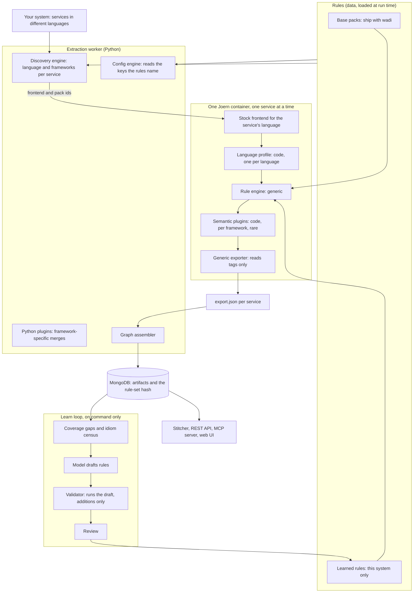

# Rule packs and learned rules plan

**Status:** proposal, not a decision record. Compiled 2026-11-13 against commit `118eb91`
(wadi 0.8.2, Joern 4.0.593). Nothing in this document is built.

**Read with the direction record (added 2026-11-18).** `architecture.md` §11 now holds a direction
record and a build order of eleven steps. Where this plan differs from
`target-architecture-plan.md`, that plan governs. The rest of this document is unchanged. This
plan is the inside of step 7 of the build order, and section 8 of the target plan lists what the
later discussion added to it. Four of its decisions have moved.

- **D4, timing against the paper, is settled.** No outside date drives the order.
- **D7 is open and contested.** T5 of the target plan recommends that a model writes rules only.
  D7 recommends keeping W8's verified one-off facts. The owner decides before step 8.
- **D3 has a working assumption.** T7 of the target plan assumes a capable agent for auditing and
  rule drafting and keeps W8's packets for work on one gap. It is still open.
- **D6 has a third candidate.** T13 of the target plan asks whether Express or Django joins
  Quarkus and FastAPI in stage 1.

The gate experiment of the target plan must report before step 7 starts. The open decisions of
section 11 move to GitHub issues with the `decision` label, in place of the `TODOS.md` lines the
paragraph below mentions. A decision record in `architecture.md` closes each one.

**Purpose.** Wadi supports one stack today: Java, Spring and Maven. This document records how
wadi could support many languages and frameworks, and how each analyzed system could extend the
rules for its own conventions, with a model drafting those extensions. It exists so the work can
be split into stages and picked up again later without repeating the analysis.

**What this is not.** It changes nothing in `architecture.md`. Each accepted stage gets a decision
record in that document first, per the standing rule, and a `TODOS.md` line.

**Companion document.** `foundation-hardening-plan.md` already covers part of this ground. Its W0
(ground truth and scorer), G9 (an unsupported stack yields a successful, empty snapshot), section 3
(the idiom census) and W8 (the hybrid extraction layer) are prerequisites or neighbours of the
stages here. Section 9 lists where this plan agrees with W8 and where it differs.

**How to read the evidence.** "Measured" means a command was run on 2026-11-13. "Read" means the
code or document was opened. "Unverified" means the statement comes from general knowledge of the
tools and was not tested.

---

## 1. The problem and its measured size

The starting worry was that adding languages and frameworks would grow the Joern container until
it is unusable. The measurements say the container is not the constraint.

| What | Size | Evidence |
|---|---|---|
| Joern image `ghcr.io/wadi-sh/joern:0.8.1` | 4.49 GB | Measured |
| Stock Joern install inside it | 1.9 GB | Measured |
| The 14 language frontends stock Joern ships | 1.7 GB of that | Measured |
| `wadi-joern-platform.jar`, all Spring and Java support | 11 MB | Measured |

The frontends present are Java, Kotlin, Python, JavaScript, Go, C#, PHP, Ruby, Rust, Swift, C,
ABAP, JVM bytecode and binaries. The 10g memory limit in `infra/docker-compose.yml` is sized for
the largest single service, because services are imported one at a time. Neither disk nor memory
grows with the number of supported frameworks.

What does block growth:

- **Cost per framework.** Spring took 3,563 Spring-specific and 3,654 Java-specific lines of
  Scala, more than 1,700 lines of Python, and six rounds of fidelity fixes. §5.1 assumed "tens of
  declarative lines per framework".
- **Wiring.** `WadiPipeline.run` applies the Spring passes to every graph
  (`joern-platform/src/main/scala/wadi/WadiPipeline.scala:36-40`). The client hard-codes
  `importCode.java` (`libs/wadi-joern-client/src/wadi_joern_client/client.py:127`). Discovery
  reads Maven only and hard-codes `languages=["java"]`
  (`services/extraction-worker/src/wadi_worker/boundary.py:122`).
- **Release coupling.** A one-line fix to a pass ships as a new Joern image. An outside
  contributor has to edit the core jar.
- **Every codebase has its own conventions.** ICPC declared its authorization in eight
  annotations of its own, and reading them took a Scala change and a release (§5.2.12). No fixed
  set of rules covers what the next codebase invents.

What already helps: the exporter finds endpoints, sinks, models and auth by tag name
(`WadiExport.scala:95-189`), so "a rule writes tags, a generic exporter reads tags" is half in
place. The hardening plan's W8 measured the same thing from the other side and puts about 60% of
wadi as framework-neutral already.

## 2. Status of each idea

| Idea | Status on 2026-11-13 |
|---|---|
| A model's job is to learn a codebase's patterns and write rules. It does not read the code on every analysis. | Decided by the owner |
| Every rule a model writes is stored, so reruns give the same answer | Decided by the owner |
| A base rule set per framework that each system can extend | Owner's direction, format undecided |
| The model can be a provider API key, a local model, or a headless coding agent | Owner's direction. §5.6 already covers the first two. |
| One Joern container, with frameworks as data files | Recommended, not confirmed |
| Joern only for now, with no second parser | Recommended, not confirmed |
| Where learned rules live, and whether a drafted rule applies before approval | Open, section 11 |
| Whether any of this starts before the paper | Open, section 11. W8 says its own part does not. |

## 3. Target architecture

Two modes that never mix. Analysis replays stored rules and runs no model. Learning runs a model
only on command, and its only output is new rules.



The work splits into three layers that grow at different rates.

| Layer | Form | How many | Holds |
|---|---|---|---|
| Language profile | Scala code in the jar | Five to eight | Which frontend to import with, how calls resolve, how control flow and type shapes export, how URL strings evaluate |
| Framework rules | Data files, loaded at run time | Many | What marks an endpoint, where the verb and path are, which calls are HTTP, database or queue sinks, which types are models, which files are build roots and config |
| Semantic plugins | Code attached to a pack | Rare | Authorization models and dependency injection, only for frameworks where that depth matters. Spring Security stays here. |

The Python worker and the stitcher get the same split. A generic engine reads the pack's discovery
and config rules, and the hard cases plug in as code.

This gives two support levels. A rules-only framework publishes routes and sinks and marks
authorization as not read, which the contracts can already express (P10). Spring stays at full
depth.

## 4. Rules

### Three scopes, one format

1. **Base packs** ship with wadi, one folder per framework: a rule file, a fixture and the
   expected output (P8).
2. **Learned rules** belong to one analyzed system. They sit on top of the base packs and cover
   that codebase's own conventions.
3. **Hints** are single corrections to one site, as §11 Phase 4 already plans.

A pattern that repeats becomes a learned rule. An answer about one site becomes a hint.

### What a learned rule covers

- The codebase's own authorization annotations. ICPC's eight are the test case.
- A wrapper around the HTTP client, such as `ApiClient.call(service, path)`, which hides the URL
  from the slicer. The rule says which argument is the service and which is the path.
- A custom response envelope. The rule names the wrapper type and the field that holds the payload.
- The codebase's own config keys for service addresses.

When a pattern needs logic a rule cannot express, the gap stays open and is published as unknown.

### Illustration

The format is not designed. This shows the kind of content only.

```yaml
id: icpc/contest-manager-guard
scope: system
origin: llm-drafted
approved_by: null
match:
  annotation: ContestManager
emit:
  tag: auth
  effect: require-relationship
  relationship: manage-contest
```

### Provenance

Every fact records the id of the rule that produced it. Every rule records its origin (built in,
written by a person, or drafted by a model), its author, its creation time with timezone, and the
gaps it was drafted from.

## 5. Analyze mode: what makes reruns match

Storing rules is necessary and not sufficient.

- **No model runs during an ordinary analysis.** Otherwise the same commit could give two answers
  depending on whether a rule appeared in between.
- **Each snapshot records the rule set it used**, as a hash over every rule applied, together with
  the wadi, pack and Joern versions. "Same commit, same rules, same output" can then be checked.
  Artifacts carry no build identity today.
- **Rules match on structure, not position.** A rule names an annotation, a type or a call shape.
  It never names a file and line, which would break on the next commit.
- **A rule that stops matching is flagged stale.** It is not redrafted silently.

## 6. Learn mode

1. **Input.** The coverage report's gaps, plus the idiom census from the hardening plan's
   section 3. The census matters because a construct the base rules never matched appears in no
   gap list.
2. **Draft.** A model reads the gaps and the source around them and drafts rules.
3. **Validate.** The engine runs each draft. The validator checks that:
   - the rule parses and runs;
   - every match has a source location a person can open;
   - the rule only adds facts and never changes or removes what a base rule produced;
   - the change is reported as a list of facts, not as a count.
4. **Review.** A person accepts or rejects. Rejections are remembered, as §5.6 point 4 already
   requires for proposals.
5. **Store.** Accepted rules join the system's learned rules, and the next analysis uses them.

One constraint shapes step 3. The code graph is discarded after extraction (P2), so the validator
cannot run later against stored artifacts. Validation has to run inside an extraction, as a dry
run with the draft rules loaded, and compare the export with and without them.

### How the model is connected

| Option | Fits | Cost |
|---|---|---|
| Evidence packets, one turn, no tools (W8) | Small and local models. The packet hash is a cache key and an audit record. | The `llm-resolver` service has to exist. |
| Headless coding agent through the MCP server | Cold start on an unfamiliar codebase, where the model has to explore | A few new MCP tools and a write path through the orchestrator. Depends on a capable model. |
| Provider API key or compatible endpoint | Either of the above | Source snippets leave the machine, so it is opt-in (§5.6 point 5) |
| A model bundled in a wadi image | Nothing | Several GB of weights plus inference memory beside Joern's 10 GB. §5.6 already rejects it. |

Whichever is chosen, the output is the same artifact: a rule proposal that passes the same
validator. No model has been selected. That needs a comparison on this task, which needs W0's
scorer.

## 7. Services in different languages

What already works by design:

- Analysis is per service. The export is one file per service and language.
- Joern takes one service at a time, so a mixed system needs no extra memory.
- The stitcher matches a call's URL and verb to an endpoint's path and verb from stored
  artifacts. It never reads source, so a Python caller and a Java endpoint match the same way.

What needs work:

- **Discovery.** It hard-codes Java and Maven. This is the hardening plan's G9.
- **Contract values.** Method signatures and the `annotation|jsr250` auth tag assume Java.
- **Service naming.** One source is `spring.application.name`. Compose hostnames are already
  neutral.
- **Two languages inside one service.** Calls between them will not be linked and must be
  published as unknown.
- **gRPC and message queues.** They match on service or topic names. Each needs its own pack and
  stitcher rule, as §10 describes.

## 8. Joern only, for now

Tree-sitter is not a backup for Joern. It produces a syntax tree. It gives no control flow, no
call resolution and no types, and the per-endpoint control-flow graph is the product's main claim
(unverified against a test, but this is how the two tools are documented). A second engine would
also need a second rule dialect and would sit outside every validation layer.

Two different problems need two different answers:

| Problem | Answer |
|---|---|
| Joern has no frontend for a language | The service stays an honest placeholder, as the stitcher does today. A syntax-only tier that lists routes and calls without flow is possible later. |
| A Joern frontend exists but is weak | Fix it upstream (P5) or evaluate Fraunhofer CPG, as §11 Phase 8 already says |

Three cheap steps keep a second engine possible:

1. `export.json` stays the only way out of the Joern layer.
2. Joern's node ids stop being used as graph node ids outside that layer.
3. Each service records an extraction level, such as full flow, routes and calls only, or not
   analyzed, so a lower tier cannot be mistaken for a full analysis.

Revisit when a real target system has a service with no Joern frontend, or when the Python probe
shows the frontend cannot produce usable control flow.

## 9. How this relates to W8

W8 was written first and was read only after most of this plan had been discussed. The two agree
on the main points and differ in three.

**Agreements.** The coverage report is the work queue. The model never does control flow,
reachability or matching. Nothing a model produces is published unchecked. A confirmed pattern
becomes a permanent rule, so the model is paid once per idiom. G9 and W0's scorer come first.

**Differences.**

| Topic | W8 | This plan | Reconciliation |
|---|---|---|---|
| What the model produces | Verified facts per gap (Tier 1), with promotion to a rule as the last step | Rules as the main output | Compatible. A repeating pattern becomes a rule. A one-off site stays a W8 proposal and can become a hint. |
| How the model is driven | One turn per evidence packet. The multi-turn agent shape is deliberately excluded, on small-model accuracy figures. | A coding agent was recommended first | Open, section 11. W8's argument is strongest for per-gap facts on small models. Rule drafting is rare and its output is frozen once stored, which weakens the caching argument there. |
| Unapproved authorization knowledge | Enters as Tier 2 evidence, which can only move an endpoint to withheld | "Authorization rules wait for approval" | Use W8's mechanism. An unapproved authorization rule acts as Tier 2 evidence. Approval lets it assert. |

**Timing.** W8 is gated behind the paper and three experiments. Stages 1 to 5 below contain no
model and are not what W8 gated, but they would compete with W0 to W7 for the same time.

## 10. Stages

Each stage is usable without the ones after it. If a model turns out to draft poor rules, stages
1 to 5 still leave a system people can extend by hand.

### Stage 0. Evidence base

Owned by `foundation-hardening-plan.md`. Listed here because every later stage is measured with it.

- [ ] W0: committed ground truth and a scorer
- [ ] G9: an unsupported stack no longer yields a successful, empty snapshot

### Stage 1. Two probes

Throwaway code, routes and sinks only. The aim is to learn what a rule format must express before
designing one from Spring alone.

- [ ] A second Java framework. Quarkus with JAX-RS is the candidate, since W8's experiment E2
      already names it. This shows what in the current code is Spring-specific.
- [ ] FastAPI on the Python frontend. This shows what is Java-specific and answers Phase 8's gate
      on frontend quality.
- [ ] Record lines needed per framework, and a first draft of the rule format

### Stage 2. Rule engine and base packs

- [ ] Decision record in `architecture.md` (P5 wording, §5.1, §10)
- [ ] Rule format, version 1
- [ ] Generic rule engine in the jar, loading packs from a mounted directory at run time
- [ ] The worker selects packs per service and passes their ids to the pipeline
- [ ] Java language profile separated from the exporter
- [ ] Spring routes, sinks and models as a base pack. Spring Security and injection stay plugins.
- [ ] Exit check: every existing Spring fixture and golden is unchanged
- [ ] The two probes become packs

### Stage 3. Reproducibility stamps

- [ ] Rule id on every tag and fact
- [ ] Rule-set hash and wadi, pack and Joern versions on every snapshot
- [ ] A test that re-analyzes one commit twice and compares the results

### Stage 4. Learned rules, written by hand

- [ ] Storage, per decision D1
- [ ] Precedence between base packs, learned rules and hints
- [ ] Stale-rule detection
- [ ] Exit check: ICPC's eight authorization annotations are read through learned rules alone

### Stage 5. Census, validator and review

- [ ] Idiom census as a gap source (hardening plan section 3)
- [ ] Validator as a dry run inside extraction, comparing exports with and without the draft
- [ ] Additions-only check
- [ ] Review through the CLI first, then the UI
- [ ] Unapproved authorization rules act as Tier 2 evidence

### Stage 6. A model drafts the rules

W8's gate applies: its experiments E1 to E3 pass first.

- [ ] Driver, per decision D3
- [ ] Provider configuration as §5.6 point 5 specifies
- [ ] Measure drafted rules against hand-written ones with W0's scorer

### Stage 7. A second language end to end

Needs stage 2 and G9. Can run beside stages 3 to 5.

- [ ] Discovery for one more ecosystem
- [ ] Language-neutral contract values, and the extraction level field
- [ ] A fixture system with services in two languages that call each other
- [ ] Exit check: the stitcher links them with no language-specific code

### Parked

- A syntax-only tier for languages Joern lacks
- One Joern image per language. Worth it only once dependency resolution needs language toolchains.
- The local-model compose profile from §5.6
- gRPC and message-queue packs
- Removing unused frontends from the image, which would save about 1.6 GB (not tried)

## 11. Open decisions for the owner

1. **D1. Where learned rules live.**
   - wadi's database: simplest to build, tied to one install, lost if the database is wiped.
   - A file under `.wadi/` in the analyzed repo: versioned and reviewed with the code, but a person
     has to commit it, because wadi cannot write to analyzed repos.
   - Both, with the committed file winning: one sync rule to build and test. This matches what §11
     plans for hints. Recommended.
2. **D2. Whether a drafted rule applies before approval.** Recommended: non-authorization rules
   apply at once and are marked unreviewed in every reader. Authorization rules act as Tier 2
   evidence until a person approves them. The cost is that REST, MCP and the UI must all show the
   mark.
3. **D3. How the model is driven.** Evidence packets as W8 specifies, a coding agent through MCP,
   or both behind one proposal contract. Packets cost the `llm-resolver` service and work with
   small models. An agent costs a few MCP tools and depends on a capable model.
4. **D4. Timing against the paper.** Whether stages 1 to 5 start before the paper. Stage 1 is
   small and would give the paper a measured cost per framework. Stages 2 to 5 are a large change
   to the layer the paper's numbers come from.
5. **D5. The real target.** Hundreds of frameworks, or three to five that serve the research.
6. **D6. First probe targets.** Quarkus and FastAPI are proposed. Express is the alternative W8's
   question 11 raises.
7. **D7. Whether W8's verified one-off facts stay beside learned rules.** Recommended: yes, through
   the §5.6 proposal and hint path.

## 12. Risks and what is unverified

- Whether one rule format can express real frameworks. Everything after stage 1 depends on it.
- The quality of every non-Java Joern frontend. None has been run through wadi.
- How well a model drafts rules. W8's prediction on record is that a small model fails the hardest
  ICPC case.
- Loading compiled plugin code at run time in Joern's server mode. Until that is shown, Scala
  plugins ship in the jar.
- The prior art for rules as data (CodeQL models-as-data, Semgrep rules, Privado rule packs) is
  cited from general knowledge.
- The hardening plan calls the reachability and assembly logic language-neutral. `WadiExport.scala`
  holds 40 Java-specific literals. Both can be true, and stage 1 will show how much moves.

## 13. Rejected alternatives

- **A container per framework.** A pass has to run in the JVM that holds the code graph. Separate
  containers would build the graph several times or ship multi-gigabyte graphs between them.
- **A pack registry only, with packs still compiled Scala.** It fixes the wiring and leaves the
  cost per framework and the release coupling. It is the first part of stage 2 anyway.
- **A model that extracts facts on every analysis.** Reruns could disagree, cost would follow
  codebase size, and published numbers would depend on a model version (P7).
- **Leaving Joern for a syntax-only parser.** It loses the control-flow graph.
- **A model bundled in the image.** §5.6 already rejects it on footprint.

## 14. What an accepted plan would change in `architecture.md`

- P5: "compiled into a jar and baked into the image" no longer holds for framework rules.
- §5.1: packs become data, with code only in language profiles and plugins.
- §5.6: the learn loop, as a sub-section, which is what W8's question 10 proposes.
- §7: rule provenance on facts, the rule-set hash on snapshots, and the extraction level.
- §9: where pack folders live in the repository.
- §10: the "add a framework" and "add a language" playbooks, which the code does not follow today.
- §11: Phases 7 and 8 reordered around the stages above.
