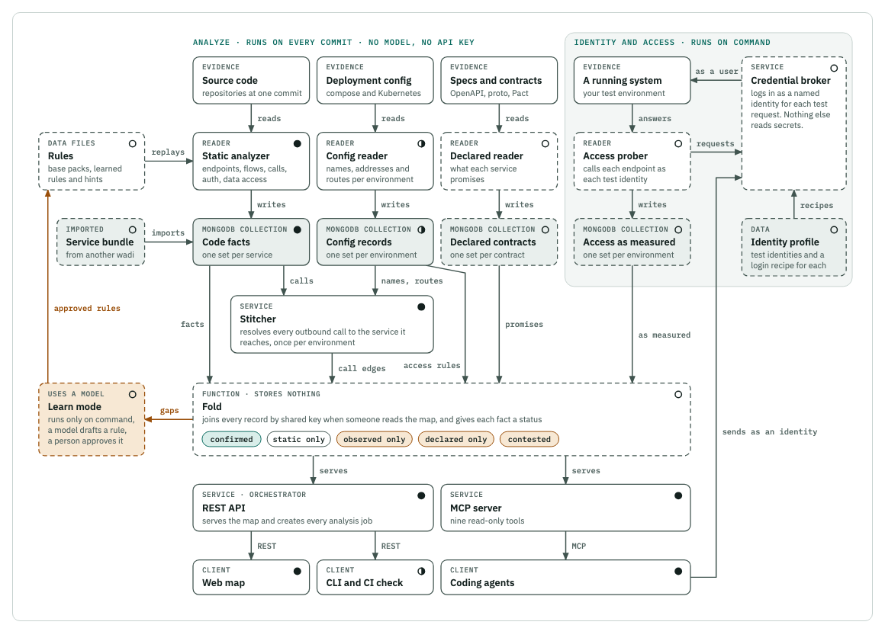
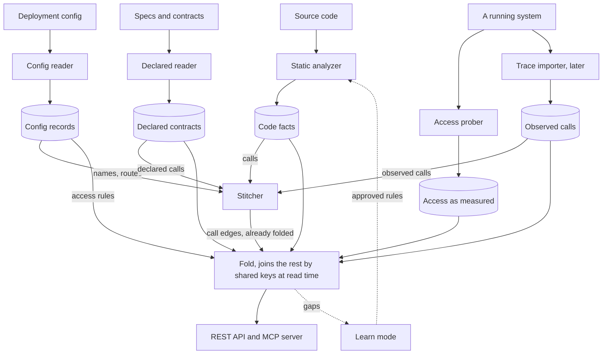
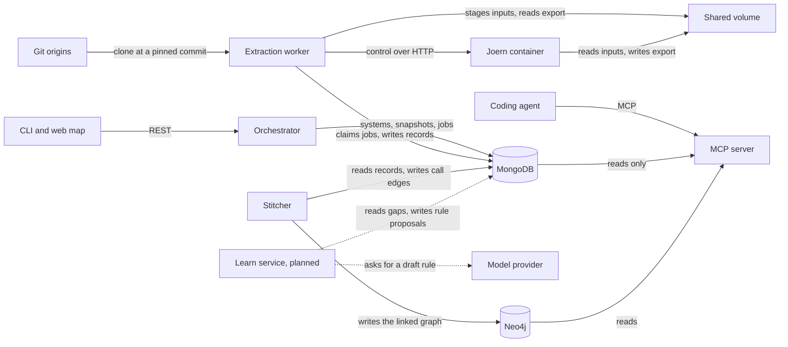
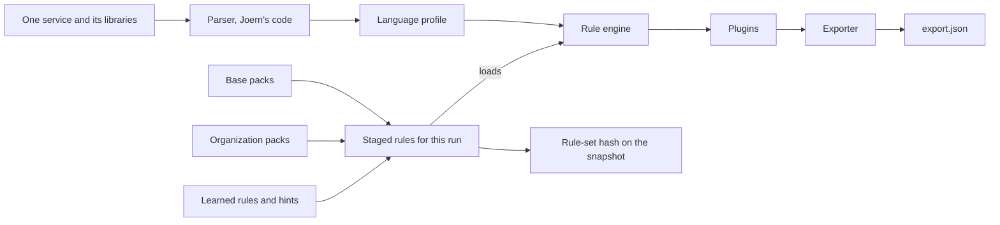

# Target architecture plan: many sources, one map

**Status:** proposal, not a decision record. Compiled 2026-11-17 against commit `f838045`
(wadi 0.9.0). Nothing in this document is built unless a section says so. Revised the same day
after a review by three models. Section 21 lists what changed.

**Accepted as the direction on 2026-11-18.** `architecture.md` §11 holds the direction record. It
accepts the four rules of section 4.1 and the build order of section 15, and it fixes how the
migration runs. It fixes no record shape: each step opens with its own decision record. Where
this plan and the five other plan documents differ, this plan governs. From that date only the
status table of section 2 is kept current. The open decisions of section 16 move to GitHub
issues with the `decision` label, and a decision record in `architecture.md` closes each one.

**Purpose.** Wadi 0.9.0 builds its map of a microservice system from source code. A design
discussion that ended on 2026-11-17 worked out how wadi could read several kinds of evidence about
one system, keep each kind in its own records, and join them into one map that says which sources
back each fact. This document records that design with the reasoning and the evidence behind it,
so the owner and later engineers or agents can pick the work up without repeating the analysis.

**What this is not.** It changes nothing in `architecture.md`. Each accepted part gets a decision
record in that document first, per the standing rule, and a GitHub issue. It also does not
repeat its two sibling plans. For export, import and the hub, and for identity and access, it
gives one short section and a link.

**Related documents.**

- `rule-packs-and-learned-rules-plan.md` covers language profiles, rule packs and learn mode. This
  plan keeps it as written, and it becomes the inside of the static analyzer. Section 8 lists what
  the discussion added to it.
- `contract-triangulation-plan.md` covers published and assumed contracts. Its package C5 is the
  starting point of the declared reader in section 6.3.
- `foundation-hardening-plan.md` owns the scorer and ground truth (W0), finding G9 and the hybrid
  extraction layer (W8). Step 1 of the build order is its W0.
- `bundle-import-and-hub-plan.md`, written on the same day, covers export, import and the hub.
  Section 11 summarizes it.
- `identity-and-access-plan.md`, written on the same day, covers authentication and
  authorization, test identities, the credential broker and the access prober. Section 12
  summarizes it.
- `architecture.md` is the decision record. A bare `§N` in this document means a section of it.

**Where the picture is.** The architecture page is the latest consolidated statement of the
design, and this document is its written form.

- Page source: `docs/designs/target-architecture-page.html`
- Published page: https://claude.ai/artifact/AvjQASWRX8YVTHUH6QV6Kj (the owner shares it with
  anyone who has the link)
- Render of its main figure: `docs/designs/target-architecture-main-figure.png`, shown below
- The page was last changed on 2026-11-17. It does not show the acceptance of 2026-11-18, so it
  still calls the build order suggested and lists the rules of section 4.1 as proposed.

Each column of the figure is one kind of evidence with its own reader and its own records. The
stitcher links services, and the fold joins all records when the map is read. A filled dot means
built, a half dot means partly built and an empty dot means planned. The amber path through learn
mode is the only place a model runs.

**How to read the evidence.** "Read" means the code or document in this repository was opened,
and the claim carries a `path:line` reference that was checked against commit `f838045`.
"Measured" means a command was run during the session or while this document was compiled.
"Opened" means a research agent opened the outside source during the session. Most pages came
through a fetch tool that returns an extract, so quoted phrases are as that tool returned them.
"Abstract only", "recalled" (from memory, not opened), "preprint" (arXiv is the only venue the
report names) and "vendor claim" are the research reports' own markers. "Unverified" means nobody
checked. The main session did not open the outside sources again, and the writer of this document
opened none.

---

## 1. The product goal

Each team owns one service, and coding agents now write most of the code. An agent that sees one
service cannot know what the other services do. Wadi's goal is a hub that every service pushes
its analysis into, so that an agent on any team understands the whole system. The owner described
the hub as the "brain" of the product.

Accuracy comes first. Test generation, coverage per endpoint and root-cause analysis all build on
the map, so a wrong or missing fact in the map becomes a wrong test or a wrong diagnosis. In the
owner's words, the few points the analyzer misses are where the product "will shine or die".

This extends two goals that `architecture.md` already records. Goal 6 is an interface that coding
agents query for ground truth. Goal 10 is a map that a developer reads in place of the code.

## 2. Status of each idea

| Idea | Status on 2026-11-17 | Where to read more |
|---|---|---|
| Static analyzer for Java and Spring: endpoints, flow graphs, outbound calls, authorization, data access | Built (0.9.0) | §5.1, §5.2 |
| Stitcher for HTTP calls, the coverage report and the Neo4j graph | Built | §5.4 |
| Orchestrator, REST API, CLI and web map | Built | §5.3, §15 |
| MCP server with nine read-only tools | Built | §8, `services/mcp-server/src/wadi_mcp/server.py:42-147` |
| MongoDB as the source of truth and Neo4j as a derived graph | Built | §6 |
| Export of a whole snapshot | Built | §14 |
| Reading compose files and Spring config | Built, inside the static analyzer's boundary scan | Section 6.2 |
| Hints per system and a committed `.wadi/hints.yml` | Recorded in `architecture.md`, not built | `architecture.md:1454-1460` |
| The `llm-resolver` service and `llm-guessed` edges | Recorded in `architecture.md`, not built. Section 3 proposes a change. | §5.6 |
| Service bundles as a kind of source, the hub's ingestion API, snapshots made of service bundles, ownership by team | Recorded in `architecture.md`, not built | Phase 11, `architecture.md:1442-1446` and `:1468-1469` |
| Evidence from outside wadi with an `observed-at-runtime` provenance | Recorded in `architecture.md` as unscheduled | `architecture.md` §11, "Unscheduled / speculative" |
| Kubernetes manifests as an identity source | Recorded in `architecture.md` as demand-triggered | `architecture.md:925` |
| A layer of the config analyzer that reads infrastructure-as-code files | Recorded in `architecture.md`, Phase 10 | `architecture.md` §11, Phase 10 and "Where the earlier phases went" |
| Language profiles, the rule engine, base packs, learned rules, learn mode and a rule-set hash on every snapshot | Planned in another plan document, with open decisions D1, D2, D5 and D6 | `rule-packs-and-learned-rules-plan.md` |
| Ingesting a provider's OpenAPI document (C5), provenance terms for declared and assumed contracts (M1), identity for a service known only from a spec (M5) | Planned in another plan document | `contract-triangulation-plan.md` |
| Scorer and ground truth (W0), G9, the idiom census, the hybrid extraction layer (W8) | The scorer and ground truth are approved as release 1c of the base migration on 2026-11-20 and are not built. A record of 2026-11-22, awaiting the owner, lets release 1c's decision record and the labeling of ground truth start before release 1a ships, while the scorer's code still waits for release 1b. A record of 2026-11-24, approved by the owner that day, starts the scorer's code when release 1d's record merges, with no score of a pinned corpus committed before the determinism gate, and makes the scorer, ground truth and the baseline tracks of release 1d. G9, the idiom census and W8 are planned in another plan document. | `architecture.md` §11, "The base migration", and `foundation-hardening-plan.md` |
| The four rules of section 4.1 and the build order of section 15 | Accepted as the direction on 2026-11-18. The build order was amended on 2026-11-20. Nothing is built. | `architecture.md` §11, "Direction and migration rules" |
| The base migration: the record model with the static analyzer as the only reader | Step 1 (four releases) and the shape spike approved on 2026-11-20. Release 1a's record, the canonical map, was approved on 2026-11-21, with the corpora pinned and 0.9.2 published. A record of 2026-11-22, awaiting the owner, lets the spike's three readers start now, keeps its import probe behind the determinism gate of release 1b, and moves A5 and #34 out of release 1d. A record of 2026-11-24, approved by the owner that day, has the tracks of step 1 built side by side, ships step 1 as three releases (1a, 1b and 1d), runs measurements on hosted runners and lets the spike's import probe start once B1 is on `master` and two analyses of `petstore-system` give equal maps. The other record shapes are provisional until the spike checkpoint. Not built. | `architecture.md` §11, "The base migration" and "Release 1a, the canonical map" |
| A model writes rules and never facts, which includes never a call edge | Accepted as rule 4 of the direction. Whether W8's verified one-off facts stay (T5 against D7) is open and decided before step 8. | Section 3 |
| The auditor inside learn mode, and the gate experiment | The gate experiment is approved on 2026-11-20 to run after release 1c of the base migration, and has not run. A record of 2026-11-24 has it scored after release 1d, which now holds the work of release 1c, while its agent runs may come earlier. The auditor is proposed in discussion only. | Sections 3 and 6.4, and `architecture.md` §11, "The base migration" |
| One collection per reader, and the fold | Accepted as rules 2 and 3 of the direction, which settles T1. The fold's shape is provisional item 6 of the base migration, decided at the spike checkpoint. Not built. | Section 4, and `architecture.md` §11, "The base migration" |
| The five statuses | Proposed in discussion only | Section 4.4 |
| Shared keys that any source can compute, and scope with the environment in it | Proposed in discussion only | Section 4.5 |
| Config reader for Kubernetes, Helm, ingress and nginx | Proposed in discussion only | Section 6.2 |
| Declared reader beyond OpenAPI: more formats, four reading routes, document coverage | Proposed in discussion only, as a widening of C5 | Section 6.3 |
| Trace importer | Proposed in discussion only, marked later | Section 6.5 |
| One rule pack per library, three route shapes, a third probe | Proposed in discussion only, as additions to the rule-packs plan | Section 8 |
| Base packs shipped in the worker image and staged for each run | Proposed in discussion only | Section 8 |
| Organization packs | Proposed in discussion only | Section 8 |
| Export per service, the import job and the publish command | Proposed in discussion only | `bundle-import-and-hub-plan.md` |
| Identity profile, credential broker, access prober and access table, with one access-rule record per place a rule lives | Proposed in discussion only | `identity-and-access-plan.md` |
| An `impact` tool and an agent A/B test | Proposed in the review the owner pasted in | Section 13 |
| Image size and the 10 GB memory limit stay as they are | Decided by the owner on 2026-11-17 | Section 9 |

## 3. Models write rules, the static analyzer writes facts

### The question and the verdict

The owner asked for an unbiased, researched opinion on one decision. Wadi can publish a map from
static analysis first and let a model fill the gaps, or a model can drive the analysis. Three
research agents gathered evidence under neutral briefs (reports 01 to 03 of the session).

The verdict, from item 015 of the session, keeps the static analyzer as the only writer of facts
in the map. Wadi does not move to a model-driven core. The rule-packs plan as drawn still leaves
one hole. Its model only looks where the analyzer already admits a gap, so it cannot see a fact
that is wrong or silently missing. The answer is a second, independent reading of the code by a
model, called the auditor (section 6.4). Every disagreement between the two readings goes into
the work queue.

The architecture page states the result as its fourth rule. A model writes rules, never facts.

### Evidence by kind of fact

| Kind of fact | Stronger reader | Evidence | How sure |
|---|---|---|---|
| Local to one handler: what is an endpoint, what it accepts and returns | Model | Agents recovering OpenAPI specs scored average F1 98.8 on endpoints and 97.0 on responses, against 57.3 and 26.6 for static baselines. On one Spring project the response scores were 98.6 against 6.9. The study used 12 APIs, single runs and GPT-5 mini (Chen 2026). | Opened, preprint |
| Types | Model | gpt-4o matched 806 of 860 types, HeaderGen 563 (Venkatesh, EMSE 2025) | Opened |
| Call graphs | Static | PyCG had 569 of 599 exact matches, the best model 518 (same study) | Opened |
| Listing every source of a flow | Static | Gemini 2.5 Pro scored F1 91.74 when it classified a dependency, and 50.25 exact match when it listed all sources. For information flow it scored 26.73 (CoRe, NeurIPS 2025). | Opened |
| Architecture across services | Static | An agent rebuilding 17 Java microservice systems reached mean F1 0.604 with GPT-4o (Liljas, ESEM 2026). The best static tool reached F1 0.86, with precision 0.93 and recall 0.80 (Code2DFD in Schneider's comparison). | Opened. Report 01 read the Liljas paper and says it used the same 17 systems. Report 02 read its abstract only and marks that as unverified. |
| Anything that must repeat | Static | Three identical agent runs returned 3, 6 and 11 findings (Semgrep 2025). With a fixed seed, five models showed accuracy variations up to 15% over 10 runs (Atil). Raw o3 found a known kernel bug in 8 of 100 runs (Heelan 2025). | Opened |

Two of wadi's own documents record the same split. `benchmarking-baselines.md:350` lists 0%
precision and 0% recall for three frontier models on cross-service structural facts
(arXiv 2606.26927), and `foundation-hardening-plan.md:1402` keeps control flow, reachability and
cross-service matching symbolic for that reason.

### Static analysis has measured holes, and it does not know where they are

- Median Java call-graph recall is 0.884, and 0.935 with support for dynamic features (Sui,
  ICSE 2020, abstract only).
- Against a purpose-built dynamic baseline, class-hierarchy analysis reached 81.1 to 93.1% recall
  at 0.9% precision or less, and 0-CFA reached 58.2% and 30.0% recall in two frameworks at 21.6%
  precision (Helm, ISSTA 2024, opened).
- Without framework modelling, Doop averaged 14.48% in-app coverage on enterprise applications.
  JackEE's modelling reached 58.04% (Antoniadis, PLDI 2020, opened).
- Modelling Spring injection and AOP raised application call edges from 3,140 to 13,114 in one
  project and from 1,168 to 2,896 in another. Up to 23.77% of the added edges were spurious
  (Jasmine, ASE 2022, opened).
- Seven Java security scanners together left 70.9% of real vulnerabilities undetected (Li,
  ESEC/FSE 2023, abstract).
- Joern rates its own Java frontend "Very High", JavaScript and Python "High", Kotlin and Go
  "Medium", with no stated criteria (Joern documentation, opened 2026-11-16). Report 01 found no
  independent measurement of Joern's call-graph recall or type recovery for any frontend.

Report 01 lists what reduces silent error in the literature. The list is framework models, a
dynamic second source, independent tools combined, and declared unsoundness that is measured per
feature.

### Three findings that decide the design

1. **Independent readers catch each other.** In Schneider's comparison the union of two tools
   lifted connection recall to 0.97 at precision 0.48. Their intersection gave precision 1.00 at
   recall 0.72. The best four-tool combination reached F1 0.91 (opened). Agreement between
   independent readers is a usable confidence tier. Wadi already works this way by hand, with its
   oracles and the 40-endpoint blind check.
2. **A wrong fact costs more than a missing one.** Models adopt incorrect retrieved content over
   60% of the time (ClashEval, opened). Agents followed a stale instruction file in 90.1% of
   choices. Claude Code flagged the conflict in 79 of 80 runs and still followed the file (Xu and
   Wu 2026, opened, preprint).
3. **The map helps most where the agent cannot read the code.** With the code on disk, graph
   context adds about 2 to 8 points of resolve rate (RepoGraph, LocAgent and Bhola, opened), and
   the gain shrinks as models grow (Bellam, abstract only). With source removed and tools added,
   a vendor benchmark saw Precision@5 go from 0.007 to 0.471 on its organization-scale suite
   (Sourcegraph, vendor claim). A statically derived dependency graph added 17.1 line and 34.2
   branch coverage points to test generation, in an ablation with no model-only baseline (SAINT,
   ICSE 2026, opened). Context files written by a model did not help. Success fell 0.5% and 2%,
   neither significant, and cost rose 20% and 23% (Gloaguen 2026, opened, preprint).

The third finding is the argument against a map written by a model. The consuming agent could
have produced that map itself, and it would then trust its errors.

### Designs where the model writes the rule and an engine runs it

Report 02 found the pattern this plan uses in published tools. In IRIS the model labels taint
sources and sinks and CodeQL does the dataflow, and it detected 55 of 120 against CodeQL's 27
(opened, preprint). In MoCQ the model writes Joern and CodeQL queries and a symbolic validator
corrects them, with recall 0.79 and precision 0.39, against 0.44 and 0.11 for a model that reads
the code alone (opened, preprint). In RepoAudit, false positives rose from 11 to 31 without the
validators (opened, preprint). An independent re-test lowers these headlines. On live projects,
false discovery was 97.0% for RepoAudit, 94.4% for IRIS and 85.3% for CodeQL (Li F. 2026, opened,
preprint).

### The case for a model-first design, and what would change the verdict

The case is real. Execution-prediction accuracy went from 75% for GPT-4 in 2024 to 95.93% for
Claude Sonnet 4.6 in 2026 (CodeMind and CRUXEval, opened). Frontier agents with ordinary tools
validated more than 500 high-severity vulnerabilities (vendor claim). On handler-level contracts,
agents already beat static tools.

Those wins are on local facts, or on tasks where a find counts and a miss costs nothing. Wadi
claims completeness per endpoint, where the miss is the defect. Report 02 found no study that
compares a 2026 frontier agent with a code property graph on interprocedural control flow,
cross-service calls or authorization. The call-graph and microservice results used 2024 models.

The owner can settle this with wadi's own ground truth. This is the gate experiment.

- A frontier agent rebuilds the map for about 40 sampled train-ticket and ICPC endpoints from
  source alone, five runs each.
- The scorer measures completeness and run-to-run agreement.
- If the agent matches the analyzer on both, a model-first design deserves a serious look, and
  work on the readers, the rule engine and the auditor (steps 6 to 8 of section 15) stops until
  that is done. The service id and import do not depend on how facts are extracted, so steps 2
  and 3 go on.
- W0's scorer measures endpoint, authorization and call facts. Flow completeness needs its own
  gold set for the sampled endpoints, written by a person. Without it the experiment decides only
  the facts W0 scores.
- If it matches on local facts and fails on flow, which the literature predicts, this design
  stands. The same setup then becomes the auditor.

### What the verdict changes in the existing plans

- **Learn mode gets more inputs.** The rule-packs plan feeds it coverage gaps and the idiom
  census. Audit disagreements join them, and so do the three gap statuses of section 4.4.
- **A learned rule still only adds facts.** Learning therefore cannot correct a wrong base fact.
  An audit disagreement goes into learn mode's work queue and, once opened and judged an
  analyzer error, into the error count of the audit sample (section 6.4). It
  never changes the status of a fact, because the auditor is a model (P7) and identical audit
  runs disagree with each other. Only readers that run with no model can make a fact contested.
  The correction goes through the rule pack and its fixture.
- **The driver question (D3) gets an answer.** W8 rules out a multi-turn agent on small-model
  figures. That holds for one packet per gap. Auditing and rule drafting are rare and need
  exploration, so they use a capable agent. Both sit behind one proposal contract.
- **Model output never becomes a call edge directly.** §5.6 point 3 lets the stitcher use a
  model's guess as a low-trust edge. Here a model can only draft a rule, and the rule must pass
  the check. This is the rule-packs plan's open decision D7, and it needs the owner's call
  (section 16, T5).
- **A fourth gate experiment** joins W8's E1 to E3. It is the experiment above.

The design keeps the existing principles. With no API key the core runs as it does today, and
every fact then has one source (P7). The auditor writes its own collection (P4). The validator
must run inside an extraction because it needs the code graph, while the auditor reads source and
stored records and can run at any time after (P2).

## 4. Many sources, one map

A source is one kind of evidence about a system. A reader is the component that reads one source
and writes records.

### 4.1 Four rules

1. **One reader per kind of evidence.** Source code, deployment config, contracts and runtime
   data each get their own reader.
2. **Each reader keeps its own records.** A reader writes only to its own collection. Each run
   writes a new set of records, keyed by snapshot or by a reader run that the snapshot lists, and
   never deletes a set that a snapshot was built from. No reader edits what another one wrote.
   Snapshots stay immutable (`libs/wadi-contracts/src/wadi_contracts/system.py:50`,
   `docs/architecture.md:1105`).
3. **Records are joined when the map is read.** The join keeps every source's value and says how
   many sources agree. Wadi discards nothing at write time. Call edges are the one exception: the
   stitcher joins their sources when it writes the edge set, because Neo4j is built from that set
   (section 4.3).
4. **A model writes rules, never facts.** Analysis runs with no model and no API key. A model
   only drafts rules, and wadi tests them. Whether a draft applies before a person approves it is
   the rule-packs plan's open decision D2. Its recommendation applies a non-authorization draft at
   once, marked unreviewed in every reader, and keeps an authorization draft as evidence only
   until a person approves it.

The diagram below is the main figure in text form: each source, its reader, its records, the
stitcher and the fold.

### 4.2 Each reader and its records

| Source | Reader | Records | One set per | Written by | State |
|---|---|---|---|---|---|
| Source code at one commit | Static analyzer | Code facts | Service | Extraction worker | Built for Java and Spring |
| Deployment config | Config reader | Config records | Environment | Extraction worker, as its own job | Partly built. Compose and Spring config are read today and sit inside each service's boundary record. |
| Specs and contracts | Declared reader | Declared contracts | Contract | Extraction worker, as its own job | Planned |
| Source code, read again by a model | Auditor | Disagreements, never facts | Sampled endpoint | Learn service | Proposed |
| A running system, through exported trace files | Trace importer | Observed calls | Environment and time window | Its own job, fed by uploaded files | Later |
| A running system, through test requests | Access prober | Access as measured | Environment | Access prober | Proposed |

A service can also arrive as a service bundle that another wadi exported. An import job writes it
into the same code-fact collections, marked as imported (section 11).

### 4.3 The fold

The fold is a pure function in the contracts library. The REST API and the MCP server call it
each time someone reads the map. It joins all records by shared keys, keeps every source's value,
and gives each fact a status. It stores nothing. The contracts library already holds two functions
of this kind, the entity fold and `resolve_type_shape`.

Whether the fold is computed on every read or stored is open (section 16, T3). An earlier answer
in the session had the stitcher write a trust level into the coverage report. The later design
computes the status when the map is read.

Three of the nine MCP tools read Neo4j: `remote_edges`
(`services/mcp-server/src/wadi_mcp/service.py:582`), `endpoint_detail` for its outbound calls
(`service.py:445-452`), and `endpoint_icfg` with cross-service expansion. `find_flows` and
`mq_topology` are planned in §8 and would read it too. The stitcher writes Neo4j from the
service boundaries, endpoints and outbound calls, and its call relations come only from stitched
edges (`services/stitcher/src/wadi_stitcher/pipeline.py:132`). A fold that runs only at read
time would never reach those tools, and they would disagree with the REST API. Facts about edges
therefore fold when the stitcher writes the edge set and Neo4j. The read-time fold covers
statuses per endpoint and per field, with a limit on how many records one query reads.

### 4.4 The five statuses

| Status | Means | Example |
|---|---|---|
| confirmed | Two or more sources agree. | The code declares `GET /orders/{id}` and a trace shows it being called. |
| static only | Only the code shows it. This is not an error. | An endpoint that no test or trace has exercised. |
| observed only | Runtime data shows it and the code analysis does not. | A call made through a client wrapper the rules do not cover yet. |
| declared only | A spec or a deployment file states it and no code was found. | An OpenAPI path whose handler was removed, or an ingress route to no endpoint. |
| contested | Two sources give different values. | The spec marks a field as required and the code treats it as optional. |

Observed only, declared only and contested are the gaps that learn mode works on. Static only
never counts as wrong, because runtime evidence covers only what a workload exercised
(section 6.5). An earlier answer in the session used a four-level trust mark (confirmed, single
reader, contested, unread). The five statuses replace it.

Four rules keep the statuses honest (P10). They were added after the review of section 21.

- **Only independent sources confirm.** Each source says whether it is independent of the code.
  A spec that springfox generated from the same annotations is a check on wadi's reading, and
  its agreement does not make a fact confirmed. A fact that two readers took from the same file,
  such as a compose file that the analyzer and the config reader both read, counts as one
  source.
- **Each fact lists the readers that covered it.** "Static only" then separates three cases: no
  other reader ran, a reader ran and found nothing, and no reader can see that kind of fact.
- **Some pairs are not comparable.** Two sources from different builds, a join that matched two
  services, or a type the code side cannot represent give "not comparable" with its reason. That
  result is never counted as agreement or as conflict.
- **A withheld claim stays withheld.** An authorization claim that wadi withholds keeps that state
  beside any status. An observation can add to it and never replace it.
- **Contested wins.** When two comparable sources agree and a third disagrees, the fact is
  contested, not confirmed. A read that hit its record limit says so and never returns
  confirmed, because the record it did not read could disagree.

### 4.5 Shared keys and scope

Records from different readers join because each one carries keys that any source can compute.

| Key | Made from |
|---|---|
| Service | One canonical service id, plus every name the service runs under as a scoped alias |
| Endpoint | The canonical service, the verb and the route template |
| Method | Class, method, file and lines |
| Data | The table or collection name |
| Messaging | The topic and the consumer group |
| Identity | A test identity named in one system's identity profile, such as admin or customer, scoped to that profile's revision (planned, section 12) |

A name can match one service, several services or none. The join keeps each outcome: a match, an
ambiguous name with its candidates, or an unmatched name. It never picks one candidate. The phone
book already reports names that several services claim (`phonebook.py:128-143`). The canonical
service id is the one of the hardening plan's B2, which stops depending on a folder path.

Every record also carries a scope. The scope is the commit, the environment and, for runtime
data, the time window. Two records are compared only when their scopes are compatible: the same
build for line-level facts, and the same deployment and identity-profile revision for access. The
session placed the list of a system's environments with the orchestrator, which already owns
systems and snapshots. The environment sits on the snapshot first. It moves onto each record only
when one snapshot holds facts that differ by environment (T2).

### 4.6 What the code assumes today

An audit of the repository (report 04) found eight places where the model assumes that code is
the only source. They are listed with the largest change first. All references were checked.

| # | Assumption | Where |
|---|---|---|
| 1 | An edge needs a static call site | `StitchedEdge.remote_call_id` is required (`libs/wadi-contracts/src/wadi_contracts/stitching.py:68-71`), and Neo4j edges hang off `RemoteCall` nodes (`libs/wadi-storage/src/wadi_storage/graph.py:269-297`) |
| 2 | One source per edge | Provenance is one scalar (`stitching.py:92-97`), and a hint replaces the mechanism match instead of joining it (`services/stitcher/src/wadi_stitcher/matching/base.py:101-103`) |
| 3 | One writer owns the whole edge set | `replace_stitched_edges` deletes every edge of the snapshot (`libs/wadi-storage/src/wadi_storage/stitch.py:26-36`) |
| 4 | A snapshot is one commit set with no environment | `Snapshot` holds `system_id` and a `commits` map (`libs/wadi-contracts/src/wadi_contracts/system.py:49-63`), and every artifact index starts with `snapshot_id` (`libs/wadi-storage/src/wadi_storage/mongo.py:68-103`) |
| 5 | One merged environment per service | Profiles collapse into one dict where the last write wins (`services/extraction-worker/src/wadi_worker/appconfig.py:133-134`, `:214-215`) |
| 6 | Node and call-site ids depend on position or run | The flow-graph node id is built from Joern ids (`services/extraction-worker/src/wadi_worker/assembler.py:461`) that are "stable only within this export" (`libs/wadi-joern-client/src/wadi_joern_client/export.py:163`). The call-site id hashes file and line (`libs/wadi-contracts/src/wadi_contracts/ids.py:108-110`). |
| 7 | Discovery is Maven plus a root compose file, scanned per checkout. Library classification is the exception: it pools modules across every checkout of a system (§5.2.14). | `services/extraction-worker/src/wadi_worker/boundary.py:350-360`, `:121-122`, `:442-445` |
| 8 | Endpoint existence carries no provenance | `Endpoint` (`libs/wadi-contracts/src/wadi_contracts/endpoint.py:535`), `EndpointSummary` and `EndpointDetailView` (`views.py:278`, `:326`) have no provenance field |

More facts from the same audit shape the record changes.

- The service id is a hash of the normalized repository source and the build root
  (`ids.py:87-95`). It contains no service name. A local path is kept verbatim (`ids.py:78`), so
  the id depends on the machine. The hardening plan's finding B2 covers the last point.
- The endpoint id is a hash of the service id, the verb and `simplify_uri(uri)`
  (`ids.py:98-100`), so an outside source cannot recompute it without the `svc_` id.
  `simplify_uri` has no rule for `*`, `**`, `<id>` or concrete values (`ids.py:31-57`). The
  existing way from a concrete path to an endpoint is `PhoneBook.resolve` followed by
  `match_endpoints` (`services/stitcher/src/wadi_stitcher/matching/paths.py:135`).
- The method id needs the full signature (`ids.py:103-105`). Nothing is keyed by method or by
  source anchor, and flow graphs are keyed by snapshot and endpoint (`mongo.py:84-89`).
- The provenance enum has six values (`libs/wadi-contracts/src/wadi_contracts/enums.py:26-34`).
  The code writes only `machine-proven`, `config-resolved` and `heuristic`, all in
  `services/stitcher/src/wadi_stitcher/matching/http.py`.
- No fact carries an environment, an observation time or a sample count, and every model forbids
  extra fields (`libs/wadi-contracts/src/wadi_contracts/base.py:16`, `:29`).
- The snapshot id is random (`services/orchestrator/src/wadi_orchestrator/app.py:300-306`), and
  `JobType` has only fetch, extract and stitch (`enums.py:307-310`).
- The only list of evidence on any fact is `EndpointAuth.evidence`
  (`libs/wadi-contracts/src/wadi_contracts/endpoint.py:463`).

### 4.7 The record changes that every new reader depends on

These six changes cover six of the eight assumptions. The other two are Maven-only discovery,
which the rule-packs plan and G9 own, and the node ids that change between runs.

The review of section 21 found that landing all six at once makes one step too large, with no
second reader to test the shapes against. Each change now lands with the first step that needs
it. The canonical service id lands in step 1 of section 15, through B2 inside W0. The origin of
a record lands in step 2, just before import. Statuses and the sources list land on call edges
first, with the config reader. It is the first reader besides the static analyzer whose records
reach call edges.

1. **Keys an outside source can compute.** Each record stores the natural keys of section 4.5
   beside its hashed id. The service id stops depending on a folder path on one machine.
2. **Scope on every fact.** The environment becomes a named scope. It sits on the snapshot first,
   with one default environment.
3. **Records per reader.** One collection per reader, one writer each. Each run writes a new set,
   and each snapshot lists the sets it uses.
4. **Statuses that do not overclaim.** The five statuses of section 4.4.
5. **A sources list on call and endpoint views.** Today `RemoteEdgeItem` has one provenance value
   (`libs/wadi-contracts/src/wadi_contracts/views.py:63-64`), `EndpointDependency` has none
   (`views.py:138-140`), and the frontend renders one provenance chip
   (`frontend/components/endpoint/inspector-selection.tsx:55`).
6. **Record what runtime tools key on.** Section 6.5 lists the nine items.

The architecture page adds two items to this step for the identity module. Identity becomes a
shared key, and access rules are stored as one record per place a rule lives
(`identity-and-access-plan.md`).

The owner asked that dynamic analysis be easy to add later. With the six changes in place, adding
runtime evidence is one new job, one collection and one adapter that maps a trace to the shared
keys. The analyzer and the views do not change. The stitcher changes once: `StitchedEdge`
requires a static call site today (assumption 1 of section 4.6), so `remote_call_id` becomes
optional when the first observed call arrives (step 10). Until then the declared reader of step 8
confirms, contests or adds a destination to an edge that has a static call site, and a declared
call with none stays a declared-only record that makes no edge.

### 4.8 What each source cannot do

- **Config finds few services or calls by itself.** Two tools that take their service list from
  deployment files found 76% and 56% of components, against 98% for the best tool that reads code
  and config. 65 of 182 components appeared in no deployment file (Schneider, section 7).
- **Config is often wrong about the running system.** 259 of 287 installed Helm applications had
  a mismatch between declaration and runtime (Bufalino, section 7). Config facts read as
  declared, not as verified.
- **Runtime evidence cannot refute a static fact.** An 11-test suite reached 119 of TrainTicket's
  262 endpoints. Silence means "not exercised".
- **Runtime evidence needs the gateway routes first.** In one TrainTicket study, 52 of 171
  observed endpoints were gateway calls missing from the static list.
- **Line-level joins need the identical build.** JaCoCo reports a class from a different build as
  0% covered. Endpoint and call joins survive a version gap (the last part is report 07's
  inference).
- **Some truth is in neither code nor git.** Cloud resources made in a console, config servers
  and auto-created Kafka topics exist only in the running system.

## 5. How other systems hold facts from several sources

Report 08 compared 19 systems or groups of systems that store facts from independent sources.
Three shapes recur, and the entity identity key is the fixed part in every one.

- **Separate records per source, combined at read time.** SARIF runs, in-toto attestations,
  DataHub aspects, Backstage provider buckets and Otterize work this way.
- **One statement per claim, all kept, with a rank.** Wikidata is the example.
- **One value per field, plus a record of who owns the field.** Kubernetes server-side apply is
  the example.

A single merged graph with no source tags was enough only where sources state facts that do not
overlap (Kythe, Cartography). The lessons of the report are the basis for the fold.

| Lesson from the report | Choice in this design |
|---|---|
| Identity fails before the fact model does. OpenLineage, Datadog, Backstage and SCIP each document a join that broke on names. | A service id that does not depend on a folder comes first, in step 1 of the build order |
| Ranking sources at write time discards the losing value. ServiceNow and DataHub lineage describe the overwrites in their own documentation. | Nothing merges at write time. The fold keeps every source's value. |
| One write domain per kind of source was enough for DataHub, Kubernetes and Backstage | One collection per reader, which is also P4 |
| Per-field ownership depends on a schema that declares merge granularity, and Kubernetes documents several failures of it | Rejected (section 18) |
| A rich store can still have a simple default read. Wikidata's "truthy" export holds only best-rank values. | The fold returns one status per fact. The sources list is there for a reader who wants it. |
| Systems that show declared beside observed keep two record kinds and present a difference (Otterize, SPDX, Smartscape) | Declared contracts beside code facts, and access rules as read beside access as measured |
| Observed data is bounded by a window. Smartscape Classic shows 72 hours, and Kiali omits edges with no traffic in the period. | The scope of runtime records holds a time window |
| Retracting a fact needs bookkeeping per source (Cartography, DataHub, Glean) | Each reader writes a whole new set of records on each run, and each snapshot lists the sets it uses |

The agent opened a page for every system named here. The ServiceNow, Otterize, Dynatrace and
Datadog claims come from vendor documentation. Four details are unverified: Marquez versioning
(recalled), the ServiceNow CMDB 360 page (its claims come from the reconciliation rules page),
Kiali's idle-node option (search snippet) and which source wins a field conflict in Datadog's
catalog.

## 6. The readers

### 6.1 Static analyzer

**What it reads.** The source of one service at a time, at a pinned commit, with the libraries it
compiles in.

**What exists today.** The extraction worker and the Joern container are the static analyzer. It
is built for Java, Spring and Maven.

- `WadiPipeline.run` applies the Spring passes to every graph
  (`joern-platform/src/main/scala/wadi/WadiPipeline.scala:36-40`).
- The client hard-codes `importCode.java`
  (`libs/wadi-joern-client/src/wadi_joern_client/client.py:127`).
- Discovery treats every leaf `pom.xml` as a service and stamps it `maven` and `java`
  (`services/extraction-worker/src/wadi_worker/boundary.py:350-360`, `:121-122`).
- The worker writes seven collections: `service_boundaries`, `endpoints`, `icfgs`, `icfg_parts`,
  `remote_calls`, `mq_interactions` and `data_models`
  (`libs/wadi-storage/src/wadi_storage/mongo.py:20-26`).
- Two dynamic checks exist and both run only in tests. They are the JaCoCo trace check
  (`e2e/test_dynamic_traces.py`) and the bytecode oracle
  (`joern-platform/src/test/scala/wadi/BytecodeOracleTest.scala`).

**What is planned.** The rule-packs plan becomes the inside of the static analyzer without
changing. One code graph passes through the parser, the language profile, the rule engine, the
plugins and the exporter (section 10). The record changes of section 4.7 add the natural keys to
what it writes. With the identity module, what it reads about access becomes a prediction that a
measurement confirms or contests (section 12).

### 6.2 Config reader

**What it reads.** Files that say how services are named, addressed and routed in each
environment. The scope follows the question, because the list of tools has no end.

| Question | Where the answer lives | What wadi gains |
|---|---|---|
| Which running thing is which service | Kubernetes Deployment and Service, Helm values | Binds an image and a DNS name to a code module |
| Where a call goes | Env vars, ConfigMaps, service registry, config server | An unresolved target becomes an edge |
| How a request gets in from outside | Ingress, nginx, API gateway, mesh routes | Explains path rewrites, marks endpoints as public or internal |
| What can block a request outside the code | Gateway auth, mesh policy, NetworkPolicy | Enforcement the code never shows |
| What it depends on that is not a service | Database URLs, topics and queues | Two services sharing one database, async wiring |
| How it behaves under failure | Timeouts, retries, replicas | Stored for root-cause work, not modelled at first |

Config answers a question the code leaves open. Train-ticket's Java uses `${station-service.url}`
six times (measured), and no reading of the source can say where that points.

**What exists today.** Part of this reader is built, inside the static analyzer and the stitcher.

- `_parse_compose_identities` reads one compose file at each repository root and yields
  hostnames, ports, allowlisted env and active profiles (`boundary.py:430-497`).
- `parse_app_config` reads Spring config and merges profiles
  (`services/extraction-worker/src/wadi_worker/appconfig.py:91`).
- The stitcher's phone book resolves a host in a fixed order: a hint (a null provider today,
  `matching/base.py:101-103`), a compose hostname, an application or discovery name
  (`phonebook.py:213-220`), a Kubernetes DNS spelling stripped to a known name
  (`phonebook.py:155-178`, `:371-383`), a gateway route or discovery locator (`:181-185`), a
  port-only heuristic (`:202-210`), and otherwise external or a bare-hostname placeholder
  (`matching/http.py:130-133`).
- Rule sets in YAML that `@ConfigurationProperties` binds become authorization rules
  (`_expand_config_rules`, `services/extraction-worker/src/wadi_worker/auth_merge.py:424`).
  Up to five `spring.security.*` keys are published as context evidence with effect `UNKNOWN`
  (`auth_merge.py:818`).
- The values sit inside each service's boundary record. `NetworkIdentity.hostnames` is a flat
  list with no source per entry, and the phone book files every entry as compose
  (`phonebook.py:117-118`).
- No code reads Kubernetes manifests, Helm charts, Kustomize, nginx, ingress, mesh config or
  Terraform. `architecture.md:112` says the boundary analyzer scans Gradle modules,
  `package.json`, `pyproject.toml` and Kubernetes manifests. The code finds Maven poms and one
  compose file. The document does not match the code.

**What stays with the static analyzer.** Config that ships with a service's code stays an input
to the static analyzer. That is `application.yml` and its profiles. The analyzer builds the auth
claim from it when it writes the code facts: placeholders resolve through it, and YAML rule sets
bind through it (`auth_merge.py:424`, `:570-640`). URL expansion uses it too, and discovery reads
it (`boundary.py:109`). Moving it to another reader would make a code fact depend on another
reader's records. Spring profiles are the analyzer's environment input. Compose files stay an
input to the analyzer as well, because discovery takes the active Spring profiles and the
overrides from them (`boundary.py:107-111`). Without them, config parsing merges every profile
(`appconfig.py:91`). The config reader may also read compose files for its own records, and the
analyzer's inputs do not change. The config fixture checks that authorization comes out the
same.

**What is planned.** The config reader becomes its own job in the extraction worker and reads
deployment files: Kubernetes manifests, Helm, Kustomize, ingress, gateways and nginx. It writes
config records, one set per environment. The stitcher then resolves calls once per environment.
The entry points for a new source are `_scan_modules` and `_to_service` in the worker, and
`PhoneBook.build` with `ResolutionKind` in the stitcher (`phonebook.py:39-43`, `:113`). The
recommended first source is Kubernetes manifests with Helm rendering and the link from image to
source. Ingress, the Gateway API and nginx follow, and mesh config comes later. With the identity
module the reader also records the access rules that a gateway, an ingress or a mesh applies.

Five rules keep config facts honest.

- Config never creates a call. A policy that allows A to reach B does not mean A calls B. Config
  can resolve, confirm or forbid an edge the code already has.
- Edge authorization covers only traffic through that edge. Config can add a restriction and can
  never make a protected endpoint public.
- Every config fact carries its environment and reads as declared, not as verified live.
- The first version reads files and exported snapshots only. It holds no cluster credentials.
- What the reader does not read in a chart, such as resource limits and probes, is counted as
  unread.

**What reading these files correctly takes.** Report 05 read the official documentation of each
tool on 2026-11-16 and opened a page for every row below.

| Topic | What the reader must get right |
|---|---|
| Helm rendering | `helm template` fakes in-cluster values and skips server-side validation. `lookup` returns empty. It renders as release `release-name` with Kubernetes v1.20 capabilities unless flags say otherwise. |
| Helm output that changes | `rand*`, `uuidv4`, `now`, `genCA` and bcrypt output change on every render |
| Helm values | The order is chart defaults, parent chart, `-f` files with the rightmost winning, then `--set` |
| Kustomize | Generated ConfigMaps and Secrets get a content-hash suffix, and `namePrefix` and `nameSuffix` rename everything |
| Renderers | No Python library renders Helm. Helm (v4.3.2) and kustomize (v5.8.3) must be called as binaries. `cdk8s synth` executes the application program, so the reader must not run it. |
| nginx `location` | Matching uses the normalized URI. `=` ends the search. Otherwise nginx remembers the longest prefix, `^~` on it skips regexes, and regexes run in file order with the first match winning. |
| nginx `proxy_pass` | With a URI part, the part of the URI that matched the location is replaced. Without one, the client's original URI passes. Replacement is undefined in regex and named locations. |
| Ingress | `Prefix` matches element by element, so `/aaa/bbb` does not match `/aaa/bbbxyz`. nginx prefix matching is by string. |
| ingress-nginx | `use-regex` or `rewrite-target` on any Ingress turns every path of that host into a case-insensitive regex location. The project was retired in March 2026. |
| Gateway API | v1.7.0 was released on 2026-10-29. `HTTPRoute` precedence is Exact, then the longest Prefix, then most header matches, then the oldest Route, then rule order. |
| Istio VirtualService | The first matching rule is used. Short hosts resolve against the VirtualService's namespace, not the service's. |
| Service ports | `targetPort` defaults to `port`. A string is looked up as a named container port, and the number may differ per pod. Undeclared container ports stay reachable. |
| Service DNS | The report lists six spellings, from `svc` in the same namespace to `svc.ns.svc.<cluster-domain>` and the SRV form |
| Env injection | `env` beats `envFrom`, and a later `envFrom` source beats an earlier one |
| NetworkPolicy | It has no effect without a supporting plugin. The safe statement is "policy P selects workload W with allow-list L". "Blocked" is unsafe. |
| Istio authorization | AuthorizationPolicy evaluates CUSTOM, then DENY, then ALLOW. With no ALLOW policy the request is allowed. RequestAuthentication rejects invalid tokens and accepts requests with no token. |
| Any auth hook | The only safe conclusion is "an auth hook is configured here". What the authorizer decides is never knowable from files. |
| Image to source | Skaffold's `build.artifacts[].image` with `context` is reliable. Jib's `to.image` and Spring Boot's `image.name` are reliable unless a command line overrides them. Backstage's `backstage.io/kubernetes-id` is strong when present. The reader must never bind by name similarity. |

The report checked these libraries against the PyPI and GitHub APIs.

| Area | Library | Latest release | Status |
|---|---|---|---|
| nginx | `crossplane` | 0.5.8, 2022-09-22 | Dormant. Predicate locations need a test. |
| HCL | `python-hcl2` | 8.2.0, 2026-11-09 | Active |
| Kubernetes schema | `kubernetes-validate` | 1.37.0, 2026-10-11 | Active |
| Kubernetes schema | `kubeconform` (Go binary) | v0.8.0, 2026-06-04 | Active |
| Envoy | `envoy-data-plane` | 2.2.0, 2026-07-21 | Active |
| Helm | `pyhelm`, `avionix` | 2019, 2021 | Dead |

The closest prior art is np-guard's `cluster-topology-analyzer` (Go, v2.3.6), which matches
Service addresses in env, args and ConfigMaps. It requires manifests with no templating.

The reader must answer "cannot tell from files" for these eight things.

1. The release name, namespace and values of an install, unless an Application, helmfile or CI
   file states them.
2. Anything behind `lookup`, `.Capabilities`, random functions, or remote bases and charts that
   are not vendored.
3. Resources that operators create, dynamic ApplicationSet output and webhook mutations, which
   includes whether a sidecar is present.
4. Whether NetworkPolicy is enforced, and whether mesh policy applies.
5. `ImplementationSpecific` or regex paths without the controller, `proxy_pass` with variables,
   and snippets.
6. The backends of selector-less and ExternalName Services, and the cluster domain.
7. What an external authorizer decides.
8. Image names supplied on a command line.

The report ranks the most likely wrong joins. The first five are joining template or overlay
names instead of rendered ones, getting `proxy_pass` wrong on the URI part or the trailing slash,
resolving a short DNS name without the client's namespace, confusing `port`, `targetPort` and the
container port, and using string prefix where element-wise matching applies.

**Test corpus.** Train-ticket cannot test this reader. It has no Kubernetes or Helm files
(measured). It has one `nginx.conf` with one `proxy_pass http://ts-new-gateway:8888` under
`location /api/v1/`, which wadi does not read. No corpus on the owner's machine has these files.
A synthetic fixture therefore comes before the reader (P8). It needs deployments, services, a
gateway route, a Helm values file per environment and the expected config records.

### 6.3 Declared reader

**What it reads.** What teams have written down about a service: OpenAPI 2 and 3, AsyncAPI,
proto files, GraphQL schemas and Pact contracts.

**What exists today.** Nothing is built. Train-ticket was measured during the session, by file
name and then by file content. It has 22 poms and no committed OpenAPI, Swagger, proto, AsyncAPI,
Pact or Postman file. 20 of its build files carry springfox, so its spec exists only while the
services run. ICPC and yas were not on the machine and are unchecked.

**What the documents buy.**

1. A check on the analyzer that needs no model. An endpoint in the spec and absent from the map
   is the kind of miss the gap list cannot see.
2. An inside for services wadi cannot read. A service in a language with no Joern frontend, an
   external API or another team's service is a placeholder today. With a spec it has endpoints
   that callers can be stitched to.
3. Labeled targets for learn mode. "The spec lists 14 endpoints here and the analyzer found none"
   tells the model what to look for, and the spec then scores the rule it drafts.
4. Intent for the consuming agent. The code says what an endpoint does and the spec says what it
   should do. A test generator needs the second, or it writes tests that confirm bugs.

**How it reads a document.** The reader finds documents by content, identifies the format and
version, reads them by one of four routes, normalizes the result into the contract vocabulary
the analyzer already emits, and accounts for the whole document.

| Route | Applies to | How it is read | Model |
|---|---|---|---|
| Standard format | OpenAPI, AsyncAPI, proto, GraphQL, Pact | An existing parser library plus a thin adapter per format | None |
| Standard with house conventions | A team's own `x-` keys, or a folder layout that encodes consumer and provider | The same adapter plus a mapping rule stored for the system | Drafts the mapping rule once, in learn mode |
| A format of the team's own | Files with a consistent structure | A mapping rule | Drafts the mapping rule once |
| Prose | Wiki pages, README files, PDFs | A model reads each document, cached by content hash, and keeps each claim with its quote | Yes, and the output is questions only |

No model reads a standard format, because a parser is exact and repeatable and a model would add
error. A document is a finite tree, so every key is either consumed or counted as unread by name.
That share is the document coverage, and code cannot give such a number. Each adapter ships a
fixture (P8) and needs a run over a large set of public specs before its output is trusted.

**Where the difficulty is.** Parsing is the easy part.

- **Binding.** One file may describe several services, and one service may have several files.
- **Joining paths.** A spec may say `/api/v1/orders/{orderId}` behind a gateway while the code
  says `/orders/{id}`. Wadi's matcher has had defects here (§5.2.11, §5.2.13), and the hardening
  plan's H3 notes that two matchers exist. They should be unified first.
- **Comparing types on the wire.** A Java `Long` has to be compared with `integer / int64`. Enums
  and inherited fields are not represented on the code side yet (G6 and G5). Until then the
  comparison answers "not comparable" there and does not report a false drift.

**Rules that keep it honest.**

- A document never overrides the code. Where they disagree the fact is contested.
- A document fills in only where the code was not read, and the fact stays declared only.
- Declared security can only withhold a claim. A spec that says "secured" never makes an endpoint
  read as protected when no enforcement was found.
- The reader records how each document was made. One generated by another tool from the same code
  is still a check. One generated from wadi's own output counts for nothing.
- Prose produces questions, never facts.

**Limits.** Spring Cloud Contract's Groovy form is code, and only its YAML form would be read. A
shared jar of Feign interfaces and DTOs is code, so the static analyzer reads it. A file in an
unknown format is found only if someone names it in a `.wadi/` file. The parser libraries are
neither chosen nor tested. Specs describe the interface and say nothing about the flow inside an
endpoint, so the auditor is still needed for that.

**Relation to the contract-triangulation plan.** That plan holds three views of an interface:
implemented, declared and assumed.

| Topic | In `contract-triangulation-plan.md` | In this plan |
|---|---|---|
| Declared view of a provider | C5 ingests a provider's OpenAPI document, with M1, M3, M4 and M6 | The declared reader is C5, widened to more formats and to the four routes |
| What the documents are for | Comparison with the implemented view (spec drift) | The same, plus the four uses listed above |
| Assumed view of a consumer | `ExpectedContract`, C1 to C4, read from the consumer's source | Not repeated here. It is read from code, so the static analyzer writes it. |
| Source with no commit | M3 | The same question. A fetched spec needs a content hash and a fetch time. |
| External service with a spec | M4, open | Open (section 16, T12) |
| Identity of a service known only from a spec | M5, open, and it cannot be changed later | The service key of section 4.5 must answer it |
| Where the comparison runs | A contract-checker service (C3) | The fold for status. Whether the contract-checker stays a separate service is not settled. |

### 6.4 The auditor inside learn mode

**What it reads.** A capable model agent reads the source of sampled endpoints at the pinned
commit. It does not see the map. It states what each sampled endpoint calls, guards and touches.

**What it writes.** Wadi compares those statements with the map. The auditor writes disagreements
into its own collection and never writes a fact. Each disagreement is opened and ends as an analyzer
fix, a new rule or a recorded model error. Its second output, per kind of fact, is the number of
analyzer errors found in the sampled endpoints. That count is a lower bound for the sample: a fact
that the analyzer and the auditor get wrong in the same way gives no disagreement, so nobody opens
it. It describes the sample, not the whole snapshot. A rate needs a scored unit and a denominator,
which the auditor's design fixes.

**What exists today.** Nothing is built. The session noted that the auditor needs only stored
records, source at a pinned commit, a model and W0's scorer, so it can run against today's
Spring-only wadi.

**How it fits learn mode.** Learn mode runs only when someone starts it, in a learn service that is
the only place holding a model key. The only thing it adds to analysis is a rule. The auditor's
disagreements and counts are reports, never facts.

1. **Find.** Wadi lists the gaps: unknowns the map reports, facts that are observed only,
   declared only or contested, and disagreements from the auditor.
2. **Draft.** A model reads the source around one gap and drafts a rule.
3. **Check.** Wadi runs the draft inside a real extraction and compares the result with and
   without it. A draft may only add facts.
4. **Approve.** A person accepts or rejects the rule. Wadi remembers rejections. Whether a
   non-authorization rule applies before this step is the rule-packs plan's open decision D2.
5. **Replay.** The approved rule is stored with the system and runs on every later analysis,
   with no model.

Steps 2 to 5 are the rule-packs plan's learn mode. The wider input in step 1 is new. The cost of the
auditor per snapshot and its sample size are not estimated. The 40-endpoint blind check of entity
access on train-ticket, whose one-sided 95% upper bound on the endpoint error rate is 7.2%
(`docs/measurements/entity-access/2026-11-15-train-ticket.md:66-70`), gives a starting size.

### 6.5 Runtime readers

Two readers take evidence from a running system. Both are optional, and analysis runs without
them.

**Trace importer (later).** It maps observed calls from exported trace files to the shared keys
and writes them into one collection. Nothing is built. Report 07 covered what runtime evidence
exists and how it joins. OpenTelemetry semantic conventions were read at v1.45.0.

| Runtime source | What it shows | Join key | Limit |
|---|---|---|---|
| Distributed traces | Service edge and endpoint per sampled request | `service.name`, `http.request.method`, `http.route` | Needs an agent or SDK in every process. Jaeger's remote-sampling fallback is 0.1%. |
| eBPF auto-instrumentation | Service edge, endpoint by raw path | Workload name, method and path | The route is inferred by heuristic. Context breaks at L7 proxies. |
| Service mesh | Service edge from metrics, raw path from access logs | Workload and service names | Istio standard metrics have no path, route or method label |
| Gateway and web server logs | Externally exposed endpoint by raw path | Method and raw path | Sees only traffic that crosses the gateway |
| Runtime coverage (JaCoCo and others) | Line and branch per process, not per request | Class, method and line of the identical build | An instrumented run |
| Database query logs | Table and statement per database user | Table name | `pg_stat_statements` has no client or application column |
| Broker metadata | Consumer service to topic edge | Topic name, group id | Producers are not listed (recalled) |
| Kubernetes API state | Deployed instance, version and environment | Labels and image digest | No traffic |

Report 07 lists what a static model must record now so that runtime evidence can join later. This
is change 6 of section 4.7.

1. The method and the route template per endpoint, with the application root, kept matchable
   against a raw path. `http.route` is Stable. The Java agent supports it in 53 of 257 modules.
   Mesh, gateway and default eBPF sources give raw paths only.
2. Every name a service runs under. `service.name` and `service.namespace` are Stable.
3. Commit, repository URL, build identity and environment per snapshot.
   `deployment.environment.name` is Stable. `vcs.ref.head.revision` is Release Candidate, and the
   report found no auto-instrumentation that sets it.
4. The runtime-native method name, the file relative to the repository and the line range for
   each node. The Java agent emits only `code.function.name`, in 33 modules, and Spring
   controller spans are off by default. Line evidence therefore comes from coverage and profilers.
5. The declaring method behind lambdas, anonymous classes and proxies.
6. The configured target of each outbound call: host, discovery name and path template.
   `peer.service` is deprecated, so a client span reliably carries only the address, the port and
   the full URL.
7. Topic names and consumer group ids. Every `messaging.*` attribute is still Development.
8. The physical table or collection name and the database name per entity. `db.collection.name`
   is Stable.
9. The gateway route table: external path to service and rewritten path.

The report ranks the joining problems by severity. The order is the report's judgment.

1. Sampling and behaviour nobody exercised. Helm et al. prove that precision measured against a
   dynamic baseline is only a lower bound, so runtime silence cannot refute a static fact.
2. Version skew. JaCoCo matches only byte-identical class files.
3. Raw path against route template. Envoy, nginx and Istio carry no template.
4. Gateway rewrites. The 52-of-171 result applies here.
5. Context lost across async boundaries.
6. Proxy and generated classes.
7. High-cardinality paths.

For ingestion, the OTLP file format is JSON Lines with one signal per file, and its specification
is still Development. The collector's `servicegraph` connector is alpha and still reads
`peer.service`. Aggregates drop the path of each request, so they cannot later attribute an edge
to an endpoint. The importer should take raw spans (the last point is the report's inference).

**Access prober.** The access prober is the second runtime reader and the first one in the build
order. It calls each endpoint of a test environment as each test identity, through the credential
broker, and writes what the system answered as access as measured. The fold joins those records
with access rules as read into the access table. `identity-and-access-plan.md` has the design.

## 7. Inventory of non-code sources

Report 06 ranked the families of files that say something about a system. Its marker key is O for
a document the agent read itself, F for a fetch-tool extract, S for a search snippet, R for
recalled and V for a vendor source. The report also tags each family with fact letters. Their
legend is not in the session material, so that column is left out.

| # | Family | Adoption evidence | Readable from files alone | Priority |
|---|---|---|---|---|
| 1 | Kubernetes manifests, Helm, Kustomize, ConfigMaps | Kubernetes is in production at 82% of container users (CNCF 2025, n=628, O), but only 28.5% of all developers use it (Stack Overflow 2025, F). Helm is in production at 81% (CNCF 2025, O). | Plain YAML reads directly. Helm needs rendering with values that may sit in another repository or in CI. | 1 |
| 2 | Dockerfiles and build config | 71.1% of developers use Docker (Stack Overflow 2025, F) | High. It joins a code module to the image name a manifest runs. | 1 |
| 3 | Ingress, Gateway API, nginx, other gateways | ingress-nginx served "about half of cloud native environments" and was retired in March 2026 (F, no source given). Envoy is at 33% (CNCF 2025, O). | Ingress and HTTPRoute read directly. nginx.conf is a separate grammar. Kong and APISIX often hold routes in a database (R). | 1 for Ingress and Gateway API, 2 for nginx, 4 for the rest |
| 4 | Flyway and Liquibase migrations, schema files | No survey figure found | High. They live in the service repository and give the physical table names that ORM code leaves implicit. | 2 |
| 5 | GitOps (Argo CD, Flux) | Argo is in production at 52% and Flux at 23% (CNCF 2025, O) | High. An Application names the repository path, chart, values files and target namespace (R). | 2 |
| 6 | Terraform and CloudFormation | 17.8% of developers use Terraform (Stack Overflow 2025, F). 71% of AWS and 55% of Google Cloud organizations use some IaC (Datadog 2024, F, V). | Medium. It needs module and variable resolution and often lives in a separate repository (R). | 2 |
| 7 | Git-backed config repositories, and config held in a server (Nacos, Apollo, Consul KV, Vault) | No survey figure found | A git-backed repository reads like the Spring config already supported. The others hold values in a server (R). | 2 for git-backed, 4 for server-held |
| 8 | Istio | Service mesh in production fell from 50% to 42% (CNCF 2023 to 2024, O). Istio is at 36% (CNCF 2025, O). | High. AuthorizationPolicy and VirtualService are declarative. | 3 |
| 9 | Messaging definitions | Kafka is at 9.4% and RabbitMQ at 10.9% of developers (Stack Overflow 2024, F) | Low. Kafka creates topics on first use by default (F). | 3 |
| 10 | Policy and identity config (OPA, Kyverno, Keycloak) | OPA 25%, Kyverno 23%, Keycloak 42% (CNCF 2025, O) | Rego is a language. Keycloak realms usually live in its database (R). | 3 |
| 11 | Ownership files (CODEOWNERS, Backstage) | Backstage is in production at 14% (CNCF 2025 chart, O, while the survey's text says single digit) | High. `dependsOn` and `consumesApis` are optional and hand-written (F). | 3 |
| 12 | CI/CD pipelines | In production at 42% to 91% by maturity tier (CNCF 2025, O) | Medium. Shell steps hide the deploy target. | 3 |
| 13 | Observability config | Prometheus is at 77% (CNCF 2025, O) | Rule files read directly. Dashboards usually live in the tool (R). | 4 |
| 14 | CDK, Pulumi, Nomad, Linkerd, Consul mesh | Pulumi is at 0.9% (Stack Overflow 2024, F), Linkerd at 11% (CNCF 2025, O) | CDK and Pulumi are programs, so only their synthesized output is readable | 4 |
| 15 | Feature flags | OpenFeature is at 2% (CNCF 2025, O) | Flag state lives in the vendor service | Do not build |

The report names three families its brief missed (all recalled): scheduled jobs and workflow
definitions, IAM policies, and DNS, CDN and WAF rules. CNCF surveys its own community and Stack
Overflow surveys all developers, so the real share lies between the two figures.

**Evidence for and against.** No study the report found measures code plus deployment files
against code alone. The closest evidence compares tools.

- Schneider et al. ran 9 of 13 tools on 17 Java and Spring applications with 182 components and
  385 connections in the ground truth. MicroDepGraph and microMiner, which depend on deployment
  files, had component recall 0.76 and 0.56 against 0.98 for Code2DFD. 65 components appear in no
  deployment file. Adding MicroDepGraph to Code2DFD moved connection F1 from 0.87 to 0.89 (F).
- Bufalino et al. installed 287 Helm-packaged applications. 259 had at least one of 634
  misconfigurations. 188 were container ports open but undeclared, 67 were ports declared but not
  open, and 241 were flagged for lacking network policies (F, preprint).
- No peer-reviewed study measures how often committed config differs from deployed state. The
  available numbers are vendor claims.

**What is usually not in git.** Console-made cloud resources (at least 38% of AWS organizations
made manual console changes within 14 days, Datadog 2024, F, V), live replica counts, auto-created
Kafka topics, and state held in a server such as gateway routes behind an admin API, config server
values and identity provider clients (R). Helm values passed by CI, sidecar injection and
operator-generated resources change the system at deploy time (R).

## 8. Rule packs and language profiles after the rule-packs plan

The rule-packs plan defines three layers: a language profile as code, framework rules as data,
and rare plugins as code. The owner asked five follow-up questions about it. This section records
the answers and marks which are additions.

### One language profile per language, one rule pack per library

A framework never gets a language profile of its own. Each framework is a rule pack.

| Language profile (code, one per language) | Rule packs on top of it (data, one per library) |
|---|---|
| Java | Spring, Quarkus, Micronaut |
| Python | FastAPI, Django, Flask |
| JavaScript and TypeScript | Express, Hono, NestJS, Fastify |
| Go | Gin, Echo |

Node.js is the runtime, so the JavaScript profile covers it. The language profile holds what is
true for the whole language: which parser to use, how one function calls another, how control
flow exports and how a URL string is built. The rule pack holds which names mean what in one
library. A rule pack is per library and not only per web framework. A Python service would use
one language profile and several rule packs at once, for example FastAPI, SQLAlchemy and an HTTP
client.

### Three ways frameworks declare routes

This is the session's own reading, from general knowledge of these frameworks. The rule-packs
plan does not list the shapes, and nobody has tested them.

| Shape | Examples |
|---|---|
| A marker on the handler | Spring `@GetMapping`, FastAPI `@app.get("/x")`, NestJS `@Get()` |
| A registration call | Express and Hono `app.get("/x", handler)`, Gin `r.GET(...)` |
| A route table in another file | Django `urls.py` |

Each shape needs engine code, written once and shared by every framework that uses it. The real
count of code pieces is then languages plus route shapes plus the rare plugins. Quarkus uses the
same shape as Spring, so it measures the cost of a rule pack alone. FastAPI measures the cost of
a new language. Neither tests the second or third shape. The session suggests Express or Django
as a third probe before the rule format is fixed.

### Where code and rules are kept

| Piece | Form | Kept in | Reaches a machine by | State |
|---|---|---|---|---|
| Parsers | Joern's code | The Joern image, 14 languages, 1.7 GB | A wadi release | Built |
| Language profiles | Wadi code, one per language | Wadi's jar inside the Joern image, 11.5 MB today | A wadi release | Java only |
| Rule engine | Wadi code, one for all rule packs | The same jar | A wadi release | Planned |
| Plugins | Wadi code, rare | The same jar | A wadi release | Built for Spring |
| Base packs | Data, one folder per library | A `packs/` folder in the wadi repository, copied into the worker image | A wadi release | Planned |
| Organization packs | Data | A git repository the company owns | The worker clones it at a commit named in the system's settings | Proposed |
| Learned rules and hints | Data | Wadi's database, and a `.wadi/` file in the analyzed repository | Git, once someone commits the file | Planned |

The first five rows arrive with a wadi release. Wadi decides which of them to use when it reads a
repository, so a Java service never loads a Python rule pack.

### How rule packs reach a machine

The rule-packs plan says the engine loads rule packs "from a mounted directory at run time" and
stops there. The session recommends two channels that wadi already has, the wadi release and git.

| Kind | Written by | Reaches a machine by | Pinned by |
|---|---|---|---|
| Base packs | Wadi maintainers, and outside contributors by pull request | Inside the worker image, pulled by `wadi upgrade` then `wadi up` | The wadi version |
| Organization packs | A company, for internal libraries many teams share | The worker clones the repository, the way it clones source today | A commit named in the system's settings |
| Learned rules and hints | Learn mode, approved by a person | Git, once someone commits the `.wadi/` file | The repository's commit |

- The worker image is 380 MB (measured) and quick to rebuild, so a rule fix does not need a new
  Joern image.
- For each run, the worker copies the rule packs that one service needs, plus the system's
  learned rules, into the volume it already shares with Joern. It stages source the same way
  today.
- The worker computes the rule-set hash over exactly those files and records it on the snapshot.
- A rule pack's sample project and expected output stay in the wadi repository for CI. Users
  receive only the rule files.
- Rule packs are visible to both containers, because a rule pack also says which files are build
  roots and config, and the Python worker reads that part.

### What is downloaded at install

Everything. A language profile is part of the Joern image, so it arrives when the image does, at
install and at each upgrade. The CLI embeds a compose file whose image tags are pinned to its own
version (`cli/src/wadi_cli/upgrade.py`), so upgrading the CLI package selects the new images.
Wadi fetches nothing at analysis time except repositories the system names. Use is selective.
Download is not.

The session gave four reasons against download on demand. Wadi cannot know what a system needs
before it reads the code. Analysis would need the network. Two machines on one wadi version could
hold different rule packs. The saving is a few megabytes, because one rule file is a few
kilobytes (estimated, since no rule pack exists yet).

A language profile is not shipped separately, because the jar is compiled against one exact Joern
version, 4.0.593 (`joern-platform/Dockerfile:18`). Whether an upgrade downloads only the jar
layer depends on the release build cache (`.github/workflows/release.yml:122`). No upgrade pull
was tested.

### Organization packs

The rule-packs plan has no place for rules that belong to a whole company. If forty services
across five teams use the same internal authorization library, each team would learn the same
rules separately. The session recommends a fourth scope. It is a folder of rule packs in a git
repository the company owns, staged beside the base packs. Git gives versioning, review and
pinning to a commit. The same channel covers an urgent fix to a base pack. The hub could hand
that folder to each team later.

No registry or package manager is proposed now. A rule pack decides what the map says, including
whether an endpoint is protected, so a downloaded rule pack has to be trusted. Code must not be
downloaded at run time. Every rule pack needs a fixture checked in CI. Nobody outside is writing
rule packs yet. If each rule pack is a self-contained folder with its own id, version and format
version, a registry can be added later as a third channel without a change to the engine.

### A monorepo with several languages

The unit of analysis is the service, not the repository.

- Today a monorepo with several Maven services works, because discovery treats every leaf
  `pom.xml` as a service. A Python or Node service in the same repository has no `pom.xml`, so
  discovery never produces a service for it (`boundary.py:350-360`).
- Under the rule-packs plan, discovery decides the language and the libraries per service
  directory. Joern takes one service at a time, so a mixed repository needs no extra memory. The
  stitcher matches a caller's URL and verb against stored records and never reads source, so a
  Python caller links to a Java endpoint the way two Java services do.
- Two languages inside one service are not linked, and calls across that line are published as
  unknown. A language with no Joern frontend stays a placeholder.
- The library-or-service classification of §5.2.14 reads Maven dependencies. How an npm workspace
  or a shared Python package would be classified is not in the plan. This is the session's
  reading of a gap.

### Which points are additions to the rule-packs plan

| Point | Already in the rule-packs plan | Addition from the discussion |
|---|---|---|
| Three layers, five to eight language profiles | Yes, section 3 | A framework never gets a language profile |
| Rule packs as data | Yes, "one folder per framework" | One rule pack per library, several per service |
| Route shapes | No | Three shapes, engine code per shape, a third probe |
| Loading from a mounted directory | Yes, stage 2 | Base packs ship in the worker image and are staged per run |
| Rule-set hash on the snapshot | Yes, section 5 | Computed by the worker over the staged files |
| Where learned rules live | Open decision D1 | For a system of several repositories, a rule stays in the repository whose code it describes, and system-wide rules stay in the database |
| A scope for a whole company | No | Organization packs |
| A registry | Rejects "a pack registry only, with packs still compiled Scala" | No registry now, with the folder format that keeps one possible |
| What is downloaded | No | Everything at install, selective use |
| Mapping rules for documents | No | They share storage and review with code rules, with a separate schema (section 6.3) |
| Inputs to learn mode | Coverage gaps and the idiom census | Auditor disagreements and the three gap statuses |
| What a model may produce | Rules, with W8's one-off facts kept (D7) | Rules only (section 16, T5) |
| How a framework answers a refused request | No | Each rule pack records it, for the access prober (section 12) |

## 9. Measured footprint

The owner asked why the stack needs about 10 GB. These are the facts. The image and container
figures were measured on the local 0.9.0 images during the session and read again while this
document was compiled.

| What | Value | Evidence |
|---|---|---|
| Joern image `ghcr.io/wadi-sh/joern:0.9.0` | 4.49 GB as listed | Measured |
| Stock Joern install inside it | 1.9 GB, one layer of 1.94 GB | Measured |
| The 14 parsers Joern ships | 1.7 GB | Measured |
| The Java parser, the only one wadi calls today | 89 MB | Measured, `WadiPipeline.scala:49` |
| Two parsers wadi has no plan to use, `ghidra2cpg` and `abap2cpg` | 307 MB and 111 MB | Measured |
| `wadi-joern-platform.jar`, all of wadi's Scala code | 11.5 MB | Measured |
| Worker image | 380 MB | Measured |
| All 0.9.0 images as listed, with MongoDB and Neo4j | 9.4 GB. They share layers, so the real figure is lower. | Measured |
| Disk for the 0.8.2 and 0.9.0 images together | 9.9 GB | Measured in the session with `docker system df`, not run again |
| Memory limit of the Joern container | 10 GB, with the JVM heap at 75% of it | Read, `infra/docker-compose.yml:81`, `:73` |
| Memory limit of Neo4j | 1 GB, heap 512 MB | Read, `infra/docker-compose.yml:52`, `:48` |
| Memory limit of MongoDB | 512 MB | Read, `infra/docker-compose.yml:36` |
| Docker VM on the owner's office Mac | 5.78 GiB, on a machine with 8 GB of RAM | Measured in the session |

The 10 GB is memory, not storage, and it is a ceiling on one container. Docker does not reserve
it. Joern builds one service's whole code graph in one JVM, and since 0.8.1 it parses a service
together with the library sources it compiles in. One system set the number. ICPC's 563 service
files and 840 library files were killed at the old 6 GB limit (`architecture.md:786`). The limit
does not grow with the number of services, languages or rule packs. The new readers are Python
jobs.

**Decision.** On 2026-11-17 the owner decided that image size and the 10 GB limit stay as they
are during the proof-of-concept stage. Correctness comes first. This plan proposes no footprint
work.

One consequence matters for correctness. The office Mac cannot give Docker 10 GB, so an ICPC
analysis will fail there. The error does not mention memory. The next service fails with
`CPGQL server unreachable`, as `architecture.md:786` records.

## 10. Which process talks to which, and one analysis of one service

### Processes

The services that build the map never call each other. Each one reads and writes MongoDB, and the
orchestrator hands out work as jobs in that database. Only the extraction worker talks to Joern.
The diagram shows the processes of 0.9.0 with the planned learn service. An arrow into MongoDB or
the shared volume stands for both reading and writing.

| From | To | Channel | State |
|---|---|---|---|
| CLI, web map | Orchestrator | REST on port 9234 | Built |
| Coding agent | MCP server | MCP | Built |
| Extraction worker | Joern container | Control over HTTP. Source, staged rules and the export file pass through a shared volume. | Built. Staged rules are planned. |
| Stitcher | MongoDB and Neo4j | Reads records, writes call edges, the coverage report and the linked graph | Built |
| Learn service | MongoDB and a model provider | Reads gaps, writes rule proposals, asks the provider for a draft rule | Planned |
| Access prober | Credential broker | Sends each test request as an identity | Proposed |
| Agent or test run | Credential broker | Sends a test request as an identity | Proposed |
| Credential broker | Identity provider and system under test | Logs in as a test user, sends the test request | Proposed |

- Any service can be restarted or replaced without the others noticing, because they share only
  the database.
- Joern holds no data that matters. It receives source files and returns one export file per
  service, and it has no database access.
- Reading the map never starts an analysis. The REST API and the MCP server read stored records.
- The config reader, the declared reader and the import job are planned as extra jobs inside the
  extraction worker, so they add no new process. Where they run is still open (section 16, T4).
- The prober to the broker is a second direct connection between wadi processes. The worker to
  Joern was the only one. Only the credential broker reads secrets.

### Inside one analysis of one service

The static analyzer is the extraction worker and the Joern container working together. Inside
Joern, wadi's code runs in a fixed order over one code graph held in memory. What wadi knows about
each framework arrives as data. The diagram shows that order and the rule files that the worker
stages for one run.

1. The orchestrator creates an extract job for a snapshot.
2. The extraction worker claims the job and checks out the repository at the pinned commit.
3. The worker finds each service, its language and its libraries, and picks the rule packs that
   match. (Planned.)
4. The worker copies those rule packs and the system's learned rules into the shared volume and
   records their hash. (Planned.)
5. Joern parses the service, runs the language profile, the rule engine and the plugins, and
   writes one export file. Today the language profile is Java only and is not separated from the
   exporter, and the rules are compiled Scala code.
6. The worker checks the file against the contracts and stores it as code facts.
7. Joern drops the code graph. The cached copy can be deleted at any time.

## 11. Export, import and the hub

A service can enter the map in two ways. The static analyzer builds its records from source, or
an import job reads a service bundle that another wadi exported. Both ways fill the same
collections, and every record says how it arrived. The stitcher, the fold and every client then
work the same on either. A boundary-only bundle has no flow graphs, so the answers that need one
read as not available for its service, never as empty (bundle section 5.6).

The hub is not a new service. It is the same stack deployed once for an organization. Each team
runs wadi on the services it owns and sends one service bundle per service to the hub. The hub
runs the same stitcher and fold across every team's service bundles and shows how old each one is.
This is how the product goal of section 1 is met.

The connection to the rest of this plan is in four points.

- Every imported fact keeps where it came from, so the fold can say which wadi analyzed it. Where
  that origin is stored is an open decision in the sibling plan.
- The shared keys of section 4.5 must hold across installs, which is why the service id must stop
  depending on a folder path on one machine.
- A service bundle carries the access rules read for a service and never a recipe. Config values
  pass a routing projection that keeps only what the receiving stitcher reads (bundle section
  5.1). Each flow-graph node carries its line of source
  (`libs/wadi-contracts/src/wadi_contracts/icfg.py:73-75`), so a full bundle shares code. The
  sibling plan recommends boundary-only bundles for a shared hub.
- The hub could later hand organization packs to each team.

`architecture.md` Phase 11 fixes the shape: service bundles as a kind of source, an ingestion API
on the hub, snapshots made of service bundles and ownership by team. Export works today for a
whole snapshot. Export per service, the import job and the publish command are proposals.
`bundle-import-and-hub-plan.md` has the detail.

## 12. Identity and access

Every service decides who may call it in its own way, and a gateway in front of it can change the
answer. Wadi therefore keeps two answers for every endpoint. Access rules as read are what the
readers found in code, config and specs, each with its reason. Access as measured is what a test
environment answered when the access prober called it as each test identity. The fold puts both
in the access table.

The module has three rules. A test names a test identity and never a token. The running system
gives the verdict. Only the credential broker reads secrets.

The connection to the rest of this plan is in six points.

- The access prober is a reader like any other, with its own records.
- Identity becomes a shared key, so services that name their roles differently join on the test
  identity.
- The static analyzer's access result becomes a prediction, and the config reader and the
  declared reader each add access rules from their own source.
- Each rule pack also says how its framework answers a refused request.
- The MCP server gains two read tools and stays read-only.
- Steps 4, 5 and 9 of the build order belong to this module.

Nothing in this module is built. Wadi 0.9.0 reads access rules from Spring code and stops there.
`identity-and-access-plan.md` has the design, the identity profile, the recipes and the limits.

## 13. The design-gaps review and how the design answers it

During the session the owner pasted in a review titled "Wadi: design gaps and what agents
actually need", dated 2026-11-16. Its verdict is that a full cross-service flow graph is an
artifact for a person or an analyzer, and that an agent needs a small, queryable summary with
evidence of what an endpoint does, touches and breaks. It ranks ten gaps. The session checked
each gap against the code. The review reads as written from a description of wadi and not from
the repository.

| Gap in the review | In the code today | Verdict |
|---|---|---|
| 1. A full flow graph is the wrong size for agents | MCP returns a method-level summary by default and a contract card per endpoint | Partly built |
| 2. Rules written per benchmark | No rule names a benchmark, but all three measured systems are Spring and shaped the rules | Wrong as stated, right in substance |
| 3. No call resolver | A seven-step resolver exists and publishes unresolved calls with reasons | Exists, lacks Kubernetes and nginx |
| 4. Data is invisible | Entity access per endpoint shipped in 0.9.0 | Mostly shipped |
| 5. Config is not read | Compose and Spring config are read | Half true |
| 6. No runtime evidence | The JaCoCo and bytecode checks run only in tests | True |
| 7. Async is deferred | Listeners are detected, and the stitcher matches HTTP only | True |
| 8. MCP tools are not shaped for agents | Nine tools built around entities, and the session found no paging | True |
| 9. A model can poison the graph | No model writes any fact today | Not a gap |
| 10. One system proves nothing | Three systems, all Spring, none held out | True in substance |

The session corrected three of the review's fixes.

- **Deployment files as the service inventory.** The 65-of-182 figure argues against it. Code
  finds services and config names them.
- **Its held-out systems.** Most are not Java and Spring, which is all wadi reads today. From
  memory, eShopOnContainers is .NET and DeathStarBench is C++ and Go. The 17 systems in
  Schneider's comparison are Java and Spring and come with ground truth.
- **Static only as a false positive.** It must not be scored that way, for the coverage reason in
  section 4.8.

The session took two things from it.

- **An `impact` tool.** `remote_edges` lists callers per service, but nothing answers "what
  breaks if I change this field or table".
- **An agent A/B test as the headline result.** Because graph context adds only 2 to 8 points
  when the agent has the code on disk, the test should run where the agent holds one service's
  code and not the others.

The review proposes eight task-shaped MCP tools: `impact`, `endpoint_summary`, `check_diff`,
`invariants`, `examples`, `failure_modes`, `conventions` and `tests_for`. Only `impact` was
discussed further. The review also says every response should carry provenance, confidence and
the commit it was computed at, which the status and scope of section 4 would supply.

The review cites RepoGraph as lifting four agent frameworks by 32.8% on average. Report 03
opened the paper and gives the absolute change as 27.33 to 29.67 and 18.33 to 20.33 on SWE-bench
Lite. The two figures are probably a relative and an absolute form of one result. That is
unverified. The session did not open the review's sources.

## 14. Every piece in one table

| Piece | What it does | Runs in | Writes | State |
|---|---|---|---|---|
| Orchestrator | Serves the REST API and creates every job | Its own service | Systems, snapshots, jobs, hints | Built. Hints are reserved, not built. |
| Extraction worker | Runs each reader as a job | Its own service | Records from each reader | Built |
| Joern container | Builds one service's code graph and exports it | Its own container, reached only by the worker | One export file per service | Built |
| Static analyzer | Extracts endpoints, flows, calls, authorization and data access | The worker and Joern | Code facts | Built for Java and Spring |
| Rule engine and rule packs | Apply what wadi knows about each framework, as data | Wadi's jar in Joern, with rule files staged by the worker | A rule-set hash on each snapshot | Planned |
| Config reader | Reads names, addresses and routes per environment | The worker, as its own job | Config records | Partly built |
| Declared reader | Reads specs and contracts | The worker, as its own job | Declared contracts | Planned |
| Access prober | Calls each endpoint as each test identity and records the answer | Its own service, started only for testing | Access as measured | Proposed |
| Credential broker | Turns an identity name into a credential and attaches it to a test request | Its own service, the only one that reads secrets | Its request log, never a credential | Proposed |
| Identity profile | Names the test identities of a system and how each one logs in | Data, stored through the orchestrator | Nothing | Proposed |
| Trace importer | Maps observed calls to the shared keys | Its own job, fed by uploaded files | Observed calls | Later |
| Export | Writes stored records out as a file set | The orchestrator's REST API and the CLI | A service bundle | Whole snapshot only |
| Import job | Checks a service bundle and stores its records as imported | The orchestrator accepts it, the worker writes it | The same service records | Planned |
| Stitcher | Links each outbound call to the service it reaches | Its own service | Call edges, coverage report, the Neo4j graph | Built for HTTP |
| Fold | Joins all records and gives each fact a status | A function in the contracts library | Nothing | Planned |
| MCP server | Gives coding agents nine read-only tools | Its own process | Nothing | Built |
| Web map | Shows the map in a browser | The frontend container | Nothing | Built |
| Learn service | Finds gaps, drafts rules and tests them, and runs the auditor | Its own service, with the only model key | Rule proposals and auditor disagreements | Planned |
| Hub | Joins the service bundles of many teams | The same services, deployed for an organization | Imported records, call edges and the coverage report, through the same services | Planned |

## 15. Build order

The order below was revised after the review of section 21. It replaces the eleven-step order of
the first version of this plan and two shorter orders given earlier in the session.

1. **A scorer, ground truth and the known wrong facts.** The hardening plan's W0 builds ground
   truth for train-ticket-aitest, ICPC and one microSecEnD application
   (`foundation-hardening-plan.md:326-327`). wadi was tuned on those, so a held-out set follows
   as step 1b (T9). The same step fixes the facts known to be wrong, because a wrong fact costs
   more than a missing one: A5, an evidenced `authenticated=false` on an access stack wadi does
   not model (`foundation-hardening-plan.md:778-788`), and the two P1 issues on ICPC's aspect that answers 403 ([#34](https://github.com/arfan-rfn/wadi/issues/34)) and on corpus measurements that cannot be reproduced ([#33](https://github.com/arfan-rfn/wadi/issues/33)). W0 also
   carries B1 and B2, so the service id stops depending on a folder before the baseline is
   taken. B2 needs one change: the identity key goes on each repository of a system, not on the
   system, because a service id is computed per repository (`pipeline.py:141`). The gate
   experiment of section 3 runs once the scorer exists. Step 1 is done when the scorer runs on
   the three corpora at pinned commits, A5 and the two P1 items are closed, and two analyses of
   one checkout on two machines give the same ids.
2. **The origin of a record and a snapshot made of bundles.** Every record's origin becomes readable
   without loss, stored as D5 of the bundle plan decides (suggested: one optional origin field on
   the envelope). A snapshot can list imported bundles beside commits. It succeeds when every job
   that filled it and its stitch succeed, and the current map is the succeeded snapshot admitted
   last. A system has at most one unfinished snapshot on every install, whether from an analysis, an
   import or a restitch, and a stale one is marked failed. An import or an analysis carries the
   members of the current map it does not replace, so an analysis on a system that holds imported
   services keeps them, and an analysis replaces a member only with one it extracted successfully
   and removes one only on affirmative evidence that it is gone. A read of a pending or running
   snapshot returns its status and no records. A restitch of the system's newest snapshot whose
   filling jobs all succeeded, which is the current map or a newer one whose stitch failed (bundle
   section 6.2), makes a new snapshot with the same members on every install, so the published map
   never changes under a reader. Under D5's suggested option a worker job copies the members'
   records into it, so the copy job lands here too (bundle section 6.2).
3. **Export per service and the import job.** The proof is the two-repository acceptance test of
   `bundle-import-and-hub-plan.md`: two services analyzed apart and imported together stitch the
   way one joint analysis does. An import is staged and checked as a whole before a new snapshot
   uses it, so a rejected or interrupted import leaves the previous snapshot readable. A bundle
   at this step names the wadi version and the image digest that produced it. The rule-set hash
   joins them at step 7 and never replaces them, because the same rule files can run under
   different parser code. Role mappings join bundles at step 4. The step changes two ids: a call id
   hashes its URL without the user name, password and query string, and each outcome of one call
   gets its own edge id (bundle plan sections 5.1 and 9).
4. **The identity profile and the credential broker with its mock issuer**, proven on one
   service running alone, with the safety rules of `identity-and-access-plan.md` enforced in
   code.
5. **The access prober and the access table.** The first version sends the requests of one
   fixture and compares them with hand-written expected answers. It needs no refusal table from
   the rule packs, and a request that fails validation reads as inconclusive.
6. **The config reader for Kubernetes and Helm**, built against a synthetic fixture first, with
   the access rules of gateways and meshes. It is the first reader besides the static analyzer
   whose records reach call edges, so statuses and the sources list land on call edges here. It also
   supplies the service names a runtime join needs.
7. The rule engine and the base packs. The rule-set hash and per-rule attribution land here.
8. The declared reader, then the auditor.
9. Real login recipes, for tests against a whole system.
10. The trace importer.
11. **The hub**: the publish command, ownership by team and authentication for a shared install.

Import moved ahead of identity because all three reviewers found that it proves the hub premise
with the smallest change to records. The first version also had the snapshot made of bundles in
step 11, though import needs it. Identity stays fourth and fifth because test generation depends
on it. The reviewers would defer it further. That is the owner's call.

The session also noted that the declared reader needs no model and no rule engine, and that the
auditor needs only stored records, source, a model and the scorer. Neither depends on step 7.

One small change can come at any point. `RemoteEdgeItem` already carries the caller's
`auth_propagation_state` (`libs/wadi-contracts/src/wadi_contracts/views.py:65`). Adding the
callee's authorization claim beside it shows an agent both facts at once: whether the caller
forwards a credential, and what the callee requires. They stay two facts. Forwarding a header
does not show that the callee accepts it, so the pair is not an access verdict. Both facts
exist today.

## 16. Open decisions for the owner

The labels are T1 to T14, disjoint from D1 to D7 of the rule-packs plan and C0 to C6 of the
triangulation plan. The two sibling plans number their own decisions from D1 as well. A bare D
label in this document always means a decision of the rule-packs plan.

1. **T1. Record "one collection per reader, joined at read time" in `architecture.md` before any
   new reader is built.**
   - Record it first: one decision record, and every reader after it follows one shape.
   - Leave it: the first new reader will pick a shape by itself, and report 08 shows that a merge
     at write time discards the losing value.
   - Recommended: record it first.
2. **T2. Environment as a scope.**
   - Add it now with one default environment: a contracts bump that touches every artifact.
   - Add it with the config reader: cheaper today, and every record written before then has no
     environment.
   - Two sub-questions stay open. One is which environment the default map shows. The session
     recommends production, with other environments shown as differences. The other is how an
     environment is named and chosen when a repository holds several values files.
   - Recommended, changed after the review of section 21: put the environment on the snapshot
     now, and on each record only once one snapshot holds facts that differ by environment. This
     avoids a contracts bump that touches every artifact before any reader needs it.
3. **T3. Whether the fold is computed on every read or stored.**
   - Computed: nothing to keep in step, and read cost grows with the number of readers.
   - Stored: fast reads, and a second copy that can go stale.
   - Neo4j limits the choice. Three built MCP tools and two planned ones read Neo4j, which is
     whose call relations come only from stitched edges (section 4.3).
   - Recommended, changed after the review of section 21: fold edge facts when the stitcher
     writes the edge set and Neo4j. Compute statuses per endpoint and per field at read time,
     with a limit on the records one query reads. Store them only if a measured read gets slow.
     The slow reads of §5.2.15 came from reading 124 MB per request, which a query limit
     prevents.
4. **T4. Where the new readers run.**
   - Jobs inside the extraction worker: no new process, and the worker already holds the
     repository checkouts. `JobType` gains values.
   - A separate service per reader: cleaner ownership, more processes to deploy.
   - Recommended: jobs inside the worker.
5. **T5. Whether anything a model writes may become a fact (D7, §5.6 point 3).**
   - Rules only: reruns match and no model output is published. A one-off site that no rule
     covers stays unknown until a person writes a hint.
   - Keep §5.6 as recorded: the stitcher consumes proposals as `llm-guessed` edges. More gaps
     close, and a guessed edge sits in the map beside proven ones.
   - Keep W8's verified one-off facts, as the rule-packs plan's D7 recommends. They enter through
     the §5.6 proposal and hint path, so a person confirms each one.
   - Recommended by the session: rules only. This differs from D7's recommendation and needs the
     owner's call.
6. **T6. The gate experiment.**
   - Run it once the scorer of step 1 exists: its cost is not estimated.
   - Skip it: the verdict of section 3 then rests on studies that used 2024 models for flow.
   - Recommended: run it. If the agent matches the analyzer on completeness and repeatability,
     stop and reconsider.
7. **T7. How the model is driven (D3).** The session assumes a capable agent for auditing and
   rule drafting and keeps W8's one-turn packets for per-gap work, behind one proposal contract.
   The cost is two drivers to build. The auditor's sample size per snapshot is not costed.
8. **T8. The first new config source.**
   - Kubernetes manifests with Helm rendering and the image link: it needs the Helm and kustomize
     binaries and a test system that has these files. No corpus on the machine does.
   - nginx and ingress first: smaller, and it leaves the service-naming question open.
   - Recommended: Kubernetes and Helm first, from files and exported snapshots only, with no
     cluster credentials.
9. **T9. The held-out test set.**
   - The 17 Java and Spring systems of Schneider's comparison: they match what wadi reads and
     come with ground truth.
   - The review's list: wider, and most of it is outside what wadi reads today.
   - Recommended: the 17 systems.
10. **T10. The first version of the declared reader.** The session recommends OpenAPI 2 and 3
    first, then Pact. It recommends that mapping rules share storage and review with code rules,
    under a separate schema, and that the prose route stays out of the first version. For a spec
    that exists only at run time, it recommends that wadi accepts a file or a URL and never boots
    the application.
11. **T11. Organization packs.** Whether the owner wants this fourth scope. The cost is one more
    repository for the worker to fetch and one setting per system. The hub goal needs something
    like it. A related question is where a learned rule lives when a system spans several
    repositories (with D1).
12. **T12. The two identity questions of the triangulation plan.** M4 asks whether an external
    service with a spec is an analyzed service marked as declared or a new target kind. M5 asks
    how a service known only from a spec gets its id. M5 cannot be changed later. The review of
    section 21 recommends reusing the placeholder id rule, a hash of the logical name
    (`ids.py:123-130`). A placeholder already upgrades when a join finds its service, so a
    service known only from a spec becomes a placeholder that has endpoints. The cost is that
    endpoint ids hash the service id (`ids.py:98-100`), so every endpoint id of that service
    changes when its source arrives. A record keyed by the old endpoint ids then needs a mapping
    from old to new.
13. **T13. A third probe.** Whether Express or Django joins Quarkus and FastAPI in stage 1 of the
    rule-packs plan before the rule format is fixed. The cost is one more throwaway probe.
    Recommended: yes, because the two untested route shapes decide whether frameworks are data.
14. **T14. What to take from the review.** Whether the `impact` tool and the agent A/B test enter
    the roadmap, and where. Also whether the triangulation plan's contract-checker stays a
    separate service once the fold exists (section 6.3).

Two more decisions belong to the sibling plans. One is which kind of test comes first, one service
running alone or the whole system. The other is the mechanics of service bundles. Timing against the
paper (D4) stays open in the rule-packs plan. The auditor would give the paper a measured count of
analyzer errors in its sample, a lower bound for that sample, and it is new work in front of W1 to
W7.

## 17. Risks and what is unverified

- **The outside evidence was not opened twice.** Research agents opened the sources, mostly
  through a fetch tool that returns an extract. The main session and this document did not open
  them again. Some are abstract only, and the vulnerability counts are vendor claims.
- **Studies that do not exist.** No study compares a 2026 frontier agent with a code property
  graph on flow, cross-service calls or authorization. None measures code plus deployment files
  against code alone. None measures static edges against trace-derived edges on one system. None
  compares a verified model with a model-written one of equal content. No published threshold
  covers tolerable missed edges.
- **Joern's other frontends.** No independent measurement of Joern's call-graph recall or type
  recovery exists for any frontend. Independent users found limits in its type recovery for Python
  on version 2.0.385 (PickleBall, opened). None has been run through wadi.
- **The rule format does not exist.** No framework other than Spring has been tried, and the
  three route shapes come from general knowledge. Python and JavaScript profiles will resolve
  calls less well, because they have no static types. Nobody has measured it.
- **Identity.** The shared keys are a design, and report 08 says identity is the part that fails
  first. The service id contains no name today.
- **No test corpus for the config reader.** No system on the owner's machine has Kubernetes or
  Helm files. Train-ticket is the only corpus there.
- **Parser libraries.** The libraries for the declared reader are neither chosen nor tested.
  `crossplane` for nginx has had no release since 2022.
- **The auditor's cost** per snapshot is not estimated.
- **Read cost of the fold.** The session recommends computing the fold on every read and storing
  it only if reads get slow. §5.2.15 records what a read path without a ceiling cost before, so
  the fold needs a measurement before it ships.
- **Unverified points about today's code.** The audit did not test whether Joern ids repeat across
  runs of one commit. It found no emitter for `AuthEvidenceKind.GATEWAY` by grep, and it read only
  two frontend render sites. The session found no code that stops Joern when it is idle and did
  not measure its idle use. The session did not check what wadi does today with a non-Java
  service. The hardening plan's G9 says an unsupported stack yields a successful, empty snapshot.
- **Unverified points about delivery.** No upgrade pull was tested. The Joern image holds the PHP
  parser's files and no `php` binary (measured). Whether that parser needs PHP is recalled.
  Loading compiled code at run time in Joern's server mode is unverified, as the rule-packs plan
  already says.
- **Prior art cited from memory.** The registries of CodeQL and Semgrep, the git sync of Nuclei
  templates and the languages of the review's held-out systems are recalled.
- **A figure in a sibling plan.** The triangulation plan's "published specs are wrong 15 to 30% of
  the time" is an industry figure that the session did not verify.
- **The architecture page** was viewed once at desktop width in the light theme. The dark theme,
  the phone layout and the final published version were not viewed.

## 18. Rejected alternatives

- **A model-driven core.** A model would extract the facts on every analysis, and reruns could
  disagree. A 2025 frontier model listed all sources of a flow exactly right about half the time,
  and models adopt a wrong fact in supplied context over 60% of the time. The gate experiment can
  reopen this.
- **A map written by a model.** The consuming agent could have written it itself and would then
  trust its errors. Context files written by a model added cost and no success.
- **Merging sources when records are written.** The losing value is gone. ServiceNow and DataHub
  document the overwrites.
- **One value per field with an owner per field.** It depends on a schema that declares merge
  granularity, and Kubernetes documents several failures of it.
- **More values on the one provenance scalar.** An edge would still have one source, so two
  sources could never confirm each other.
- **Deployment files as the service inventory.** 65 of 182 components appeared in no deployment
  file.
- **Scoring static only as a false positive.** A test suite exercises part of a system, so
  silence is not a refutation.
- **Concluding "blocked" from a NetworkPolicy, or "authentication required" from a
  RequestAuthentication alone.** Neither follows from the files.
- **A model that reads standard formats.** A parser is exact and repeatable.
- **Booting the application to fetch a spec that is served at run time.** Wadi accepts a file or
  a URL.
- **Cluster credentials in the first version.** Files and exported snapshots are enough to start.
- **Binding an image to source by name similarity.** Report 05 lists it among the likely wrong
  joins.
- **A language profile per framework.** The count of code pieces would follow the count of
  frameworks.
- **Rule packs compiled into the Joern image.** A rule fix would need a new image, and the Python
  worker also reads rule packs.
- **A registry or package manager for rule packs now.** It is a trust problem and a product to
  run, and no outside rule packs exist.
- **Download of language profiles or rule packs on demand.** Analysis would need the network, and
  two machines could hold different rules.
- **Aggregated service-graph metrics as the input of the trace importer.** They drop the path of
  each request.
- **Footprint work during the proof of concept.** The owner decided against it on 2026-11-17.

## 19. What an accepted plan would change in `architecture.md`

- §2, P4: one new data domain and one writer for each of config records, declared contracts,
  observed calls, access as measured, rule proposals, auditor disagreements, the identity profile
  (the orchestrator) and the credential broker's request log (the credential broker).
- §2, P1: new wording, not only a decision record. P1's one exception today is a call to a
  domain's owner to cause a write. The access prober sending requests through the credential
  broker is a different kind of call. Its reason is to keep secrets inside one process. The
  record names the interface, its version and what each side does when the other fails.
- §2, P7: the wording gains "a model writes rules, never facts" and "a model's disagreement never
  changes a fact's status".
- §2, P8: a rule for packs whose fixtures live outside wadi's repository, such as organization
  packs and learned rules. wadi's CI cannot diff them, so the record must say who runs their
  fixtures. One option is that the pack's own repository runs the fixture and the worker refuses
  a pack that has no passing result.
- §4: a snapshot's scope includes the environment, and records gain it when one snapshot holds
  facts that differ by environment. A snapshot can be made of service bundles as well as
  commits. Snapshots stay immutable: a reader run writes a new set and never replaces one a
  snapshot uses. `architecture.md:112` is corrected to match what discovery reads.
- §5.2: the config reader and the declared reader as jobs in the extraction worker. Config that
  ships with the code stays an input to the static analyzer, and so do compose files, which set
  the active profiles. The config reader may read compose files for its own records as well.
- §5.4: the stitcher resolves once per environment. The call view can show a call with no static
  call site, which `StitchedEdge` cannot hold today.
- §5.6: the learn service, the auditor and the wider inputs. Point 3 changes if T5 is accepted.
- §6: the new collections.
- §7: shared keys, scope, the five statuses, the sources list and the fold. `JobType` gains job
  kinds for the new readers and the import job.
- §8: status and sources in tool answers. The identity module's two read tools.
- §9: the `packs/` folder.
- §10: a playbook for "add a reader".
- §11: "non-wadi evidence ingestion" moves from unscheduled to a phase. Phases 7, 10 and 11 are
  reordered around the build order of section 15.
- §13: base packs in the worker image. The Helm and kustomize binaries if T8 is accepted.
- `architecture-views.md`: the connectivity map gains the new jobs, the learn service and the
  second direct connection.

## 20. Sources

The opening block explains the markers. Session material is cited as "item NNN" and "report NN".
The research reports hold longer source lists. The reports and the record of the discussion are
stored in `docs/research/2026-11-architecture-discussion/`. "Report NN" is the file
`report-NN-*.md` there, and "item NNN" is a numbered entry in `discussion-record.md`.

**Session material**

- Items 012, 015, 018, 022, 025, 031, 035, 038, 041, 043, 048, 050, 052, 054, 056, 058, 060, 062
  and 068 of the session, and the session's working summaries, which are not stored
- Reports 01 to 08 of the session's research and audit agents
- The architecture page, `docs/designs/target-architecture-page.html`

**Static analysis limits (report 01)**

- Sui et al., ICSE 2020, abstract only: https://2020.icse-conferences.org/details/icse-2020-papers/47/On-the-Recall-of-Static-Call-Graph-Construction-in-Practice
- Helm et al., ISSTA 2024, opened: https://sse.cs.tu-dortmund.de/storages/sse-cs/r/Publications/Preprints/dyncg-issta-2024.pdf
- Antoniadis et al., PLDI 2020, opened: https://janvitek.org/events/NEU/7575/pubs/elephant.pdf
- Chen et al., Jasmine, ASE 2022, opened: https://weihang-wang.github.io/papers/ASE2022-Jasmine.pdf
- Schneider et al., opened, preprint: https://arxiv.org/html/2412.08352v1
- Liljas et al., ESEM 2026, opened: https://drops.dagstuhl.de/entities/document/10.4230/LIPIcs.ESEM.2026.62
- Abdelfattah et al., the TrainTicket coverage study, opened: https://arxiv.org/pdf/2308.09257
- Li et al., ESEC/FSE 2023, abstract: https://2023.esec-fse.org/details/fse-2023-research-papers/21/-Remote-Comparison-and-Evaluation-on-Static-Application-Security-Testing-SAST-Tool
- Joern documentation, opened 2026-11-16: https://docs.joern.io/
- Kellas et al., PickleBall, opened: https://arxiv.org/html/2508.15987v2

**Models against static analysis (report 02)**

- Venkatesh et al., EMSE 2025, opened: https://arxiv.org/abs/2410.00603
- Xie et al., CoRe, NeurIPS 2025, opened: https://arxiv.org/abs/2507.05269
- Liu et al., CodeMind, opened: https://arxiv.org/abs/2402.09664
- Gu et al., CRUXEval, opened: https://arxiv.org/abs/2401.03065
- Chen, "OpenAI for OpenAPI", opened, preprint: https://arxiv.org/abs/2601.12735
- Li et al., IRIS, opened, preprint: https://arxiv.org/abs/2405.17238
- Li P. et al., MoCQ, opened, preprint: https://arxiv.org/abs/2504.16057
- Guo et al., RepoAudit, opened, preprint: https://arxiv.org/abs/2501.18160
- Li F. et al., the independent re-test, opened, preprint: https://arxiv.org/abs/2601.19239
- Anthropic, vendor claim, opened: https://www.anthropic.com/research/zero-days
- Heelan 2025, opened: https://sean.heelan.io/2025/05/22/how-i-used-o3-to-find-cve-2025-37899-a-remote-zeroday-vulnerability-in-the-linux-kernels-smb-implementation/
- Semgrep 2025, opened: https://semgrep.dev/blog/2025/finding-vulnerabilities-in-modern-web-apps-using-claude-code-and-openai-codex
- Atil et al., opened, preprint: https://arxiv.org/abs/2408.04667

**Code context for agents (report 03)**

- RepoGraph, opened: https://arxiv.org/abs/2410.14684
- LocAgent, opened: https://arxiv.org/abs/2503.09089
- Bhola et al., opened: https://arxiv.org/abs/2606.22417
- Bellam, abstract only: https://deeplearn.org/arxiv/856072
- Sourcegraph CodeScaleBench, vendor claim, opened: https://sourcegraph.com/blog/codescalebench-testing-coding-agents-on-large-codebases-and-multi-repo-software-engineering-tasks
- Gloaguen et al., opened, preprint: https://arxiv.org/abs/2602.11988
- ClashEval, opened: https://arxiv.org/abs/2404.10198
- Xu and Wu 2026, opened, preprint: https://arxiv.org/abs/2610.30571
- SAINT, ICSE 2026, opened: https://arxiv.org/abs/2511.13305

**Kubernetes, Helm and nginx (report 05, all opened on 2026-11-16)**

- Helm template: https://helm.sh/docs/helm/helm_template/
- Helm functions: https://helm.sh/docs/chart_template_guide/function_list/
- Helm values: https://helm.sh/docs/chart_template_guide/values_files/
- Kustomize: https://kubernetes.io/docs/tasks/manage-kubernetes-objects/kustomization/
- cdk8s synth: https://cdk8s.io/docs/latest/cli/synth/
- nginx `location`: https://nginx.org/en/docs/http/ngx_http_core_module.html#location
- nginx `proxy_pass`: https://nginx.org/en/docs/http/ngx_http_proxy_module.html#proxy_pass
- Ingress: https://kubernetes.io/docs/concepts/services-networking/ingress/
- ingress-nginx path matching: https://kubernetes.github.io/ingress-nginx/user-guide/ingress-path-matching/
- ingress-nginx retirement: https://kubernetes.io/blog/2025/11/11/ingress-nginx-retirement/
- Gateway API `HTTPRoute`: https://github.com/kubernetes-sigs/gateway-api/blob/main/apis/v1/httproute_types.go
- Istio VirtualService: https://istio.io/latest/docs/reference/config/networking/virtual-service/
- Istio AuthorizationPolicy: https://istio.io/latest/docs/reference/config/security/authorization-policy/
- Istio RequestAuthentication: https://istio.io/latest/docs/reference/config/security/request_authentication/
- Kubernetes Service: https://kubernetes.io/docs/concepts/services-networking/service/
- Kubernetes DNS: https://kubernetes.io/docs/concepts/services-networking/dns-pod-service/
- NetworkPolicy: https://kubernetes.io/docs/concepts/services-networking/network-policies/
- Skaffold schema: https://github.com/GoogleContainerTools/skaffold/blob/main/docs-v2/content/en/schemas/v4beta14.json
- Jib: https://github.com/GoogleContainerTools/jib/blob/master/jib-maven-plugin/README.md
- Spring Boot image build: https://docs.spring.io/spring-boot/maven-plugin/build-image.html
- Backstage Kubernetes configuration: https://backstage.io/docs/features/kubernetes/configuration/
- np-guard cluster-topology-analyzer: https://github.com/np-guard/cluster-topology-analyzer

**Non-code sources (report 06)**

- CNCF Annual Survey 2025, read by the agent: https://www.linuxfoundation.org/hubfs/Research%20Reports/CNCF_Annual_Survey_Report_1.15.26.pdf
- CNCF Annual Survey 2024, read by the agent: https://www.linuxfoundation.org/hubfs/Research%20Reports/cncf_annual_survey24_031225a.pdf
- Stack Overflow 2025, fetch extract: https://survey.stackoverflow.co/2025/technology
- Stack Overflow 2024, fetch extract: https://survey.stackoverflow.co/2024/technology
- Datadog State of DevSecOps 2024, vendor telemetry: https://www.datadoghq.com/state-of-devsecops-2024/
- Kubernetes statement on ingress-nginx, fetch extract: https://kubernetes.io/blog/2026/01/29/ingress-nginx-statement/
- Code2DFD, read by the agent: https://arxiv.org/abs/2304.12769
- Bufalino et al., fetch extract, preprint: https://arxiv.org/abs/2506.21134
- Confluent broker configs, fetch extract: https://docs.confluent.io/platform/current/installation/configuration/broker-configs.html

**Runtime evidence (report 07, all opened)**

- OpenTelemetry HTTP spans, v1.45.0: https://opentelemetry.io/docs/specs/semconv/http/http-spans/
- OpenTelemetry attribute registry: https://opentelemetry.io/docs/specs/semconv/registry/attributes/http/
- OpenTelemetry messaging spans: https://opentelemetry.io/docs/specs/semconv/messaging/messaging-spans/
- OpenTelemetry database spans: https://opentelemetry.io/docs/specs/semconv/db/database-spans/
- The Java agent's instrumentation list, full text: https://raw.githubusercontent.com/open-telemetry/opentelemetry-java-instrumentation/main/docs/instrumentation-list.yaml
- OTLP file exporter: https://opentelemetry.io/docs/specs/otel/protocol/file-exporter/
- Service graph connector: https://github.com/open-telemetry/opentelemetry-collector-contrib/blob/main/connector/servicegraphconnector/README.md
- Jaeger sampling: https://www.jaegertracing.io/docs/latest/architecture/sampling/
- JaCoCo class ids: https://www.jacoco.org/jacoco/trunk/doc/classids.html
- `pg_stat_statements`: https://www.postgresql.org/docs/current/pgstatstatements.html

**Evidence models (report 08, all opened)**

- SARIF 2.1.0: https://docs.oasis-open.org/sarif/sarif/v2.1.0/os/sarif-v2.1.0-os.html
- Backstage, life of an entity: https://backstage.io/docs/features/software-catalog/life-of-an-entity
- Backstage issue 11406: https://github.com/backstage/backstage/issues/11406
- DataHub dataset model: https://docs.datahub.com/docs/generated/metamodel/entities/dataset
- DataHub lineage: https://docs.datahub.com/docs/features/feature-guides/lineage
- ServiceNow reconciliation rules, vendor: https://www.servicenow.com/docs/r/xanadu/servicenow-platform/configuration-management-database-cmdb/r_ReconciliationRulesPrinciples.html
- OpenLineage naming: https://openlineage.io/docs/spec/naming
- Datadog Software Catalog setup, vendor: https://docs.datadoghq.com/internal_developer_portal/software_catalog/set_up/
- SCIP announcement, vendor: https://sourcegraph.com/blog/announcing-scip
- Wikidata ranking: https://www.wikidata.org/wiki/Help:Ranking
- Wikibase RDF dump format: https://www.mediawiki.org/wiki/Wikibase/Indexing/RDF_Dump_Format
- SPDX 2.3.1 package information: https://spdx.github.io/spdx-spec/v2.3.1/package-information/
- Otterize, vendor: https://docs.otterize.com/reference/shadow-vs-active-enforcement
- Dynatrace Smartscape on Grail, vendor: https://docs.dynatrace.com/docs/platform/grail/smartscape-on-grail
- Dynatrace Smartscape Classic, vendor: https://docs.dynatrace.com/docs/discover-dynatrace/platform/smartscape
- Kubernetes server-side apply: https://kubernetes.io/docs/reference/using-api/server-side-apply/
- Cartography: https://docs.cartography.dev/dev/writing-intel-modules.html
- Glean incrementality: https://glean.software/docs/implementation/incrementality/
- Kythe storage: https://kythe.io/docs/kythe-storage.html
- Kiali graph FAQ: https://kiali.io/docs/faq/graph/

**Cited by the review the owner pasted in (item 035), not opened in the session**

- RepoGraph: https://arxiv.org/html/2410.14684v2
- CodeQL models as data: https://codeql.github.com/docs/codeql-language-guides/customizing-library-models-for-java-and-kotlin
- Cerny and Taibi: https://ar5iv.labs.arxiv.org/html/2205.08527
- Anthropic, writing tools for agents: https://anthropic.com/engineering/writing-tools-for-agents
- MSR 2024 dataset of microservice projects: https://2024.msrconf.org/details/msr-2024-data-and-tool-showcase-track/28/A-Dataset-of-Microservices-based-Open-Source-Projects

## 21. Review by three models on 2026-11-17

Three models reviewed the three plans, the architecture page and the research folder on
2026-11-17, each on its own and read-only: Claude Opus 5.5, GPT 6.2 Sol and Gemini 3.8 Flash.
Each checked plan claims against the code at `f838045`. Between them they spot-checked more than
forty `path:line` references. One was partly wrong (`auth_merge.py:818`, now corrected in
section 6.2) and one needed a qualifier (assumption 7 of section 4.6). The scores for the first
version were 6, 6 and 6.5 out of 10.

| Finding | Raised by | What changed |
|---|---|---|
| A reader that replaces its records deletes what older snapshots were built from | Opus, GPT | Each run writes a new set, and a snapshot lists the sets it uses (section 4.1) |
| A model auditor could mark a fact contested, against P7 | Opus, GPT | Disagreements go to learn mode and the error rate only (section 3) |
| The statuses miss coverage, independence and pairs that cannot be compared | Opus, GPT | Four rules added to section 4.4 |
| A name can join two unrelated services | GPT | Canonical service id with scoped aliases, and ambiguous or unmatched results (section 4.5) |
| A fold only at read time cannot reach the four MCP tools that read Neo4j | Opus | Edge facts fold when the stitcher writes edges (section 4.3, T3) |
| The static analyzer already builds code facts from Spring config | Opus | Config that ships with the code stays with the analyzer (section 6.2) |
| Step 2 was too large, import needed a snapshot that only step 11 built, and identity came before the cheaper proof | All three | Build order revised (section 15) |
| Known wrong facts had no step | Opus | Step 1 fixes A5 and the two P1 items |
| The config reader had no fixture (P8) | Gemini | A synthetic fixture comes first (section 6.2) |
| The umbrella plan said it kept the rule-packs plan as written, then required approval for every draft | Opus, GPT | Rule 4 defers to the rule-packs plan's D2 (section 4.1) |
| P1 and P8 need new wording, not only a decision record | Opus, Gemini | Section 19 |

The sibling plans record the findings that belong to them. These are the bundle safety rules,
the round-trip test and import staging in `bundle-import-and-hub-plan.md`, and the broker
limits, the mock issuer and the inconclusive result in `identity-and-access-plan.md`.

The reviewers disagreed on two points. On T3, Gemini recommended storing the fold, and GPT and
Opus recommended computing it with a limit per query. Section 16 follows GPT and Opus. On
timing, all three would defer the identity module to after the hub proof. The revised order keeps
it at steps 4 and 5 because the owner named test generation as a main use. That choice stays with
the owner.

Some findings stay out of scope. Gemini noted that the stitcher matches HTTP only and that wire
shapes carry no validation constraints. The first is Phase 3 in `architecture.md`. The second is
in the hardening plan. GPT proposed the agent A/B test as an early acceptance test. That is T14,
still open.

### Round 2

The same three models reviewed the revised documents. They scored them 7.5 (Opus), 7 (GPT) and
8 (Gemini). They found most round-1 findings resolved and the revised order sound for steps 1
to 5. The changes from round 2 are below.

| Finding | Raised by | What changed |
|---|---|---|
| B2 puts one identity key on a system, but a service id is computed per repository | Opus, GPT | The key goes on each repository, and B2 lands in step 1 with W0, as the hardening plan sequences it (section 15, bundle D4) |
| The import flow wrote records before the snapshot they belong to existed, and nobody copied the unchanged services | Opus, GPT, Gemini | The bundle plan states the sequence, names the copy, makes a succeeded status the point where a snapshot becomes current, and suggests where an upload waits |
| `spring.security.*` values travel in auth evidence | GPT | The export projection drops the value, and a sentinel test checks the bytes (bundle section 5.1) |
| A host list cannot keep tests off production, and stripping token fields cannot keep credentials out of an answer | GPT | The broker checks exact destinations on every hop and returns only the fields a fixture lists (identity section 9) |
| Inconclusive required reaching the handler, which a valid refusal before the handler never does | GPT | Evidence rules per kind of result (identity section 6.5) |
| Moving compose files would change which Spring profiles the analyzer reads | GPT | Compose stays an analyzer input (section 6.2) |
| A fact could be confirmed and contested at once, and a capped read could hide the dissent | GPT | Contested wins, and a capped read never returns confirmed (section 4.4) |
| The list of MCP tools that read Neo4j was wrong, and the edge fold had not reached the diagram or section 4.7 | Opus, GPT | Corrected (sections 4.2, 4.3 and 4.7) |
| The gate experiment would stop the import work, and W0's scorer does not score flow | Opus, GPT | The stop covers steps 6 to 8, and flow needs its own gold set (section 3) |
| Step 3 promised the rule-set hash and role mappings of later steps | GPT | Step 3 names the wadi version and image digest instead (section 15) |
| Stale text: access as measured "can travel", the broker "writes nothing", D8's step number, learn mode's approval, the page | Opus, GPT, Gemini | Corrected in all three plans and on the page |

Two points stay open. Whether a boundary-only bundle carries data models is still the owner's
decision. A placeholder id for a service known only from a spec changes every endpoint id of
that service when its source arrives (T12).

### Round 3

The third round checked only the round-2 fixes. Scores were 8 (Opus), 7.5 (GPT) and 8.5
(Gemini). Opus and Gemini found no blocker or major defect in steps 1 to 5. GPT found three, all
now fixed in the sibling plans. A system has at most one pending snapshot, and a map read of an
unfinished snapshot returns only its status (bundle section 6.2). The export projection covers
every value in `network.env`, where `spring.security.*` values also sit today (bundle section
5.1). A saved test sends through the credential broker, and the broker removes the exact
credentials it holds from every answer and log entry (identity sections 6.2 and 9). Two stale
step numbers, the retry identity and the description of what Neo4j is built from were corrected
as well.

### Round 4

Only GPT was still unsatisfied, so only GPT checked its round-3 findings again. It scored 7.5 and
raised three narrower points, now fixed in the sibling plans. The orchestrator checks for an
unfinished snapshot and creates the new one in a single step, and a restitch on a hub makes a new
snapshot instead of rewriting a published one (bundle section 6.2). The export projection keeps
the host, port and URL values that the receiving stitcher needs and drops every other value. A
full bundle goes only where its code may be read (bundle section 5.1). The first broker returns
verdicts of fixture checks instead of strings from the system under test, and its log names
operations instead of raw paths (identity section 9).

### Round 5

GPT checked the round-4 fixes and scored 8. It found publication and the broker resolved. It
was not satisfied with the export projection of step 3, for two reasons that held against the
code. The round-4 wording had dropped the servlet context path and the application name, which
the receiving stitcher needs. The projection also did not cover the URL and evidence text of
each outbound call. Bundle section 5.1 now keeps those routing values, reduces outbound URLs the
same way as the others, and keeps only the evidence markers the stitcher reads. No reviewer has
checked this last change.

### Round 6

A fresh review by all three models, asked to name the finding behind every point it deducted.
Opus scored 7, GPT 4.5 and Gemini 7.5. All three found that the round-5 projection chose
environment values by shape, which lets a password shaped like a host name through, and that
keeping the name of a dropped value makes the matcher substitute it (`paths.py:51-52`). Every
finding below was checked against the code and the text, and each was fixed.

| Finding | Raised by | Change |
|---|---|---|
| Routing values chosen by shape, names of dropped values kept, JDBC URLs, source text in other fields | All three | Bundle 5.1: entries chosen by key (context path, keys a call URL or gateway target names), dropped keys removed, every unlisted field dropped, the projection applied again on import, a residual risk in section 12 |
| URL reduction breaks templates and `{?}` holes | GPT, Opus | Bundle 5.1: a call URL is a template, and only literal user info and queries go |
| The acceptance test cannot pass byte for byte | Opus, GPT | Bundle 9: edges compared on id, kind, caller, target, confidence, provenance and reason code |
| A local restitch blanks or loses the map under step 2's read rule | GPT, Opus | Step 2 and bundle 6.2: a restitch makes a new snapshot on every install |
| Import validation rejects valid full bundles | GPT | Bundle 5.3: uniqueness per collection and per flow graph, unbound callees allowed |
| A boundary-only service reads as "calls nothing" | GPT | Bundle 5.6 and section 11: not available, never empty |
| The shared-key recipe can sign a token production accepts | GPT | Identity 9: enabled only when the owner records that production rejects the key |
| One access cell per endpoint and identity loses the request case | GPT | Identity 6.6: one cell per request case, relationship rules not decidable from roles |
| Config records missing as an input to the fold | GPT | Section 4.2 diagram, the page figure, and a rule that one file read twice is one source |
| The incoming bundle skips the branch rule | GPT | Bundle 6.2 step 3 |
| The rule-set hash replaces producer identity | GPT | Step 3 and bundle 6.3: it joins the version and digest |
| Step 2 commits to an open decision (D5) | Opus | Step 2 states the property and names D5 |
| "Never carries a secret" overstates a full bundle | Opus | Section 11, identity 6.10 and the page |
| The config reader is not the first reader without a model | Gemini | Sections 4.7 and 15 step 6 |
| Identity as a key lands at step 5, though role mappings join at step 4 | Gemini | Identity 13 |
| The hub's row says it writes bundles | Gemini | Section 14 |

### Round 7

Each model checked its own round-6 findings and the changes. Opus scored 7, GPT 4 and Gemini
8.5. Opus found that the round-6 restitch fix opened a gap: no rule said which succeeded
snapshot is current, so restitching an older snapshot could replace a newer map. Every finding
below was checked against the code and the text, and each was fixed.

| Finding | Raised by | Change |
|---|---|---|
| No rule for which succeeded snapshot is current | Opus | Bundle 6.2 step 5 and step 2: the succeeded snapshot admitted last; restitch only of the current map, with no unfinished snapshot |
| An imported or copied snapshot can never succeed under today's monitor | Opus | Step 2 and bundle 6.2: success needs every filling job and the stitch; the copy job lands in step 2 |
| Withholding a value can invent a target (a default applies, a dropped query parses) | GPT | Bundle 5.1: the exporter runs the matcher's expansion and parsing on both values, and a differing or failing value becomes a placeholder that never resolves |
| Relaxed key spellings, `host:port`, gateway targets | Opus, GPT | Bundle 5.1: both spellings, `host:port`, gateway targets name no keys (`phonebook.py:230-237`) |
| Reason code compared on edges, where it does not exist | All three | Bundle 9: compared on the coverage report's unresolved entries |
| "No secret in a bundle" still in three places; a secret under a routing key unlisted | All three | Bundle 5.1 table and 13, identity 9 rule 4; bundle 12 names the risk, and the manifest lists every config key |
| Dropping request-policy text breaks the record and loses CORS origins | GPT | Bundle 5.1: a fixed marker for removed text, CORS origins kept |
| Ids can collide with another member in Neo4j | GPT | Bundle 5.3 |
| An interrupted admission holds the system's one slot | GPT | Bundle 6.2 step 3: snapshot and job in one step, a stale pending snapshot fails |
| Named-branch mode has no branch in the manifest | GPT | Bundle 5.1 manifest and 6.2 step 3, and the page |
| A changed role mapping reads as a retry | GPT | Bundle 6.3 |
| Authorities missing from the access cell; the page drops the request case | GPT | Identity 6.6 and the page's access figure |
| A config-only fact has no status | GPT | Section 4.4: declared only covers a deployment file |
| The page omits the shared-key gate | GPT | The page's broker list |
| The read rule and D5 copy differ between documents and the page | Opus | Step 2, bundle 6.2 steps 4 and 5, the page |
| Section 5 puts the service id in step 2 | Gemini | Section 5 table |

### Round 8

Each model checked its own round-7 findings and the changed text, and raised a new finding only
if it was a blocker or major. Opus scored 7.5, GPT 5.5 and Gemini 9.75 (satisfied). Every
finding below was checked against the code and the text, and each was fixed.

| Finding | Raised by | Change |
|---|---|---|
| The one-unfinished rule covered only hub imports, so a local import could hide a newer analysis; analysis inserts its snapshot before its job | Opus, GPT | Step 2 and bundle 6.2 step 3: one unfinished snapshot on every install, created with its first job, a stale one failed, and a late job cannot change it |
| A failed stitch or import had no way back | Opus, GPT | Bundle 6.2 step 5: a restitch of a newer snapshot whose stitch alone failed; 6.3: a bundle whose snapshot failed can be sent again |
| A withheld value in a path segment still matched as exact | Opus | Bundle 5.1: the matcher treats the marker anywhere as unresolved, named as a stitcher change |
| The before-and-after check skipped gateway targets and context paths | Opus, GPT | Bundle 5.1 and the test paragraph |
| An out-of-order publish of an older commit replaces a newer bundle | Opus | Bundle 6.2 step 3: commit time in the manifest decides |
| Dedup across branches discards a named-branch upload | GPT | Bundle 6.3: the branch is part of the identity |
| Role mappings carry roles only | GPT | Identity 6.1 and 6.10, bundle 5.1, the page |
| A drill-in on an imported record reads the receiver's commit | GPT | Bundle 5.6 |
| A failed import's partial records could be read | Opus | Bundle 6.2 step 5 |
| Bundle 6.2 and the page fixed D5's storage key; the page's read rule named pending only | GPT | Bundle 6.2 step 4 and the page |
| "Never a recipe or a secret" in identity section 2; "no credential" in rule 4; deployment files in the access table | All three | Identity sections 2, 6.6 and 9 |

### Round 9

Each model checked its own round-8 findings and the changed text. Opus scored 8.5, GPT 6.25 and
Gemini 9.8 (satisfied). Every finding below was checked against the code and the text, and each
was fixed.

| Finding | Raised by | Change |
|---|---|---|
| A new analysis on a system with imported services drops them from the current map | Opus | Step 2 and bundle 6.2 step 4: every new snapshot carries the current map's members it does not replace |
| Member selection assumed D3's named branch; "admitted" was undefined | GPT, Opus | Bundle 6.2 step 4: the members are the current map's, and D3 decides only which bundle may start a snapshot |
| Commit time does not order commits | GPT, Opus | Bundle 6.2 step 3: the publish command checks descent in the sender's repository and the manifest records it; local and folder imports skip the check |
| A withheld context path can retarget a call | GPT | Bundle 5.1: a withheld context path stops endpoint matching on that service |
| A first analysis whose stitch failed has no restitch | GPT | Bundle 6.2 step 5 and step 2: the newest snapshot when its stitch alone failed |
| A staged library drill-in reads the receiver's build | GPT | Bundle 5.6 |
| Measurement checks roles only | GPT | Identity 6.5 and the page's profile figure |
| A unique index is not atomic admission; a waiting request has no durability | GPT, Opus | Bundle 6.2 step 3 and section 12 |
| No writer named for imported role mappings | Opus | Bundle 5.3 |
| Two statuses fit one deployment-only access rule | GPT | Identity 6.6 |
| The page overstated config scrubbing and resend; manifest and storage rows incomplete | GPT, Gemini | The page's bundle tables, hub list and storage table |

### Round 10

Each model checked its own round-9 findings and the changed text. Opus scored 8.55, GPT 6.25 and
Gemini 9.75 (satisfied). Every finding below was checked against the code and the text, and each
was fixed.

| Finding | Raised by | Change |
|---|---|---|
| The descent answer can be stale when the hub admits the bundle; D3's any-branch option and a first publish had no rule | Opus, GPT, Gemini | Bundle 6.2 step 3: the manifest records the base commit, the hub admits only while it is still current, a first bundle passes, and the any-branch option skips the check |
| Nothing ends a membership; a deleted service stays live; analysis had no replace rule or collision check | Opus, GPT | Bundle 6.2 step 4 and step 2: an analysis replaces the members of the repositories it read, failed discovery fails it, an imported member leaves by the team's request, the collision check runs on every snapshot |
| A failed retry can strand recovery | GPT | Bundle 6.2 step 5: the newest snapshot whose filling jobs succeeded and whose stitch failed stays eligible |
| A drill-in on an imported member has no source authorization | GPT | Bundle 5.6: only a repository the receiving system lists, and never for a boundary-only member |
| The evidence for an authenticated request assumed a login and visible roles | GPT, Opus | Identity 6.5: evidence per kind of credential, named by the fixture, or the result is inconclusive |
| Conflicting read sources could not make a cell contested; no status fit a measured cell whose rule is not decidable | GPT, Opus | Identity 6.6: contested and observed only reworded |
| Imported role mappings missing from the identity plan and the page | Opus, GPT | Identity 6.6 and 6.11, the page's storage table |
| Role-mapping digest and base commit missing from the manifest | Gemini, Opus | Bundle 5.1 and the page |
| The page said "in one step", omitted the withholding rule and the failed-stitch restitch | Opus, GPT | The page's hub list, bundle table and build order |

### Round 11

Each model checked its own round-10 findings and the changed text. Opus scored 8.7, GPT 6.5 and
Gemini 9.85 (satisfied). Opus and GPT both found that the round-10 restitch guard was always
true, because the current map is the last snapshot that succeeded. Every finding below was
checked against the code and the text, and each was fixed.

| Finding | Raised by | Change |
|---|---|---|
| The restitch guard was always true, so an older snapshot could become current again | Opus, GPT | Bundle 6.2 step 5 and step 2: only a failed-stitch snapshot created after the current one, or before any success |
| Discovery is not authoritative enough to delete a member; source versus import had no rule | GPT, Opus | Bundle 6.2 step 4: removal needs a complete discovery report, source replaces an import with the same id, an explicit request removes any other member |
| A configured repository is not approval for every revision | GPT | Bundle 5.6: only a commit reachable from the receiver's configured ref |
| Issued claims were accepted as evidence of applied authorities | GPT, Opus | Identity 6.5: evidence from the deciding layer, for refusals too |
| An imported mapping could grant a sender's admin to a receiver identity with the same name | GPT, Opus | Identity 6.6: only for an identity the receiver declares the same, in a compatible scope |
| A measurement could hide a conflict between read sources | GPT, Opus | Identity 6.6: each source compared on its own; a read conflict stays contested |
| Dedup blocked a deliberate re-admission | GPT | Bundle 6.3: a retry only while the bundle is the current member |
| Declared calls without a static call site had no edge before step 10 | GPT | Section 4.7 |
| The page stated descent without its exceptions | Opus, GPT | The page's hub list |
| The manifest's prose inventory was stale | Gemini, GPT | Bundle 5.1 |

### Round 12

Each model checked its own round-11 findings and the changed text. Opus scored 8.8 (satisfied,
no blocker or major left), GPT 7.2 and Gemini 9.95 (satisfied). Every finding below was checked
against the code and the text, and each was fixed.

| Finding | Raised by | Change |
|---|---|---|
| Restitching the current map could push a newer failed-stitch snapshot out of reach; step 2 and the page dropped first-success recovery | GPT, Opus | Bundle 6.2 step 5, step 2 and the page: only the newest snapshot whose filling jobs all succeeded |
| A clean scan was taken as proof of removal, and the rule could remove imports | GPT | Bundle 6.2 step 4: removal needs affirmative evidence such as a missing build root, and an analysis never removes an import |
| A carried member's drill-in read the new commit | Opus | Bundle 6.2 step 4: a carried member keeps the commit it was read at |
| A local import could replace a member analyzed from source | Opus | Bundle 6.2 step 4: refused unless the owner asks |
| Bundle 5.3 kept the unconditional imported-mapping rule; "compatible scope" could never hold | Opus, GPT | Bundle 5.3 and identity 6.6: a linked identity for the same deployment |
| Present evidence was not bound to the request and the intended principal | GPT | Identity 6.5: the evidence must show the predicted identity, and a mismatch is reported, never scored |
| Successive gates read as conflicting sources | GPT | Identity 6.6: comparable means the same decision at the same layer |
| No status for agreeing independent reads or an inconclusive probe | Opus, GPT | Identity 6.6 status table |
| Import promised to restore a whole-snapshot export | GPT | Bundle 5.1 |
| The resend bullet opened with "twice changes nothing"; the page created the snapshot before the checks | GPT, Gemini | Bundle 6.3 and the page's hub list |

### Round 13

Each model checked its own round-12 findings and the changed text. Opus scored 9.3 (satisfied),
GPT 7.5 and Gemini 10 (satisfied). Every finding below was checked against the code and the
text, and each was fixed.

| Finding | Raised by | Change |
|---|---|---|
| A restitch had two membership rules, carry-forward and the same members | Opus, GPT | Bundle 6.2 step 4, step 2 and the page: a restitch takes exactly the members of the snapshot it restitches |
| B2's new id scheme could show one service twice | GPT | Bundle 6.2 step 4: a member under the retired id is replaced when repository and build root match |
| A carried member kept its commit but not its staged library inputs, and was not shown as stale | GPT, Opus | Bundle 6.2 steps 4 and 6 |
| The imported-mapping link could outlive the mapping it approved | GPT | Identity 6.6: the link names the mapping's digest and joins the receiver's profile revision |
| A request with no caller credential was taken as anonymous | GPT | Identity 6.5: the deciding layer must have treated it as anonymous |
| Evidence was checked against the profile, not the mapping used | Opus | Identity 6.5 |
| The acceptance test expected the same reason code for withheld calls | GPT | Bundle 9: withheld calls are listed and expect the withheld reason |
| "Static only" overlapped "confirmed"; no status for a combined path read | Opus, GPT | Identity 6.6 status table |
| The upload transport named the whole-snapshot stream | GPT | Bundle 5.3 |

### Round 14

Each model checked its own round-13 findings and the changed text. Opus scored 9.3 (satisfied),
GPT 7.6 and Gemini 9.9 (satisfied). Every finding below was checked against the code and the
text, and each was fixed.

| Finding | Raised by | Change |
|---|---|---|
| The acceptance test still required equal edges for withheld calls | Opus, GPT | Bundle 9: edges are compared only for calls the projection did not withhold; a withheld call expects an undetermined edge with its own id and reason |
| An access cell could take agreement about one layer as confirmation, and a spec could supply an answer | GPT, Opus | Identity 6.6: confirmed means the whole path; a spec can contest or withhold, never decide (section 6.3); a combined read takes the status of the deciding layer |
| An imported mapping's approval was not checked against the stored mapping | GPT | Bundle 5.3: the worker checks the digest before a link applies |
| The two anonymous rules disagreed | GPT | Identity 6.5: a 2xx proves anonymous reach only with the evidence of the anonymous rule |
| B2's replacement missed a repository whose key spelling changed | GPT | Bundle 6.2 step 4: the old repository key must be verified to be the same repository |
| The next import silently superseded a newer failed-stitch snapshot | Opus | Bundle 6.2 step 4: the supersession is stated and its bundles are reported to their senders |
| The page omitted carried members' ages | Gemini | The page's hub list |

### Round 15

Opus scored 9.6 (satisfied) and Gemini 10 (satisfied, no findings). GPT's run stopped before it
reported, because the ChatGPT usage limit was reached, so GPT has not reviewed the round-14
changes. Opus's four minor findings were fixed.

| Finding | Raised by | Change |
|---|---|---|
| The supersession report could go out before the superseding snapshot was filled | Opus | Bundle 6.2 step 4: reported only once its filling jobs succeed |
| Access cells narrowed "confirmed" without saying so | Opus | Identity 6.6: the narrowing and its reason are stated |
| "Never shows one service twice" held only for a verified repository | Opus | Bundle 6.2 step 4: limited to the verified case; an unverified old member stays carried with its age |
| The digest check was placed at import for a link that may come later | Opus | Bundle 5.3: the worker checks the manifest digest on import, the fold checks the link when the map is read |

### Round 16

GPT reviewed the round-14 and round-15 changes and scored 8.0. Opus and Gemini, already
satisfied, did not run. Every finding below was checked against the code and the text, and each
was fixed.

| Finding | Raised by | Change |
|---|---|---|
| The acceptance test expected a new edge id for every withheld call, though a call the joint analysis left undetermined keeps its id | GPT | Bundle 9: the test computes the expected id from the call and the undetermined target |
| A combined read could pass a layer's status to the cell, and an answer as read that is not decidable could read as contested | GPT | Identity 6.6: the deciding layer gives the answer, the table gives the status; contested needs a decided answer |
| B2's same-repository evidence could describe a folder's current checkout, not the old member | GPT | Bundle 6.2 step 4: the new history holds the old member's commit, or the owner maps the keys |
| The supersession report named bundles that are still members | GPT | Bundle 6.2 step 4: only bundles the superseded snapshot admitted and the new one lacks |
| The auditor's disagreement count was called an error rate | GPT | Section 6.4: a lower bound, because a shared miss gives no disagreement |

### Round 17

GPT scored 7.5. Every finding below was checked against the code and the text, and each was
fixed.

| Finding | Raised by | Change |
|---|---|---|
| B2 could replace a member with a fork that shares its history and build root | GPT | Bundle 6.2 step 4: the same repository entry of the system, or the owner's mapping, binds the old member; shared history and a folder's current remote do not |
| An access cell with no decided read and no conclusive measurement had no status, and contested's precedence was implicit | GPT | Identity 6.6: such a cell holds no fact and shows both reasons; contested wins |
| A bundle a failed restitch copied could drop out without a report | GPT | Bundle 6.2 step 4: every bundle of the superseded snapshot in neither the current map nor the new snapshot is reported |
| The withheld-call test treated a call as one outcome | GPT | Bundle 9: the call's edges and unresolved entries are compared as a set; untouched candidates keep their edges; calls left out of stitching have none |
| Resend identity missed inputs outside the commit | GPT | Bundle 6.3 and the page: from step 6, the commit of every other repository read and the environments covered |
| The second fixture's golden said "unknown" for cases the stitcher classifies, and section 8.2 said no case invents a link | GPT | Bundle 8.2 and 9: a dotted host name is published as an external API; the golden is today's result per case |
| The paper claim dropped the audit's sample scope | GPT | Sections 3, 6.4 and 16: the count describes the sample |

### Round 18

GPT scored 7.5. Every finding below was checked against the code and the text. Two are defects
in today's code: the duplicate undetermined edge id (confirmed by computing both ids) and the
compose `env_file` that can name a file outside the repository.

| Finding | Raised by | Change |
|---|---|---|
| B2 could replace a member when the owner reuses a repository entry for a fork | GPT | Bundle 6.2 step 4: kept, and stated as today's re-analysis rule: an entry's new contents replace its old ones |
| Two unmatched candidates of one call get the same undetermined edge id, which the unique index refuses | GPT | Bundle 9: the test checks unique ids, and step 3 fixes the collision |
| A file read from outside the repository could change a call's target under an equal identity | GPT | Bundle 5.1, 6.3 and the page: a digest of each such file joins the manifest and the identity |
| Section 8.2 still claimed no wrong service link, and the gateway row and golden overstated | GPT | Bundle 8.2 and 9: a cluster DNS name can bind to another service by its first label; the golden is per call |
| The no-status fallback could cover a cell with a layer conflict | GPT | Identity 6.6: the fallback applies only when no comparable sources disagree |
| The audit rate had no denominator, and the 7.2% figure was misdescribed | GPT | Section 6.4: a count for the sample; the figure is the entity-access upper bound on train-ticket |

### Round 19

The first GPT run failed with "Selected model is at capacity" before it read anything, and a
retry on the same model completed. GPT scored 8.0. Every finding below was checked against the
code and the text, and each was fixed.

| Finding | Raised by | Change |
|---|---|---|
| The acceptance test computed both misses of one call to the same expected id while requiring unique ids | GPT | Bundle 9: step 3 gives each outcome of a call a distinct, stable id; an undetermined edge carries no target fields, so the target alone cannot; the fixture has a call that misses twice |
| A digest of a whole outside file could confirm a guess at a secret the projection dropped | GPT | Bundle 5.1, 6.3 and the page: the digest is taken after the projection, over what the bundle keeps |
| B2 said a repository entry proves only the id scheme changed | GPT | Bundle 6.2 step 4: stated as the proposed replacement policy |
| The host summary skipped the exact lookup and the endpoint match, and section 13 still said every loss ends as an unknown | GPT | Bundle 8.2 and 13 |
| Learn mode's "only output" ignored the auditor's reports | GPT | Section 6.4: a rule is the only thing it adds to analysis |

### Round 20

GPT scored 7.9. Every finding below was checked against the code and the text, and each was
fixed.

| Finding | Raised by | Change |
|---|---|---|
| A call id hashes the raw URL, so an exported id could confirm a guess at a stripped credential | GPT | Bundle 5.1 and section 15 step 3: from step 3 the call id hashes the URL without user name, password and query; the sentinel test checks that ids do not move with a sentinel |
| A changed Spring profile set outside the repository could change a port under an equal identity | GPT | Bundle 5.1, 6.3 and the page: the identity takes a digest of the projected records in place of the outside-file digest |
| A failed extraction of one service could replace its good member | GPT | Bundle 6.2 step 4 and section 15 step 2: only a successful extraction replaces a member; a failed one is carried and marked |
| B2 called entry-based replacement today's rule | GPT | Bundle 6.2 step 4: a resemblance to today's fresh snapshot |
| The host fallback skipped the loopback port rule | GPT | Bundle 8.2: conditional on every lookup failing |
| The page still said a rule is learn mode's only output | GPT | The page's learn-mode text and its tooltip |

### Round 21

GPT scored 7.6. Every finding below was checked against the code and the text, and each was
fixed. The review loop stopped after this round; GPT has not reviewed these changes.

| Finding | Raised by | Change |
|---|---|---|
| An export of a snapshot made before step 3 would keep call ids that hash a stripped credential | GPT | Bundle 5.1: such an export rekeys its call ids and their references, or refuses |
| The slicer deduplicates a site's candidates by the rendered URL, so a stripped value still decides how many calls a site has | GPT | Bundle 5.1: candidates are deduplicated by the stripped URL |
| A flow graph's node ids come from Joern's export and can change between runs of one commit | GPT | Bundle 6.3: the records digest leaves out or rewrites per-run ids, and its test renumbers a graph |
| Every reference had to resolve, but a boundary-only bundle carries no methods for a call's caller | GPT | Bundle 5.3: a method reference with its own signature is descriptive |
| A resend could match on a digest the hub never checked | GPT | Bundle 6.3: the hub recomputes the digest before it treats a send as a retry |
| A failure outside the per-service handler fails the whole job | GPT | Bundle 6.2 step 4: the statement covers caught staging and extraction failures only |
| The stored URL was called the URL as written | GPT | Bundle 5.1: the URL or template the slicer rendered |
